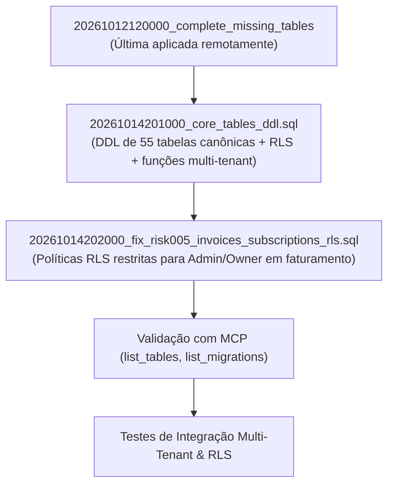

# DATABASE MIGRATION PLAN — ELETRICAI INDUSTRIAL OS

Este documento detalha o plano técnico de consolidação, ordenação e aplicação das migrations do ElétricAi no Supabase, garantindo integridade referencial, isolamento multi-tenant e ausência de operações destrutivas.

---

## 1. Diagnóstico do Histórico de Migrations

### 1.1. Estado Remoto Registrado
- O Supabase remoto possui 55 migrations aplicadas no catálogo interno (`supabase_migrations.schema_migrations`).
- A última migration aplicada remotamente é `20261012120000_complete_missing_tables`.
- O banco remoto possui apenas 17 tabelas ativas; nenhuma das tabelas centrais (`profiles`, `tenants`, `projects`, etc.) foi materializada.

### 1.2. Inconsistência Cronológica Local Detectada
Na auditoria da Etapa 2, foram criadas localmente:
- `20261014200000_fix_risk005_invoices_subscriptions_rls.sql` (timestamp 20:00:00)
- `20261014201000_core_tables_ddl.sql` (timestamp 20:10:00)

**Problema:** A migration `200000` tenta aplicar policies RLS estritas sobre as tabelas `invoices` e `subscriptions`. Como seu timestamp é 10 minutos anterior ao da migration `201000` (que efetivamente cria `invoices` e `subscriptions`), a execução cronológica em banco vazio ignora o bloco de políticas porque `IF EXISTS (SELECT 1 FROM pg_tables WHERE ... tablename = 'invoices')` resulta em falso.

**Solução Segura:**
1. Manter a integridade da ordem de dependências:
   - A DDL canônica das tabelas centrais (`core_tables_ddl.sql`) deve executar primeiro.
   - O RLS estrito de faturamento (`fix_risk005_invoices_subscriptions_rls.sql`) deve executar **imediatamente após** a criação das tabelas.
2. Atualizar o timestamp da migration de RLS de faturamento para `20261014202000_fix_risk005_invoices_subscriptions_rls.sql` ou consolidar suas policies diretamente na DDL canônica para garantir que `invoices` e `subscriptions` nasçam com as policies restritas ativas desde o primeiro instante.

---

## 2. Princípios de Execução e Regras de Segurança

1. **Zero Operações Destrutivas:** Nenhuma instrução `DROP TABLE`, `DROP SCHEMA CASCADE`, `TRUNCATE` ou `supabase db reset` será executada contra o ambiente remoto.
2. **Idempotência Real:** Todos os blocos usam `CREATE TABLE IF NOT EXISTS`, `CREATE INDEX IF NOT EXISTS`, `DO $$ BEGIN ... END $$` com checagens de existência prévia para nunca sobrescrever dados ou tabelas já presentes no banco remoto (como `twin_hotspots`, `deletion_requests`, `platform_admins`, etc.).
3. **Preservação de Dados Existentes:** As 17 tabelas que já existem no banco remoto serão preservadas intactas, recebendo apenas índices e constraints complementares sem perda de registros.
4. **Isolamento Multi-Tenant Garantido:** Cada tabela criada inclui explicitamente `ALTER TABLE ... ENABLE ROW LEVEL SECURITY` e políticas baseadas em `tenant_id = (SELECT tenant_id FROM profiles WHERE id = auth.uid())` ou membros de `tenant_memberships`.
5. **Aprovação Explícita:** Nenhuma alteração no Supabase remoto será efetuada sem autorização explícita do usuário após a revisão deste plano.

---

## 3. Ordem de Aplicação das Migrations

### Detalhamento dos Passos:

1. **Passo 1 — Reordenação e Validação Local:**
   - Ajustar o timestamp da migration de RLS de faturamento para `20261014202000` para respeitar a dependência das tabelas criadas em `20261014201000`.
   - Garantir que não há referências cíclicas ou chamadas a funções inexistentes.

2. **Passo 2 — Validação em Banco Isolado (Pré-requisito):**
   - Registrar formalmente a necessidade de teste em instância local descartável ou branch de desenvolvimento do Supabase antes da publicação em produção.

3. **Passo 3 — Aplicação Controlada no Supabase Remoto (`rvaaxvdimggztjxoktvy`):**
   - Executar a migration `20261014201000_core_tables_ddl.sql` via Supabase MCP tool (`apply_migration` / `execute_sql`).
   - Executar a migration `20261014202000_fix_risk005_invoices_subscriptions_rls.sql`.

4. **Passo 4 — Verificação Pós-Aplicação:**
   - Listar novamente todas as tabelas via `list_tables` para certificar que as 55 tabelas estão presentes com RLS ativado.
   - Testar via consulta SQL de baixo impacto a existência das colunas e das funções auxiliares (`get_user_tenant_id()`, `is_platform_admin()`).
