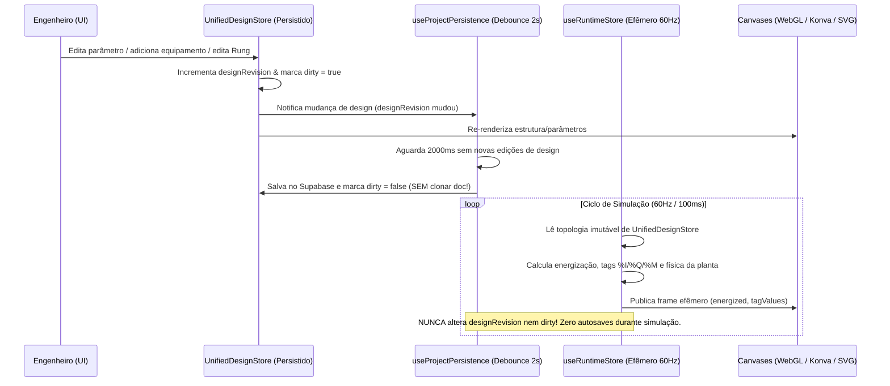

# Contratos de Integração Entre Canvases (Canvas Integration Contracts)

> **Status:** Especificação de Contratos de Transformação e Propagação (Fase B / Fase C)  
> **Escopo:** Regras formais, pré-condições, pós-condições, diagnósticos de ambiguidade e prevenção de loops de renderização para as 8 pontes entre representações do ElétricAi.

---

## Princípios Inegociáveis de Integração

1. **Identidade Estável Acima de Rótulos (`id` vs `tagCode`)**: Nenhum canvas pode inferir vínculo entre elementos comparando strings de exibição (`label`, `name` ou `uKey.includes(...)`). Todo vínculo atravessa `equipmentId`, `terminalId`, `connectionId` ou `tagId` canônicos.
2. **Proibição de Invenção Silenciosa**: Quando uma transformação entre representações encontra topologia incompleta, ambiguidade de associação ou conflito de tipos/endereços, a operação **NÃO inventa conexões, lógica ou endereços**. Ela emite um `ModelDiagnostic` (`requiresUserIntervention: true`) e solicita decisão explícita do engenheiro.
3. **Validação Estrutural Pós-Conversão**: Uma conversão só transita para o estado `valid` após passar pelo validador determinístico da representação de destino.
4. **Separação Estrita Design vs Runtime**: Ticks de simulação (60 Hz / 100 ms) atualizam exclusivamente `useRuntimeStore` e nunca mutam o documento de projeto (`UnifiedProjectDoc`) nem disparam `dirty: true` no autosave.

---

## Contrato 1 — Unifilar ↔ Multifilar

### Situação Atual no Código
- [`buildMultifilarCommands`](file:///c:/Users/98911/Desktop/eletric/eletricaip/src/lib/diagram/multifilar.ts#L83-L120) clona cada nó de `sheet: "unifilar"` criando um novo ID aleatório (`makeNode`), perdendo o vínculo com o equipamento original e exigindo destruir toda a folha Multifilar (`clearMultifilarCommands`) a cada atualização.

### Contrato Canônico (`UnifilarToMultifilarContract`)
- **Fonte:** `engineering.equipments`, `engineering.connections` e `views.unifilar`.
- **Destino:** `views.multifilar` e terminais detalhados por fase em `engineering.connections`.
- **Regras de Transformação:**
  1. **Preservação de Identidade (`equipmentId`)**: O nó renderizado na folha Multifilar referencia exatamente o mesmo `equipmentId` canônico do Unifilar (`views.multifilar.nodes[equipmentId]`), mantendo sua própria coordenada $(x, y)$ de layout Multifilar.
  2. **Expansão Determinística de Condutores**:
     - Cada conexão unifilar `connectionId` é expandida nos condutores exigidos por `equipment.phases` e pelo tipo de dispositivo no catálogo (`3F` → `L1, L2, L3`; `3F+N` → `L1, L2, L3, N`; `3F+N+PE` → `L1, L2, L3, N, PE`), vinculando terminais homólogos (`1/L1→2/T1`, `3/L2→4/T2`, `5/L3→6/T3`, `N→N`, `PE→PE`).
  3. **Sincronização Incremental Bidirecional de Parâmetros**:
     - Alterar `specs` (`powerKw`, `nominalCurrentA`, `tripCurve`) ou `tagCode` no Unifilar ou no Multifilar atualiza `engineering.equipments[equipmentId]` imediatamente em ambos sem recalcular posições $(x, y)$ já ajustadas manualmente no Multifilar.
  4. **Tratamento de Ambiguidade / Incompletude**:
     - Se um componente unifilar estiver conectado a outro com número de fases incompatível (ex.: carga trifásica `3F` alimentada por disjuntor monopolar `1F`), a expansão Multifilar daquele ramo é bloqueada e emite o diagnóstico `MULTIFILAR_PHASE_MISMATCH` apontando os `equipmentId` envolvidos.

---

## Contrato 2 — Equipamentos Elétricos ↔ Associações de Controle Ladder / FBD

### Situação Atual no Código
- [`analyzeUnifilarForLadder`](file:///c:/Users/98911/Desktop/eletric/eletricaip/src/lib/unifilar-ladder-bridge.ts#L156-L270) lê apenas `useProjectStore.nodes` (ignorando `useDiagramStore.doc` do WebGL) e faz pareamento heurístico BFS de contatores/relés/disjuntores; quando não acha um contator para um motor DOL, sintetiza tags como `KM_M_01` sem criar nem vincular um equipamento real no diagrama elétrico.

### Contrato Canônico (`ElectricalToControlContract`)
- **Fonte:** `engineering.equipments` e `engineering.connections` (extraídos da camada canônica alimentada pelo `WebglCanvas`).
- **Destino:** `engineering.tags`, `engineering.controlBindings` e blocos de programa em `plc.programs` (Ladder ou FBD).
- **Regras de Transformação:**
  1. **Descoberta Topológica Estrita por Grafo de Potência**:
     - Para cada carga acionada (`motor_3p`, `motor_1p`, `bomba`, `esteira`), o analisador percorre o grafo à montante (`engineering.connections` onde `kind === "power"`) até o barramento (`busbar` / `qgbt` / `ccm`).
     - Identifica os dispositivos de manobra (`contactor`, `vfd`, `softstarter`) e proteção (`breaker`, `overload_relay`, `rcd`) pertencentes exclusivamente ao ramo daquela carga.
  2. **Criação de `ControlBinding` e `CanonicalTag`**:
     - Bobina do contator (`KMx:A1-A2`) $\rightarrow$ `ControlBinding(role: "main_contactor_coil")` + `CanonicalTag(area: "Q", dataType: "BOOL", linkedEquipmentId: KMx.id)`.
     - Contato auxiliar de selo (`KMx:13-14`) $\rightarrow$ `ControlBinding(role: "aux_seal_contact")` linked ao mesmo `tagId` ou tag de feedback DI.
     - Contato NF do relé térmico (`Fx:95-96`) $\rightarrow$ `ControlBinding(role: "overload_trip_nc")` + `CanonicalTag(area: "I", dataType: "BOOL", linkedEquipmentId: Fx.id)`.
     - Dispositivo de parada de emergência (`ESTOP`) $\rightarrow$ `ControlBinding(role: "estop_safety_nc")`.
  3. **Recusa de Ambiguidade (Sem Invenção Silenciosa)**:
     - **Caso A — Partida Direta (DOL) sem Contator no ramo:** Emite diagnóstico `CONTROL_BRIDGE_MISSING_CONTACTOR` (`requiresUserIntervention: true`). O usuário escolhe na UI: *(1) Inserir contator canônico no ramo Unifilar e vincular* ou *(2) Cancelar geração daquele ramo*.
     - **Caso B — Dois contatores em paralelo/cascata sem função declarada (Reversão vs Estrela-Triângulo):** Emite diagnóstico `CONTROL_BRIDGE_AMBIGUOUS_STARTER_TOPOLOGY` solicitando ao usuário confirmar se a topologia é Reversora ou $Y\text{-}\Delta$.

---

## Contrato 3 — Ladder / FBD ↔ Tags e Interfaces PLC

### Situação Atual no Código
- [`PlcCanvas`](file:///c:/Users/98911/Desktop/eletric/eletricaip/src/components/canvases/plc-canvas.tsx#L155-L196) sobrescreve `useEditorStore` ao trocar de bloco (`hydrateEditor`), e existem dois compiladores FBD→ST diferentes ([`fbd-canvas.tsx`](file:///c:/Users/98911/Desktop/eletric/eletricaip/src/components/canvases/fbd-canvas.tsx#L204-L231) vs [`editor-bridge.ts`](file:///c:/Users/98911/Desktop/eletric/eletricaip/src/lib/fbd/editor-bridge.ts#L204-L215)).

### Contrato Canônico (`ControlToPlcHardwareContract`)
- **Fonte/Destino:** `plc.programs` (Ladder e FBD), `engineering.tags` e `plc.rack` (`PlcChannelBinding`).
- **Regras de Transformação:**
  1. **Blocos de Programa como Contêineres Canônicos**:
     - Os editores `LadderCanvas` e `FbdCanvas` editam diretamente o bloco ativo em `plc.programs[activeBlockId]` (por padrão `OB1` para Ladder e `FC1`/`OB1` para FBD), eliminando a cópia desconectada e impedindo perda de rungs ao alternar para a aba `PLC`.
  2. **Compilador Único FBD → ST**:
     - O preview ST em `FbdCanvas` e a compilação em `PlcCanvas` utilizam exclusivamente [`compileFbdNodesToSt`](file:///c:/Users/98911/Desktop/eletric/eletricaip/src/lib/fbd/editor-bridge.ts) (`generateStructuredText`), removendo o gerador inline duplicado de `fbd-canvas.tsx`.
  3. **Alocação e Validação de Endereços I/O no Rack PLC**:
     - Toda `CanonicalTag` com `area === "I"` ou `area === "Q"` vinculada a um canal físico (`plcChannelId`) valida:
       - Compatibilidade de direção (`DI`/`AI` $\leftrightarrow$ `%I` / `%IW`; `DO`/`AO` $\leftrightarrow$ `%Q` / `%QW`).
       - Compatibilidade de tipo (`BOOL` para cartões digitais; `INT`/`REAL`/`WORD` para cartões analógicos).
       - **Unicidade de endereço físico:** Dois `CanonicalTag` diferentes não podem ocupar o mesmo canal físico (`slotNumber`, `channelIndex`). Caso haja colisão, emite `PLC_IO_ADDRESS_COLLISION`.

---

## Contrato 4 — Programas e Tags ↔ Simulação

### Situação Atual no Código
- [`SimCanvas`](file:///c:/Users/98911/Desktop/eletric/eletricaip/src/components/canvases/sim-canvas.tsx) e [`plant-engine.ts`](file:///c:/Users/98911/Desktop/eletric/eletricaip/src/lib/simulation/plant-engine.ts) rodam sobre 8 motores fixos (`M01..M08`) e associam tags procurando substrings como `"SPEED"` ou `"NIVEL"` no nome da tag.

### Contrato Canônico (`ProgramAndTagsToSimulationContract`)
- **Fonte:** `engineering.equipments`, `engineering.connections`, `engineering.tags`, `engineering.controlBindings` e `plc.programs`.
- **Destino:** `useRuntimeStore` (estado efêmero de execução a 60 Hz).
- **Ciclo Determinístico de Scan (Fechamento de Malha)**:
  1. **Leitura de Entradas Físicas (`Plant → Tags %I`)**: O estado físico dos equipamentos canônicos (ex.: contato térmico `Fx` fechado/aberto, botão `ESTOP`, sensores ligados via `ControlBinding`) escreve nos valores de runtime de `CanonicalTag` (`area: "I"`) pelo `tagId`.
  2. **Execução dos Blocos PLC (`OB1` Ladder + FBD)**:
     - Avalia os rungs Ladder (`evaluateRung`) e blocos FBD (`FbdEngine.step`) usando os valores atuais de `useRuntimeStore.tagValues[tagId]`.
     - Atualiza bobinas e saídas (`area: "Q"` e `"M"`) em `useRuntimeStore.tagValues[tagId]`.
  3. **Atuação na Planta Elétrica (`Tags %Q → Equipments`)**:
     - Para cada `ControlBinding` com `role === "main_contactor_coil"`, o estado da tag `tagId` fecha/abre os contatos principais do contator `KMx`.
     - O solucionador de topologia elétrica propaga energização a partir das fontes (`transformer`/`busbar`) através dos dispositivos fechados (`breaker` fechado + `contactor` fechado + `overload_relay` não atuado) até a carga (`motor`), calculando corrente instantânea, aquecimento térmico $I^2t$ e rotação a partir dos `specs` reais do equipamento no diagrama.

---

## Contrato 5 — Tags e Equipamentos ↔ SCADA / HMI

### Situação Atual no Código
- Widgets SCADA em [`KIND_CATALOG`](file:///c:/Users/98911/Desktop/eletric/eletricaip/src/lib/project-store.ts#L78-L137) usam `defaults: { tag: "TANQUE_NIVEL" }` (string solta). Se uma tag é renomeada no editor de tags, o widget SCADA perde a comunicação silenciosamente.

### Contrato Canônico (`TagsToScadaContract`)
- Cada widget em `views.scada.widgets` possui `boundTagId: string | null` e `boundEquipmentId: string | null`.
- **Leitura e Escrita:**
  - Widgets indicadores (`gauge`, `display`, `trend`, `level`) leem `useRuntimeStore.tagValues[boundTagId]` e metadados (`unit`, `scaleMin`, `scaleMax`, `name`) de `engineering.tags[boundTagId]`.
  - Widgets de comando (`button`, `switch`, `slider`, `input`) escrevem em `useRuntimeStore.setTagValue(boundTagId, nextValue)` respeitando limites `[scaleMin, scaleMax]` e tipo (`BOOL` vs `REAL`).
- **Integridade Referencial:** Se uma tag ou equipamento vinculado a um widget SCADA for excluído, o widget permanece no layout visual mas exibe badge de diagnóstico `SCADA_ORPHAN_TAG_BINDING` indicando qual vínculo precisa ser reatribuído.

---

## Contrato 6 — Equipamentos e Tags ↔ Digital Twin

### Situação Atual no Código
- [`useDigitalTwinStore`](file:///c:/Users/98911/Desktop/eletric/eletricaip/src/lib/digital-twin-store.ts) vive isolado em `localStorage` (`eletricai-digital-twin`), não é salvo no Supabase com o projeto, e [`TwinCanvas`](file:///c:/Users/98911/Desktop/eletric/eletricaip/src/components/canvases/twin-canvas.tsx#L55-L71) faz fallback para nomes de tags hardcoded (`TEMP_M01`, `PRESSAO_PT01`, `VIBRACAO_M03`).

### Contrato Canônico (`EquipmentAndTagsToTwinContract`)
- **Persistência no Projeto:** As configurações do Digital Twin (`mappings`, `alarmRules`, `nameplates`) migram de `localStorage` avulso para `views.twin` dentro do `UnifiedProjectDoc` persistido no Supabase.
- **Vínculo Estrito por ID:** Cada `TwinBinding` vincula `(equipmentId: string, parameterKey: "temperatureC" | "vibrationMmS" | "currentA" | "rpm" | "levelPct", tagId: string)`.
- **Nameplate Automático Sincronizado:** Os dados de placa (`powerKw`, `voltageV`, `nominalCurrentA`, `efficiency`, `startingMethod`) no Digital Twin são lidos diretamente de `engineering.equipments[equipmentId].specs`, mantendo-se sempre idênticos ao diagrama Unifilar/Multifilar.

---

## Contrato 7 — Alterações de Parâmetros → Recálculo e Invalidação de Estudos Dependentes

### Situação Atual no Código
- [`ElectricalStudyPanel`](file:///c:/Users/98911/Desktop/eletric/eletricaip/src/components/simulation/electrical-study-panel.tsx) opera como uma calculadora avulsa com valores iniciais estáticos (`750 kVA`, `45 m`).

### Contrato Canônico (`ParameterChangeToStudiesContract`)
1. **Extração Direta do Modelo:** Os estudos (Dimensionamento NBR 5410, Queda de Tensão, Curto-Circuito IEC 60909, Seletividade e Coordenação, Energia Incidente / Arco Elétrico e Validador Normativo [`validateNormative`](file:///c:/Users/98911/Desktop/eletric/eletricaip/src/lib/normative-validator.ts)) recebem seus parâmetros diretamente de `engineering.equipments`, `engineering.connections` e `engineering.circuits`.
2. **Grafo de Dependências e Invalidação Automática (`stale`)**:
   - Toda mutação em `engineering.equipments[id].specs`, `engineering.connections[id].conductor` ou `project.nominalSystem` recalcula imediatamente o hash de entrada dos estudos vinculados.
   - Estudos rápidos (Validação Normativa NBR 5410 / NR-10 / NR-12, Queda de Tensão de Circuito e Resumo de Condutores) são recalculados de forma síncrona/reativa.
   - Estudos completos salvos no projeto (`studies[studyId]`) têm seu status alterado de `"valid"` para `"stale"` e exibem alerta visual nos painéis e na exportação de PDF/Memorial até que o recálculo seja confirmado.

---

## Contrato 8 — Persistência ↔ Restauração Completa do Projeto

### Situação Atual no Código
- [`useProjectPersistence`](file:///c:/Users/98911/Desktop/eletric/eletricaip/src/lib/use-project-persistence.ts) salva apenas `project`, `editor`, `diagram` e `plc` (omitindo `useDigitalTwinStore` e estudos), agenda um autosave fantasma no `queueMicrotask` após o load, e salva durante simulações porque `setRungs`/`setFbdSim` marcam `dirty: true`.

### Contrato Canônico (`PersistenceAndRestorationContract`)
1. **Snapshot Atômico Completo (`ProjectSnapshot v3`)**:
   - Inclui `unifiedDoc: UnifiedProjectDoc` completo (engenharia canônica + layouts `unifilar`, `multifilar`, `scada`, `twin` + `plc` + `studies` + `diagnostics`), mantendo os campos v2 espelhados ou migrados via `upgradeSnapshotV2ToV3` para retrocompatibilidade.
2. **Controle de Concorrência Otimista (`version`)**:
   - `saveProject` verifica a versão `version` do diagrama no Supabase; se o servidor tiver uma revisão mais nova que a base local, retorna conflito explícito (`VERSION_CONFLICT`) para resolução sem sobrescrita silenciosa.
3. **Invariante de Restauração (`load(save(state)) ≡ state`)**:
   - Após salvar e recarregar o projeto em uma nova sessão, 100% dos IDs de equipamentos, terminais, conexões, tags, blocos PLC, rungs Ladder, nós FBD, widgets SCADA, vínculos Digital Twin e estudos são restaurados com igualdade estrutural profunda (`deepEqual`).

---

## Matriz de Propriedade de Estado e Prevenção de Loops de Renderização

### Regras Anti-Loop Obrigatórias
1. **Proibição de `loadDoc({ ...cur })` em `queueMicrotask` pós-load**: A hidratação inicial em [`useProjectPersistence`](file:///c:/Users/98911/Desktop/eletric/eletricaip/src/lib/use-project-persistence.ts#L85-L96) define `dirty = false` e registra `lastLoadedRevision = doc.revision`. O listener de autosave ignora qualquer transição onde `designRevision === lastLoadedRevision`.
2. **Separação de `setRungs` (Edição) vs `setRungEnergization` (Runtime)**:
   - [`RungGrid`](file:///c:/Users/98911/Desktop/eletric/eletricaip/src/components/canvases/ladder/rung-grid.tsx#L100-L105) e [`useFbdEngine`](file:///c:/Users/98911/Desktop/eletric/eletricaip/src/lib/fbd/use-fbd-engine.ts) passam a gravar resultados de avaliação de scan exclusivamente em `useRuntimeStore` (`ladderScanState`, `fbdSimSnapshot`), **jamais** chamando mutadores de design (`setRungs`, `setFbdSim` com `dirty: true`).
3. **Proibição de `useEffect` Bidirecional Entre Stores**:
   - O padrão antigo em [`PlcCanvas`](file:///c:/Users/98911/Desktop/eletric/eletricaip/src/components/canvases/plc-canvas.tsx#L155-L215) (um `useEffect` copiando de `usePlcStore` para `useEditorStore` e outro `useEffect` copiando de `useEditorStore` de volta para `usePlcStore`) é eliminado: ambos leem e despacham ações sobre a mesma fatia canônica `plc.programs[activeBlockId]`.
