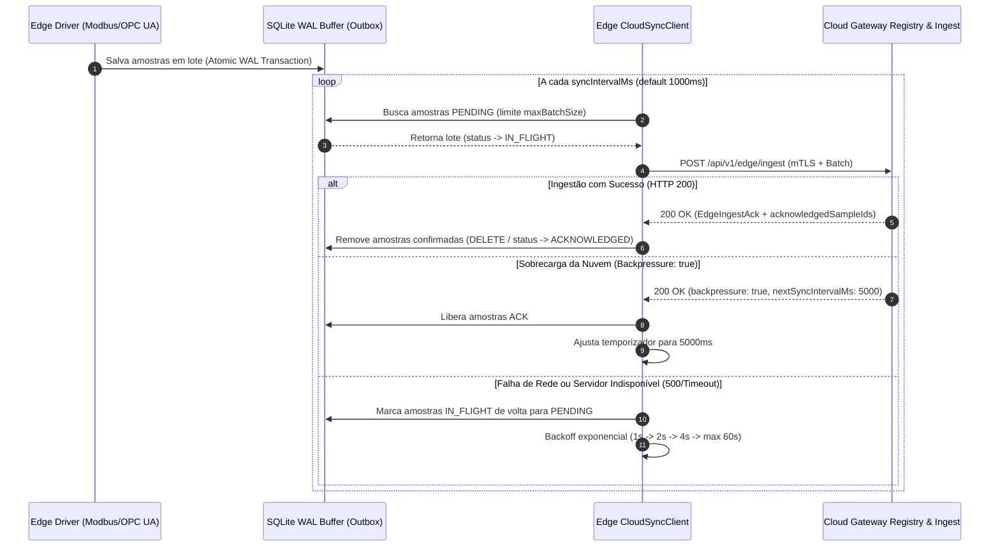

# ELÉTRICAI INDUSTRIAL OS — CONTRATO DE DADOS CLOUD–EDGE
## ESPECIFICAÇÃO DE PROTOCOLO DE TELEMETRIA, SINCRONIZAÇÃO E INGESTÃO (GATE 3.4)

**Documento:** `docs/architecture/CLOUD_EDGE_DATA_CONTRACT.md`  
**Versão do Protocolo:** `1.0.0`  
**Classificação:** `APPROVED_FOR_CLOUD_EDGE_ARCHITECTURE_INTEGRATION`  
**Normas de Referência:** OPC UA Part 4 (Services), Sparkplug B v2.2, RFC 8259 (JSON), RFC 7946, ISA-101

---

## 1. INTRODUÇÃO & ESCOPO

Este documento define o contrato de dados formal e imutável que rege a comunicação entre o **ElétricAi Edge Gateway** e a **ElétricAi Cloud Ingestion Engine**.

O contrato foi desenhado sob os seguintes axiomas de engenharia:
1. **Unidirecionalidade Estrita:** Todo fluxo de dados de processo é originado pelo Edge Gateway em direção à Cloud (Outbound-only via HTTPS/WSS na porta 443).
2. **Determinismo & Rastreabilidade:** Cada amostra possui identificação unívoca (`sampleId`), carimbo de tempo da fonte (`sourceTimestamp`), carimbo do gateway (`gatewayTimestamp`) e sequência monotônica estrita (`sequenceNumber`).
3. **Idempotência Transacional:** O reenvio de lotes decorrente de falhas parciais de rede ou retransmissões do buffer SQLite WAL não gera contagem duplicada ou corrupção no historiador da Cloud.
4. **Isolamento de Segurança:** O Edge Gateway não tem permissão para declarar seu próprio `organizationId` ou `plantId`. O roteamento multi-tenant é resolvido autoritativamente pelo Cloud Gateway Registry com base no certificado mTLS e credencial criptográfica autenticada.

---

## 2. ESTRUTURA DO CONTRATO DE DADOS (SCHEMAS V1.0.0)

### 2.1. Lote de Telemetria (`EdgeTelemetryBatch`)

O lote de telemetria é a unidade fundamental de transferência entre o buffer local do Edge e o endpoint de ingestão da Cloud.

```typescript
export const CLOUD_EDGE_PROTOCOL_VERSION = "1.0.0";

export interface EdgeTelemetryBatch {
  /** Versão canônica do protocolo (obrigatoriamente "1.0.0") */
  protocolVersion: "1.0.0";
  
  /** Identificador único do Edge Gateway emissor */
  gatewayId: string;
  
  /** UUID v4 unívoco atribuído ao lote na geração */
  batchId: string;
  
  /** Número sequencial estritamente monotônico por gateway */
  batchSequenceNumber: number;
  
  /** Carimbo de tempo do envio (Epoch em milissegundos UTC) */
  sentAt: number;
  
  /** Array de amostras industriais normalizadas */
  samples: EdgeSamplePayload[];
}
```

### 2.2. Amostra de Telemetria Industrial (`EdgeSamplePayload`)

```typescript
export interface EdgeSamplePayload {
  /** UUID v4 unívoco da amostra gerado na aquisição */
  sampleId: string;
  
  /** Sequência monotônica da amostra no gateway */
  sequenceNumber: number;
  
  /** Caminho hierárquico canônico da tag (ex: "SE01.TRAFO01.VOLT_A") */
  tagPath: string;
  
  /** UUID do equipamento canônico vinculado (se existir) */
  canonicalEquipmentId?: string;
  
  /** Valor numérico, booleano ou string da grandeza física */
  value: number | boolean | string;
  
  /** Classificação de qualidade conforme OPC UA / IEC 60870 */
  quality: "GOOD" | "BAD" | "UNCERTAIN" | "STALE";
  
  /** Carimbo de tempo da aquisição no dispositivo físico (Epoch ms) */
  sourceTimestamp: number;
  
  /** Carimbo de tempo da recepção no daemon do gateway (Epoch ms) */
  gatewayTimestamp: number;
  
  /** Unidade de engenharia (ex: "V", "A", "kW", "°C", "bar") */
  engineeringUnit?: string;
  
  /** Código de status binário original do protocolo de origem */
  rawQualityCode?: number;
  
  /** Proveniência explícita do dado */
  provenance?: "PHYSICAL_DATA" | "INTERNAL_RUNTIME" | "SIMULATED_DATA" | "FORCED_DATA";
}
```

### 2.3. Confirmação de Ingestão (`EdgeIngestAck`)

A Cloud responde sincronicamente a cada lote com um objeto de reconhecimento estruturado:

```typescript
export interface EdgeIngestAck {
  /** Indica se o lote foi processado com sucesso */
  success: boolean;
  
  /** Versão do protocolo confirmada */
  protocolVersion: "1.0.0";
  
  /** GatewayId validado pela Cloud */
  gatewayId: string;
  
  /** BatchId correspondente ao lote recebido */
  batchId: string;
  
  /** Carimbo de tempo da recepção na Cloud (Epoch ms) */
  receivedAt: number;
  
  /** Quantidade de amostras validadas e persistidas */
  processedCount: number;
  
  /** IDs das amostras confirmadas para liberação da outbox SQLite */
  acknowledgedSampleIds: string[];
  
  /** Lista opcional de amostras rejeitadas com motivo */
  rejectedSampleIds?: Array<{ id: string; reason: string }>;
  
  /** Sinalizador de backpressure: se true, Edge deve desacelerar */
  backpressure: boolean;
  
  /** Intervalo recomendado para a próxima sincronização em milissegundos */
  nextSyncIntervalMs?: number;
  
  /** Mensagem de erro descritiva em caso de falha */
  error?: string;
}
```

---

## 3. VALIDAÇÃO FORMAL COM ZOD (SCHEMA ENFORCEMENT)

A Cloud valida os dados em runtime utilizando Zod antes de qualquer desempacotamento ou consulta ao banco:

```typescript
export const EdgeSamplePayloadSchema = z.object({
  sampleId: z.string().min(1),
  sequenceNumber: z.number().int().nonnegative(),
  tagPath: z.string().min(1).max(256),
  canonicalEquipmentId: z.string().optional(),
  value: z.union([z.number(), z.boolean(), z.string()]),
  quality: z.enum(["GOOD", "BAD", "UNCERTAIN", "STALE"]),
  sourceTimestamp: z.number().int().positive(),
  gatewayTimestamp: z.number().int().positive(),
  engineeringUnit: z.string().max(32).optional(),
  rawQualityCode: z.number().int().optional(),
  provenance: z.enum(["PHYSICAL_DATA", "INTERNAL_RUNTIME", "SIMULATED_DATA", "FORCED_DATA"]).optional(),
});

export const EdgeTelemetryBatchSchema = z.object({
  protocolVersion: z.literal(CLOUD_EDGE_PROTOCOL_VERSION),
  gatewayId: z.string().min(1).max(128),
  batchId: z.string().min(1),
  batchSequenceNumber: z.number().int().nonnegative(),
  sentAt: z.number().int().positive(),
  samples: z.array(EdgeSamplePayloadSchema).min(1).max(5000),
});
```

---

## 4. CICLO DE VIDA DE INGESTÃO E POLÍTICA DE ERROS

### 4.1. Tabela de Códigos HTTP e Semântica de Resposta

| Código HTTP | Motivo Técnico | Ação do Edge Gateway |
|---|---|---|
| **200 OK** | Lote validado, persistido e reconhecido | Remove amostras do buffer SQLite (`acknowledgedSampleIds`) |
| **400 Bad Request** | Schema inválido, payload corrompido ou versão divergente | Descarta amostras inválidas e notifica log local de erro |
| **401 Unauthorized** | Token de autenticação ausente ou inválido | Retém buffer local, tenta reautenticação |
| **403 Forbidden** | Gateway revogado (`GATEWAY_REVOKED`) ou não associado | Pausa transmissões, entra em modo quarentena local |
| **429 Too Many Requests** | Backpressure ativo ou rate limit excedido | Aplica recuo exponencial (`nextSyncIntervalMs`) |
| **500 / 503 Service Unavailable**| Indisponibilidade temporária do serviço de ingestão | Retém amostras no SQLite WAL e tenta novamente via backoff |

### 4.2. Exemplo Completo de Payload JSON Enviado (`POST /api/v1/edge/ingest`)

```json
{
  "protocolVersion": "1.0.0",
  "gatewayId": "gw-substation-brazil-01",
  "batchId": "a78d8a5c-41be-4978-8df0-82a0b16866f8",
  "batchSequenceNumber": 1042,
  "sentAt": 1740000000000,
  "samples": [
    {
      "sampleId": "samp-0001",
      "sequenceNumber": 50201,
      "tagPath": "SE01.TRAFO01.VOLT_A",
      "canonicalEquipmentId": "eq-trafo-138kv-01",
      "value": 13812.4,
      "quality": "GOOD",
      "sourceTimestamp": 1739999999850,
      "gatewayTimestamp": 1739999999900,
      "engineeringUnit": "V",
      "rawQualityCode": 0,
      "provenance": "PHYSICAL_DATA"
    },
    {
      "sampleId": "samp-0002",
      "sequenceNumber": 50202,
      "tagPath": "SE01.QGBT01.TEMP_BARRAMENTO",
      "canonicalEquipmentId": "eq-qgbt-01",
      "value": 47.8,
      "quality": "GOOD",
      "sourceTimestamp": 1739999999850,
      "gatewayTimestamp": 1739999999900,
      "engineeringUnit": "°C",
      "rawQualityCode": 0,
      "provenance": "PHYSICAL_DATA"
    }
  ]
}
```

### 4.3. Exemplo Completo de Resposta JSON da Cloud (`EdgeIngestAck`)

```json
{
  "success": true,
  "protocolVersion": "1.0.0",
  "gatewayId": "gw-substation-brazil-01",
  "batchId": "a78d8a5c-41be-4978-8df0-82a0b16866f8",
  "receivedAt": 1740000000045,
  "processedCount": 2,
  "acknowledgedSampleIds": [
    "samp-0001",
    "samp-0002"
  ],
  "backpressure": false,
  "nextSyncIntervalMs": 1000
}
```

---

## 5. CONTROLE DE FLUXO, ORDENAÇÃO E BACKPRESSURE



---

## 6. MAPEAMENTO DE PROVENIÊNCIA & QUALIDADE ISA-101

Para manter fidelidade estrita à norma **ISA-101 (Human-Machine Interfaces for Process Automation)**, a Cloud classifica a proveniência dos dados em tempo real conforme as regras consolidadas:

| Proveniência | Condição Técnica | Badge Visual SCADA | Indicador de Risco |
|---|---|---|---|
| `PHYSICAL_DATA` | Dado recebido de Edge Gateway ativo, canal físico OK, `quality == "GOOD"` | **FÍSICO (Verde)** | Operação Normal |
| `FORCED_DATA` | Tag sob intervenção manual autorizada (`isForced: true`) | **FORÇADO (Laranja)** | Cautela Operacional |
| `STALE_DATA` | Tempo sem atualização > limite ou Edge/PLC offline | **STALE (Amarelo)** | Dado Congelado |
| `BAD_QUALITY` | Falha de leitura de campo, checksum inválido ou código de erro | **BAD (Vermelho)** | Sinal Inválido |
| `INTERNAL_RUNTIME`| Variável calculada internamente pela engine do sistema | **RUNTIME (Azul)** | Cálculo de Processo |
| `SIMULATED_DATA` | Fonte marcada explicitamente como simulação matemática | **SIMULADO (Púrpura)**| Ambiente de Teste |
| `NOT_CONNECTED` | Tag sem driver associado ou desconectada | **OFFLINE (Cinza)** | Sem Comunicação |
