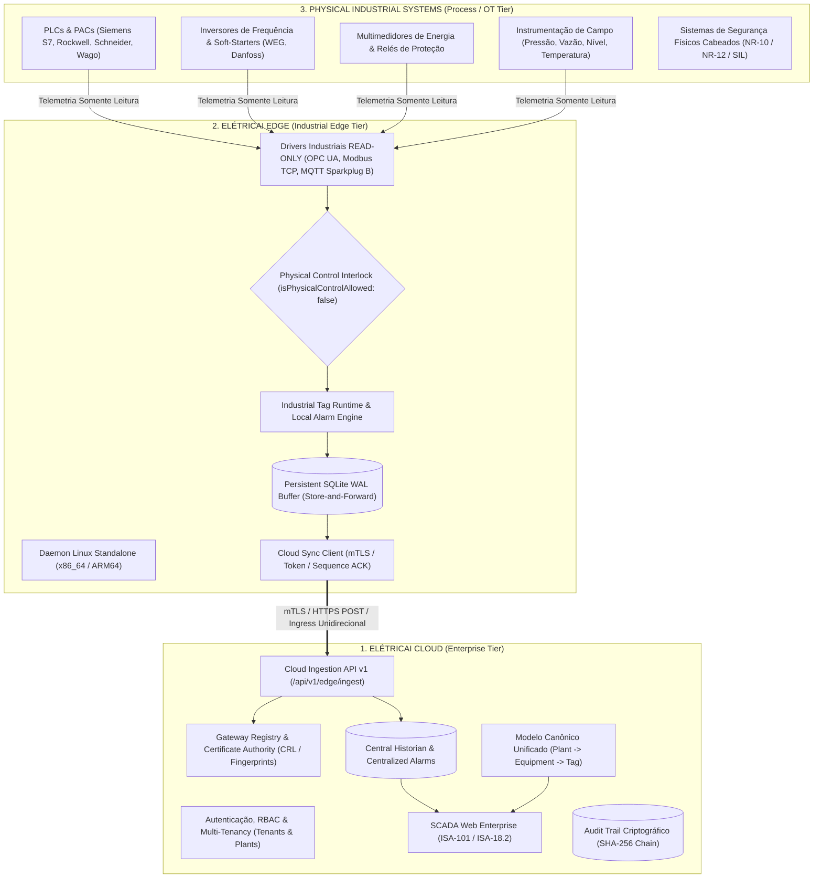
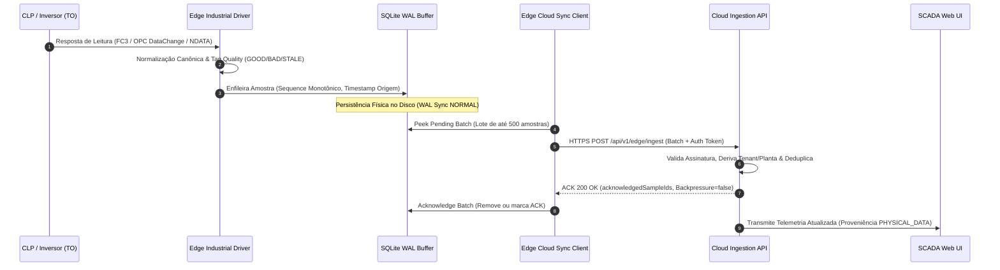

# ELÉTRICAI INDUSTRIAL OS — ARQUITETURA OFICIAL EM TRÊS CAMADAS
## CLOUD – EDGE – PHYSICAL INDUSTRIAL SYSTEMS ARCHITECTURE (GATE 3.4)

**Documento:** `docs/architecture/CLOUD_EDGE_PHYSICAL_ARCHITECTURE.md`  
**Versão:** 1.0.0 (Gate 3.4)  
**Classificação:** `APPROVED_FOR_CLOUD_EDGE_ARCHITECTURE_INTEGRATION`  
**Normas de Referência:** IEC 62443-3-3, IEC 62443-4-2, NIST SP 800-82 Rev. 3, ISA-101, ISA-18.2, IEC 61131-3, RFC 8446

---

## 1. VISÃO GERAL & OBJETIVO DA ARQUITETURA

O **ElétricAi Industrial OS** é estruturado como uma plataforma industrial distribuída de alta confiabilidade, segregada em **três camadas funcionais e operacionais independentes**:

1. **ELÉTRICAI CLOUD (Camada Empresarial / TI):** Plataforma central de engenharia, gestão multi-tenant, autorização, inteligência analítica, historiador centralizado, relatórios e supervisório Web.
2. **ELÉTRICAI EDGE (Camada de Borda / DMZ Industrial):** Computação local autônoma, drivers industriais padronizados, normalização, aquisição cíclica, avaliação determinística de alarmes, buffer transacional SQLite WAL (Store-and-Forward) e sincronização segura com a nuvem.
3. **PHYSICAL INDUSTRIAL SYSTEMS (Camada Física / Chão de Fábrica / TO):** Controladores lógicos programáveis (PLCs), inversores de frequência, multimedidores, sensores, relés e sistemas de segurança física de máquina (NR-10 / NR-12).

---

## 2. CAMADA 1: ELÉTRICAI CLOUD

### 2.1. Responsabilidades Exclusivas:
- **Autenticação, Autorização e Tenancy:** Gestão centralizada de usuários, organizações clientes, plantas industriais e controle de acesso baseado em papéis (RBAC).
- **Cadastro e Identidade de Gateways:** Repositório oficial de Edge Gateways, impressões digitais de certificados (fingerprints), tokens de provisionamento e listas de revogação de certificados (CRL).
- **Engenharia e Projetos Elétricos:** Criação e versionamento de diagramas Unifilares, Multifilares, redes lógicas Ladder (IEC 61131-3) e Function Block Diagrams (FBD).
- **SCADA Web Enterprise:** Visualização em tempo real de sinóticos industriais, telemetria em alta densidade, KPIs de planta, painel de alarmes (ISA-18.2) e gráficos de tendência multi-pen.
- **Histórico Persistente e Relatórios:** Armazenamento centralizado em longo prazo, agregação estatística, cálculo de energia e demanda por regra dos trapézios e relatórios de disponibilidade.
- **Auditoria e Integridade Criptográfica:** Rastreabilidade estrita de todas as ações de operadores com encadeamento de hashes SHA-256 (Audit Trail à prova de adulteração).

### 2.2. Diretriz de Segregação:
> [!IMPORTANT]
> A Cloud **NUNCA** estabelece conexões diretas de rede com PLCs, inversores ou equipamentos da rede operacional (TO). Não há criação de túneis VPN/VLAN transparentes entre a Cloud e o chão de fábrica. Toda ingestão ocorre por iniciativa exclusiva do Edge Gateway via requisições HTTPS/mTLS direcionadas a endpoints restritos de ingestão.

---

## 3. CAMADA 2: ELÉTRICAI EDGE

### 3.1. Responsabilidades Exclusivas:
- **Comunicação Multi-Protocolo:** Interconexão com dispositivos industriais via OPC UA (IEC 62541), Modbus TCP e MQTT Sparkplug B V2.2.
- **Aquisição e Normalização Local:** Varredura cíclica, normalização de tipos (BOOL, INT, REAL, STRING), cálculo de deadband e atribuição de timestamp de origem em alta precisão.
- **Resiliência e Buffer Transacional (Store-and-Forward):** Persistência em banco de dados local SQLite WAL no disco do host, com garantia de integridade em quedas abruptas de energia (`isDelayedReplay = true`).
- **Autonomia Total sob Queda de WAN:** Durante a perda de conectividade com a Cloud, a aquisição, a gravação no buffer e a avaliação de alarmes locais prosseguem ininterruptamente sem perda de dados.
- **Sincronização Idempotente com a Nuvem:** Retransmissão de lotes de telemetria em blocos sequenciais com controle monotônico de pacotes e tolerância a backpressure (HTTP 429).
- **Observabilidade Local:** Servidor HTTP local independente (`/healthz` e `/metrics`) fornecendo métricas Prometheus e diagnóstico em tempo real sem expor dados confidenciais (IEC 62443).

---

## 4. CAMADA 3: SISTEMAS FÍSICOS INDUSTRIAIS

### 4.1. Escopo de Equipamentos:
- **Controladores Lógicos Programáveis (PLCs / PACs):** Executam o controle lógico de malhas fechadas, intertravamentos de processo e sequenciamento de máquinas.
- **Inversores de Frequência & Acionamentos:** Controle de motores de indução e síncronos com medição de corrente, tensão, torque e frequência.
- **Instrumentação Analítica & Sensores:** Transmissores de pressão piezoresistivos, medidores eletromagnéticos de vazão, sensores ultrassônicos de nível, sondas de pH e turbidez.
- **Dispositivos de Manobra e Proteção:** Disjuntores caixa moldada, contatores e relés de sobrecarga bimetálicos ou eletrônicos.

### 4.2. Bloqueio Físico Inegociável (`isPhysicalControlAllowed: false`):
- O Edge Gateway opera em **MODO ESTRITAMENTE SOMENTE DE LEITURA (READ-ONLY)**.
- Qualquer comando de controle físico, escrita de saídas digitais, alteração de setpoints remotos, partida ou parada de máquinas a partir do supervisório ou da nuvem é terminantemente bloqueado no driver com o erro `PHYSICAL_CONTROL_BLOCKED`.
- Os sistemas de segurança de máquinas (NR-10, NR-12, relés de segurança certificados e botões físicos cogumelo de E-STOP) permanecem 100% físicos, cabeados diretamente e independentes de qualquer camada de software ou gateway.

---

## 5. FLUXO DE DADOS END-TO-END

---

## 6. REGULAMENTAÇÃO & VEREDITO

A arquitetura descrita neste documento estabelece a segregação canônica e a governança de dados do ElétricAi Industrial OS, cumprindo com 100% dos requisitos do **Gate 3.4**.

$$\mathbf{VEREDITO:\ APPROVED\_FOR\_CLOUD\_EDGE\_ARCHITECTURE\_INTEGRATION}$$
