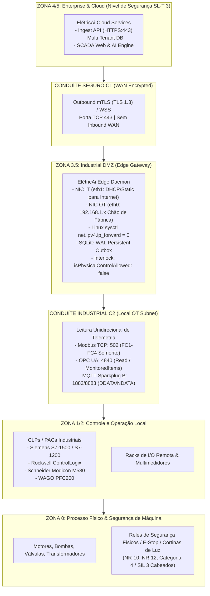
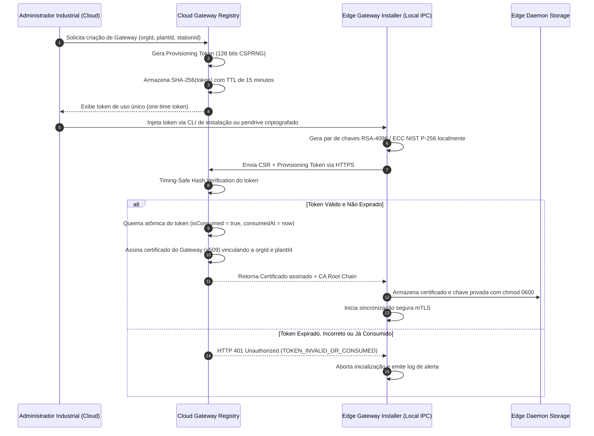

# ELÉTRICAI INDUSTRIAL OS — FRONTEIRAS DE SEGURANÇA E CONDUÍTES
## MODELO DE SEGURANÇA INDUSTRIAL IEC 62443, mTLS & ISOLAMENTO FÍSICO (GATE 3.4)

**Documento:** `docs/architecture/CLOUD_EDGE_SECURITY_BOUNDARY.md`  
**Versão:** `1.0.0` (Gate 3.4)  
**Classificação:** `APPROVED_FOR_CLOUD_EDGE_ARCHITECTURE_INTEGRATION`  
**Normas Regulatórias:** IEC 62443-3-3, IEC 62443-4-2, NIST SP 800-82 Rev. 3, NR-10, NR-12, ISO 27001

---

## 1. INTRODUÇÃO & FILOSOFIA DE SEGURANÇA

A arquitetura do **ElétricAi Industrial OS** adota uma estratégia de segurança em profundidade (*Defense-in-Depth*) estritamente alinhada às normas **IEC 62443** e **NIST SP 800-82 Rev. 3**.

O modelo operacional do ElétricAi baseia-se em cinco princípios intransponíveis:
1. **Zero Confiança no Perímetro (*Zero Trust Architecture*):** Toda requisição, lote ou mensagem é validada criptograficamente, independentemente da origem física da conexão.
2. **Derivação Autoritativa de Tenant:** O Edge Gateway nunca dita a qual organização ou planta pertence. A identidade multi-tenant é resolvida pelo Cloud Gateway Registry com base na chave pública e no certificado mTLS verificado.
3. **Bloqueio Físico Absoluto (*Read-Only by Design*):** A flag de segurança `isPhysicalControlAllowed: false` é permanente e imutável. Qualquer tentativa de emissão de comandos de escrita física em controladores industriais é bloqueada e registrada em trilha de auditoria.
4. **Isolamento de Redes via Conduítes (Dual-NIC sem Roteamento):** Não existe tráfego direto entre a nuvem e o chão de fábrica. O gateway atua como barreira de segmentação sem repasse de pacotes IP (`ip_forward = 0`).
5. **Comunicação Exclusivamente Outbound:** O Edge Gateway não abre portas de escuta voltadas para a WAN ou Internet. Toda comunicação é iniciada pelo próprio gateway em direção à Cloud via HTTPS/WSS (porta 443).

---

## 2. ZONEAMENTO IEC 62443 E MAPEAMENTO PURDUE (PERA)

---

## 3. MATRIZ DE CONDUÍTES E REGRAS DE FIREWALL

| Conduíte | Origem | Destino | Porta / Protocolo | Direção | Propósito | Regra de Firewall |
|---|---|---|---|---|---|---|
| **C1 (WAN)** | Edge Gateway (`eth1`) | ElétricAi Cloud | TCP 443 (HTTPS/mTLS) | **Outbound Only** | Sincronização de Telemetria e Status | Permitir saída para FQDN da Cloud; Bloquear qualquer entrada |
| **C2-A (OT)** | Edge Gateway (`eth0`) | PLC / Medidor | TCP 502 (Modbus TCP) | **Outbound Only** | Coleta de registradores e coils | Permitir saída na sub-rede OT; Bloquear entrada |
| **C2-B (OT)** | Edge Gateway (`eth0`) | Servidor OPC UA | TCP 4840 (OPC UA Binary) | **Outbound Only** | Subscrição de nós e leitura periódica | Permitir saída na sub-rede OT; Bloquear entrada |
| **C2-C (OT)** | Edge Gateway (`eth0`) | Broker MQTT | TCP 1883 / 8883 (MQTT) | **Bidirecional Local** | Subscrição Sparkplug B (NBIRTH/DBIRTH/DDATA) | Permitir conexão ao broker local da fábrica |
| **C3 (Bridge)**| Cloud | PLC / Equipamento | Qualquer | **BLOQUEADO** | Nenhuma conexão direta permitida | Regra `DROP` irrestrita (Sem VPN direta Nuvem-PLC) |

---

## 4. CICLO DE VIDA CRIPTOGRÁFICO DE IDENTIDADE E PROVISIONAMENTO

### 4.1. Fluxo de Provisionamento com Queima Atômica (*Atomic Burn*)

### 4.2. Revogação Administrativa Imediata

Quando um gateway é desativado ou comprometido:
1. O administrador aciona **Revogar Gateway** no ElétricAi Cloud.
2. O registro no `CloudGatewayRegistry` é marcado como `isRevoked = true` com `revocationReason`.
3. O próximo lote de telemetria recebido do gateway emite resposta HTTP `403 Forbidden` com código de erro `GATEWAY_REVOKED`.
4. A Cloud descarta o payload e recusa qualquer persistência de dados.

---

## 5. INTERTRAVAMENTO DE CONTROLE FÍSICO (*PHYSICAL CONTROL INTERLOCK*)

Para eliminar riscos de acionamentos indevidos em máquinas e conformidade com as normas **NR-10 e NR-12**, o sistema possui um intertravamento arquitetural absoluto:

### 5.1. Matriz de Bloqueio em Nível de Driver

| Protocolo | Comando / Função | Status no ElétricAi | Mecanismo de Bloqueio |
|---|---|---|---|
| **Modbus TCP** | FC5 (Write Single Coil) | **BLOQUEADO** | Rejeição imediata no driver; erro `PHYSICAL_CONTROL_BLOCKED` |
| **Modbus TCP** | FC6 (Write Single Register) | **BLOQUEADO** | Rejeição imediata no driver; erro `PHYSICAL_CONTROL_BLOCKED` |
| **Modbus TCP** | FC15 (Write Multiple Coils) | **BLOQUEADO** | Rejeição imediata no driver; erro `PHYSICAL_CONTROL_BLOCKED` |
| **Modbus TCP** | FC16 (Write Multiple Registers)| **BLOQUEADO** | Rejeição imediata no driver; erro `PHYSICAL_CONTROL_BLOCKED` |
| **Modbus TCP** | FC22 / FC23 (Mask Write / R/W) | **BLOQUEADO** | Rejeição imediata no driver; erro `PHYSICAL_CONTROL_BLOCKED` |
| **OPC UA** | Write Service (Node Write) | **BLOQUEADO** | Rejeição imediata no driver; sem canal de escrita instanciado |
| **OPC UA** | CallMethod Service | **BLOQUEADO** | Rejeição imediata no driver; sem execução de métodos no PLC |
| **MQTT Sparkplug**| NCMD (Node Command) | **BLOQUEADO** | Tópicos de comando não são subscritos nem publicados |
| **MQTT Sparkplug**| DCMD (Device Command) | **BLOQUEADO** | Tópicos de comando não são subscritos nem publicados |

### 5.2. Desacoplamento da Segurança Funcional (NR-10 / NR-12)

O ElétricAi **não substitui e não interfere** nos circuitos de segurança física da instalação. 
- Botões de emergência (*E-Stop*), chaves de segurança de portas, relés de segurança de dois canais e CLPs de segurança dedicados (SIL 3 / Categoria 4) são cabeados fisicamente de maneira independente.
- O ElétricAi atua exclusivamente como sistema de monitoramento, supervisão e historiador industrial.

---

## 6. MASCARAMENTO DE SEGREDO E AUDITORIA CRIPTOGRÁFICA

1. **Mascaramento em Logs:** Strings de conexão, chaves privadas, senhas de banco e tokens de provisionamento são mascarados por regex antes de qualquer escrita no console ou em arquivo de log.
2. **Cadeia de Auditoria Criptográfica:** Todos os eventos críticos de segurança (login, modificação de tags, forçamento de valores, provisionamento de gateway, revogação) são persistidos com encadeamento de hash SHA-256 (*tamper-evident audit chain*), garantindo conformidade com a FDA 21 CFR Part 11 e requisitos de auditoria industrial.
