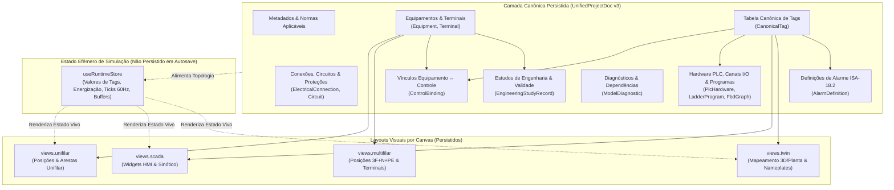

# Modelo Técnico Unificado de Engenharia (Unified Engineering Model)

> **Status:** Especificação Arquitetural e Auditoria (Fase A / Fase B)  
> **Escopo:** Auditoria do estado atual (`src/lib/*`, `src/components/canvases/*`) e definição da fonte única de verdade (`UnifiedProjectDoc`) para o ElétricAi.

---

## PARTE 1 — AUDITORIA DA ARQUITETURA ATUAL

A inspeção completa do código-fonte revela que o ElétricAi possui motores determinísticos maduros (NBR 5410, NBR 14039, NR-12, IEC 60909, compilador FBD→ST IEC 61131-3, avaliador Ladder 60 Hz, Digital Twin e motor WebGL PixiJS), mas **o estado técnico do projeto encontra-se fragmentado em 6 stores Zustand independentes**, com modelos de dados paralelos que não compartilham identificadores canônicos.

### 1.1 Inventário de Stores e Estado Global

| Store | Arquivo | Modelo Principal | Persistido no Supabase? | Consumidores Reais |
| :--- | :--- | :--- | :--- | :--- |
| **`useDiagramStore`** | [`src/lib/diagram/store.ts`](file:///c:/Users/98911/Desktop/eletric/eletricaip/src/lib/diagram/store.ts) | `DiagramDoc` (`nodes: Record<string, DiagramNode>`, `edges: Record<string, DiagramEdge>`, `sheets: ["unifilar", "multifilar", "ladder"]`) | Sim (`snapshot.diagram`) | [`WebglCanvas`](file:///c:/Users/98911/Desktop/eletric/eletricaip/src/components/canvases/webgl-canvas.tsx), [`RightPropertyPanel`](file:///c:/Users/98911/Desktop/eletric/eletricaip/src/components/editor/right-property-panel.tsx), [`CanvasAiChat`](file:///c:/Users/98911/Desktop/eletric/eletricaip/src/components/canvas-ai-chat.tsx) (patch WebGL), [`exportDiagramDxf`](file:///c:/Users/98911/Desktop/eletric/eletricaip/src/lib/dxf-export.ts), [`summarizeConductors`](file:///c:/Users/98911/Desktop/eletric/eletricaip/src/lib/diagram/multifilar.ts) |
| **`useProjectStore`** | [`src/lib/project-store.ts`](file:///c:/Users/98911/Desktop/eletric/eletricaip/src/lib/project-store.ts) | `IndustrialNode[]`, `IndustrialEdge[]`, `tags: Record<string, number \| boolean \| string>`, `logs: RuntimeLog[]` | Sim (`snapshot.project`) | [`ScadaCanvas`](file:///c:/Users/98911/Desktop/eletric/eletricaip/src/components/canvases/scada-canvas.tsx) (`LazyKonvaCanvas`), [`UnifilarLadderBridgePanel`](file:///c:/Users/98911/Desktop/eletric/eletricaip/src/components/simulation/unifilar-ladder-bridge-panel.tsx), [`SimCanvas`](file:///c:/Users/98911/Desktop/eletric/eletricaip/src/components/canvases/sim-canvas.tsx), [`TwinCanvas`](file:///c:/Users/98911/Desktop/eletric/eletricaip/src/components/canvases/twin-canvas.tsx), [`RightPanel`](file:///c:/Users/98911/Desktop/eletric/eletricaip/src/components/right-panel.tsx) |
| **`useEditorStore`** | [`src/lib/editor/store.ts`](file:///c:/Users/98911/Desktop/eletric/eletricaip/src/lib/editor/store.ts) | `editorTags: Record<string, EditorTag>`, `rungs: LadderRung[]`, `fbdNodes: FbdNode[]`, `fbdEdges: FbdEdge[]`, `fbdSim: FbdSimSnapshot \| null` | Sim (`snapshot.editor`) | [`LadderCanvas`](file:///c:/Users/98911/Desktop/eletric/eletricaip/src/components/canvases/ladder-canvas.tsx), [`FbdCanvas`](file:///c:/Users/98911/Desktop/eletric/eletricaip/src/components/canvases/fbd-canvas.tsx), [`PlcCanvas`](file:///c:/Users/98911/Desktop/eletric/eletricaip/src/components/canvases/plc-canvas.tsx), [`SimCanvas`](file:///c:/Users/98911/Desktop/eletric/eletricaip/src/components/canvases/sim-canvas.tsx), [`ScadaCanvas`](file:///c:/Users/98911/Desktop/eletric/eletricaip/src/components/canvases/scada-canvas.tsx) |
| **`usePlcStore`** | [`src/lib/plc/store.ts`](file:///c:/Users/98911/Desktop/eletric/eletricaip/src/lib/plc/store.ts) | `PlcProject` (`vendor`, `rack: PlcRackSlot[]`, `variables: PlcVariable[]`, `programBlocks: PlcProgramBlock[]`) | Sim (`snapshot.plc`) | [`PlcCanvas`](file:///c:/Users/98911/Desktop/eletric/eletricaip/src/components/canvases/plc-canvas.tsx) |
| **`useDigitalTwinStore`** | [`src/lib/digital-twin-store.ts`](file:///c:/Users/98911/Desktop/eletric/eletricaip/src/lib/digital-twin-store.ts) | `mappings: TwinMapping[]`, `alarms: TwinAlarm[]`, `telemetryBuffers`, `nameplates`, `whatIfOverrides` | **NÃO** (apenas `localStorage` chave `eletricai-digital-twin`) | [`TwinCanvas`](file:///c:/Users/98911/Desktop/eletric/eletricaip/src/components/canvases/twin-canvas.tsx) |
| **`usePlantStore` & `useAlarmStore`** | [`src/lib/simulation/plant-store.ts`](file:///c:/Users/98911/Desktop/eletric/eletricaip/src/lib/simulation/plant-store.ts), [`src/lib/alarm-store.ts`](file:///c:/Users/98911/Desktop/eletric/eletricaip/src/lib/alarm-store.ts) | `PlantSnapshot` (motores `M01..M08` fixos em código), `AlarmEntry[]` (ISA-18.2) | **NÃO** (efêmeros em memória) | [`SimCanvas`](file:///c:/Users/98911/Desktop/eletric/eletricaip/src/components/canvases/sim-canvas.tsx), [`ScadaCanvas`](file:///c:/Users/98911/Desktop/eletric/eletricaip/src/components/canvases/scada-canvas.tsx), [`BottomPanel`](file:///c:/Users/98911/Desktop/eletric/eletricaip/src/components/bottom-panel.tsx) |

---

### 1.2 Evidências de Desconexões e Quebras de Semântica no Código Real

#### 1. Ruptura entre o Editor Unifilar WebGL (`useDiagramStore`) e a Ponte Unifilar→Ladder (`useProjectStore`)
- O usuário desenha os diagramas Unifilar e Multifilar no [`WebglCanvas`](file:///c:/Users/98911/Desktop/eletric/eletricaip/src/components/canvases/webgl-canvas.tsx), que despacha comandos (`addNode`, `addEdge`, `updateProps`) exclusivamente para `useDiagramStore.getState().doc` ([`src/lib/diagram/store.ts`](file:///c:/Users/98911/Desktop/eletric/eletricaip/src/lib/diagram/store.ts#L78-L96)).
- Contudo, o painel **Ponte Unifilar → Ladder** ([`UnifilarLadderBridgePanel`](file:///c:/Users/98911/Desktop/eletric/eletricaip/src/components/simulation/unifilar-ladder-bridge-panel.tsx#L235-L238)) lê `useProjectStore.getState().nodes` e `edges`:
  ```ts
  const { nodes, edges } = useProjectStore.getState();
  const analysis = analyzeUnifilarForLadder(nodes, edges);
  ```
- **Consequência real:** Como `useDiagramStore` e `useProjectStore` nunca são sincronizados quando o usuário edita o diagrama no canvas WebGL, clicar em **"Analisar Unifilar"** retorna `"Diagrama unifilar vazio"` mesmo que o diagrama Unifilar no WebGL possua dezenas de transformadores, disjuntores e motores.

#### 2. Perda de Identidade Canônica na Geração Unifilar → Multifilar
- Em [`buildMultifilarCommands`](file:///c:/Users/98911/Desktop/eletric/eletricaip/src/lib/diagram/multifilar.ts#L83-L120), cada nó com `sheet === "unifilar"` é clonado para `sheet === "multifilar"` chamando `makeNode(n.type, ...)`, o que gera um **novo ID aleatório** (`idMap.set(n.id, clone.id)`), sem armazenar `equipmentId` ou `sourceNodeId` no `DiagramNode`.
- **Consequência real:** O motor `M1` no Unifilar e o motor `M1` no Multifilar têm IDs distintos (`node_abc` vs `node_xyz`). Alterar a potência ou corrente de `M1` no Unifilar não propaga para o Multifilar; a única opção atual é apagar toda a folha Multifilar (`clearMultifilarCommands`) e recriá-la do zero, destruindo ajustes manuais de layout.

#### 3. Portas e Terminais Físicos Sem Vínculo às Arestas do Grafo
- O catálogo [`COMPONENT_CATALOG`](file:///c:/Users/98911/Desktop/eletric/eletricaip/src/lib/diagram/catalog.ts#L22-L120) define `PortSpec` (`id`, `side`, `offset`, `kind: "power" | "N" | "PE" | "control"`) por tipo de componente.
- Porém, [`DiagramNodeSchema`](file:///c:/Users/98911/Desktop/eletric/eletricaip/src/lib/diagram/schema.ts#L31-L40) usa `ports: z.array(z.string()).default([])` (vazio por padrão em `makeNode`), e [`DiagramEdgeSchema`](file:///c:/Users/98911/Desktop/eletric/eletricaip/src/lib/diagram/schema.ts#L42-L53) possui apenas `source: z.string()` e `target: z.string()` (IDs de nós), **sem `sourcePortId` nem `targetPortId`**.
- **Consequência real:** Uma conexão entre um contator e um motor não sabe se está ligada aos terminais de força (`1/L1-2/T1`, `3/L2-4/T2`, `5/L3-6/T3`) ou ao contato auxiliar (`13-14 NO`).

#### 4. Triplicação do Modelo de Tags (`useProjectStore.tags` vs `useEditorStore.editorTags` vs `usePlcStore.variables`)
- Existem três repositórios de tags incompatíveis:
  1. `useProjectStore.tags`: mapa plano indexado pelo **nome de exibição** (`Record<string, number | boolean | string>`).
  2. `useEditorStore.editorTags`: mapa indexado por `tag.id` (`Record<string, EditorTag>`), onde `EditorTag` tem `id`, `name`, `type`, `address`, `value`.
  3. `usePlcStore.project.variables`: lista de `PlcVariable` (`id`, `name`, `address`, `dataType`, `scope`, `initialValue`).
- Além disso, [`SimCanvas`](file:///c:/Users/98911/Desktop/eletric/eletricaip/src/components/canvases/sim-canvas.tsx#L139-L155) e [`TwinCanvas`](file:///c:/Users/98911/Desktop/eletric/eletricaip/src/components/canvases/twin-canvas.tsx#L55-L71) buscam tags por **substring no nome de exibição** (`uKey.includes("SPEED") || uKey.includes("VELOCIDADE")`, `uKey.includes("NIVEL") || uKey.includes("LEVEL")`) e injetam tags fixas (`TEMP_M01`, `TANQUE_NIVEL`, `SP_SPEED`, `PRESSAO_PT01`, `VIBRACAO_M03`).

#### 5. Sobrescrita Destrutiva entre PLC e Editores Ladder/FBD
- Em [`PlcCanvas`](file:///c:/Users/98911/Desktop/eletric/eletricaip/src/components/canvases/plc-canvas.tsx#L155-L196), selecionar um bloco (`OB1`, `FC1`, `FB1`) executa um `useEffect` que chama `hydrateEditor({ rungs: activeBlock.ladder?.rungs ?? [], editorTags: blockTags })`.
- **Consequência real:** Como `OB1` é inicializado com `rungs: []` em [`createDefaultPlcProject`](file:///c:/Users/98911/Desktop/eletric/eletricaip/src/lib/plc/types.ts#L195-L255), abrir a aba **PLC** após criar rungs na aba **Ladder** sobrescreve `useEditorStore.rungs` com um array vazio se os rungs não tiverem sido previamente salvos dentro de `OB1`!

#### 6. Duplicação de Compiladores FBD → Structured Text (ST)
- [`FbdCanvas`](file:///c:/Users/98911/Desktop/eletric/eletricaip/src/components/canvases/fbd-canvas.tsx#L204-L231) possui um gerador ST inline simplista (`useEffect` com concatenação de strings) para o painel lateral de preview.
- [`compileFbdNodesToSt`](file:///c:/Users/98911/Desktop/eletric/eletricaip/src/lib/fbd/editor-bridge.ts#L204-L215) utiliza o compilador formal [`generateStructuredText`](file:///c:/Users/98911/Desktop/eletric/eletricaip/src/lib/fbd/engine/st-codegen.ts) baseado em ordenação topológica e estado IEC 61131-3.

#### 7. Duas Pipelines de IA Paralelas Gravando em Stores Diferentes
- [`generateDiagramPatch`](file:///c:/Users/98911/Desktop/eletric/eletricaip/src/lib/diagram/ai.functions.ts) gera `AiDiagramPatch` (`addNodes`, `addEdges` validados por Zod) aplicado ao `useDiagramStore` pelo [`CanvasAiChat`](file:///c:/Users/98911/Desktop/eletric/eletricaip/src/components/canvas-ai-chat.tsx).
- [`designIndustrialSystem`](file:///c:/Users/98911/Desktop/eletric/eletricaip/src/lib/ai-architect.functions.ts) gera `{ nodes, edges, plcLogic }` no formato de `useProjectStore` + `useEditorStore.rungs`.

#### 8. Estudos Elétricos Desconectados do Diagrama e Simulação de Planta Fixa
- [`ElectricalStudyPanel`](file:///c:/Users/98911/Desktop/eletric/eletricaip/src/components/simulation/electrical-study-panel.tsx#L49-L69) inicializa formulários com `DEFAULT_VALUES` estáticos (`750 kVA`, `11.6 A`, `45 m`) sem ler os componentes do diagrama nem invalidar estudos quando um parâmetro é alterado no Unifilar.
- [`plant-engine.ts`](file:///c:/Users/98911/Desktop/eletric/eletricaip/src/lib/simulation/plant-engine.ts) instancia `DEFAULT_MOTORS` fixos (`M01` a `M08` de `5.5 kW` e exaustores `EX01`, `EX02`), ignorando os motores reais do projeto.

#### 9. Loops de Atualização e Autosaves Indevidos durante Simulação
- Em [`RungGrid`](file:///c:/Users/98911/Desktop/eletric/eletricaip/src/components/canvases/ladder/rung-grid.tsx#L100-L105), um `setInterval` de `100 ms` durante `running === true` chama `setRungs(...)` a cada ciclo de scan. No [`useEditorStore`](file:///c:/Users/98911/Desktop/eletric/eletricaip/src/lib/editor/store.ts#L154), `setRungs` marca `dirty: true`, disparando o listener de [`useProjectPersistence`](file:///c:/Users/98911/Desktop/eletric/eletricaip/src/lib/use-project-persistence.ts#L230-L233) e agendando salvamentos contínuos no Supabase a cada 2 segundos enquanto a simulação roda.
- O mesmo ocorre no motor FBD: [`useFbdEngine`](file:///c:/Users/98911/Desktop/eletric/eletricaip/src/lib/fbd/use-fbd-engine.ts) chama `setFbdSim(snap)`, que em [`useEditorStore`](file:///c:/Users/98911/Desktop/eletric/eletricaip/src/lib/editor/store.ts#L108) seta `dirty: true`.
- Em [`useProjectPersistence`](file:///c:/Users/98911/Desktop/eletric/eletricaip/src/lib/use-project-persistence.ts#L90-L93), o `queueMicrotask` que clona `doc` (`loadDoc({ ...cur })`) logo após carregar o projeto muda a referência de `s.doc`, acionando `unsub4` e agendando um autosave desnecessário 2 segundos após abrir o projeto.

---

## PARTE 2 — ARQUITETURA DO MODELO TÉCNICO UNIFICADO (`UnifiedProjectDoc`)

Para eliminar as duplicações sem reescrever os motores gráficos ou de cálculo existentes, definimos o **`UnifiedProjectDoc` (Schema Version 3)** como a **Fonte Única de Verdade (Single Source of Truth)** para os dados de engenharia, separando rigorosamente:
1. **Entidades Canônicas de Engenharia (`engineering`)**: Identidade estável por UUID/ULID imutável (`id`), independente de rótulo (`tagCode` / `displayName`) ou posição geométrica.
2. **Layouts Visuais por Representação (`views`)**: Coordenadas $(x, y)$, rotação, escala, roteamento de ortogonais e metadados visuais específicos de cada canvas (`unifilar`, `multifilar`, `scada`, `twin`).
3. **Estado Efêmero de Runtime (`runtime`)**: Valores instantâneos de simulação, energização de barramentos/rungs, buffers de telemetria e ticks de 60 Hz — mantidos em store separada **sem nunca acionar `dirty` ou autosave de projeto**.



---

### 2.1 Especificação de Tipos Canônicos (`src/lib/model/unified-schema.ts`)

```ts
export type SchemaVersion = 3;

export type ApplicableStandard =
  | "NBR_5410"
  | "NBR_14039"
  | "NR_10"
  | "NR_12"
  | "IEC_60909"
  | "IEC_61131_3"
  | "IEC_60617"
  | "ISA_18_2";

export interface ProjectMetadata {
  id: string;                      // UUID imutável no Supabase
  name: string;
  description: string | null;
  client: string | null;
  schemaVersion: SchemaVersion;
  applicableStandards: ApplicableStandard[]; // Normas técnicas de engenharia (independentes do idioma de UI!)
  nominalSystem: {
    frequencyHz: 50 | 60;
    lowVoltageV: number;           // ex.: 380, 220, 440
    mediumVoltageKv: number;       // ex.: 13.8, 34.5
    earthingScheme: "TN-S" | "TN-C-S" | "TN-C" | "TT" | "IT";
  };
  revision: number;                // Incrementado a cada persistência confirmada
  updatedAt: string;               // ISO-8601
}
```

#### A. Componentes, Terminais, Conexões, Circuitos e Proteções

```ts
export type EquipmentCategory = "source" | "protection" | "switching" | "drive" | "load" | "instrumentation" | "plc_module" | "passive";

export interface CanonicalTerminal {
  id: string;                      // Estável por equipamento, ex.: "${equipmentId}:1/L1"
  code: string;                    // Código IEC 60947 / IEC 60617: "1/L1", "2/T1", "A1", "A2", "13", "14", "PE"
  kind: "L1" | "L2" | "L3" | "N" | "PE" | "control_supply" | "aux_no" | "aux_nc" | "analog" | "digital";
  direction: "in" | "out" | "bidirectional";
}

export interface CanonicalEquipment {
  id: string;                      // UUID canônico único em todo o projeto (NUNCA muda ao renomear tagCode)
  tagCode: string;                 // Identificador técnico de engenharia: "QF1", "KM1", "M1", "TR1", "PT101"
  displayName: string;             // Descrição livre do usuário: "Bomba de Recalque Principal"
  catalogType: string;             // Referência ao catálogo unificado (ex.: "motor_3p", "disjuntor_3p", "contator")
  category: EquipmentCategory;
  phases: "1F" | "2F" | "3F" | "3F+N" | "3F+N+PE" | "DC";
  terminals: CanonicalTerminal[];
  specs: {
    powerKw?: number;
    apparentPowerKva?: number;
    voltageV?: number;
    primaryKv?: number;
    secondaryV?: number;
    nominalCurrentA?: number;
    breakingCapacityKa?: number;
    tripCurve?: "B" | "C" | "D" | "MA";
    rcdSensitivityMa?: number;     // DR (ex.: 30mA, 300mA)
    startingMethod?: "DOL" | "STAR_DELTA" | "SOFT_STARTER" | "VFD";
    powerFactor?: number;
    efficiency?: number;
    impedancePct?: number;
    custom?: Record<string, string | number | boolean>;
  };
  circuitId?: string;              // Referência opcional ao circuito a que pertence
}

export interface ElectricalConnection {
  id: string;                      // UUID estável da conexão
  fromEquipmentId: string;
  fromTerminalId: string;          // Ex.: "eq_km1:2/T1"
  toEquipmentId: string;
  toTerminalId: string;            // Ex.: "eq_m1:U1"
  kind: "power" | "neutral" | "pe" | "control" | "signal";
  phase?: "L1" | "L2" | "L3" | "N" | "PE" | "3F";
  conductor?: {
    crossSectionMm2: number;
    material: "Cu" | "Al";
    insulation: "PVC_70C" | "EPR_90C" | "XLPE_90C";
    lengthM: number;
    installationMethod: "A1" | "A2" | "B1" | "B2" | "C" | "D" | "E" | "F";
  };
}

export interface CanonicalCircuit {
  id: string;
  code: string;                    // Ex.: "C1", "CCM1-M01"
  name: string;
  sourceEquipmentId: string;       // Quadro/Barramento de origem
  protectionEquipmentId?: string;  // Disjuntor/Fusível principal do circuito
  loadEquipmentIds: string[];      // Cargas atendidas
  conductorSpec: ElectricalConnection["conductor"];
  designCurrentIbA?: number;
  voltageDropPct?: number;
}
```

#### B. Tags Canônicas, Vínculos Equipamento↔Controle e Hardware PLC

```ts
export type TagDataType = "BOOL" | "INT" | "DINT" | "REAL" | "WORD" | "TIME" | "STRING";
export type TagArea = "I" | "Q" | "M" | "DB";

export interface CanonicalTag {
  id: string;                      // UUID imutável da tag (usado por Ladder, FBD, PLC, SCADA, Sim e Twin)
  name: string;                    // Nome simbólico IEC 61131-3: "KM1_CMD", "M1_OVERLOAD", "LT101_LEVEL"
  dataType: TagDataType;
  area: TagArea;
  address?: string;                // Endereço físico/lógico IEC: "%I0.0", "%Q0.0", "%IW64", "%MW10"
  unit?: string;                   // Unidade de engenharia: "°C", "bar", "%", "rpm", "A", "kW"
  scaleMin?: number;
  scaleMax?: number;
  initialValue: boolean | number | string;
  description?: string;
  linkedEquipmentId?: string;      // Equipamento elétrico ou instrumento de origem/destino
  linkedTerminalId?: string;       // Terminal específico (ex.: bobina A1/A2 ou contato 95-96)
  plcChannelId?: string;           // Canal físico do rack PLC associado
}

export type ControlRole =
  | "main_contactor_coil"          // Bobina KM1 (A1-A2) -> Tag DO (%Q)
  | "aux_seal_contact"             // Contato de selo KM1 (13-14) -> Tag DI/M
  | "overload_trip_nc"             // Contato térmico F1 (95-96) -> Tag DI (%I)
  | "breaker_aux_status"           // Contato auxiliar disjuntor QF1 -> Tag DI (%I)
  | "estop_safety_nc"              // Botão emergência NR-12 -> Tag DI (%I)
  | "start_command_no"             // Botão liga / comando partida -> Tag DI/M
  | "stop_command_nc"              // Botão desliga -> Tag DI/M
  | "vfd_speed_ref"                // Referência de velocidade VFD -> Tag AO (%QW)
  | "vfd_run_feedback"             // Confirmação de marcha VFD -> Tag DI (%I)
  | "sensor_process_value";        // Valor de processo (PT100, pressão, nível) -> Tag AI (%IW)

export interface ControlBinding {
  id: string;
  equipmentId: string;             // ID canônico do equipamento (ex.: motor M1 ou contator KM1)
  role: ControlRole;
  tagId: string;                   // ID canônico da tag (`CanonicalTag.id`)
  terminalIds: string[];           // Terminais elétricos envolvidos (ex.: ["A1", "A2"])
}

export interface PlcChannelBinding {
  channelId: string;               // Ex.: "slot2:ch0"
  slotNumber: number;
  channelIndex: number;
  direction: "DI" | "DO" | "AI" | "AO";
  address: string;                 // Ex.: "%I0.0"
  tagId: string | null;            // Referência para `CanonicalTag.id`
  equipmentId: string | null;      // Referência para `CanonicalEquipment.id`
}
```

#### C. Programas Ladder, Grafos FBD, SCADA, Digital Twin, Estudos e Diagnósticos

- **Programas PLC (`plc.programs`)**: Cada `PlcProgramBlock` (`OB1`, `FC1`, `FB1`) armazena diretamente seu grafo `ladder` (`LadderRung[]` onde cada célula referencia `tagId: string` canônico, mantendo `tag: string` apenas como espelho derivado de `CanonicalTag.name`) ou `fbd` (`FbdNode[]`, `FbdEdge[]` onde nós `input`/`output` referenciam `tagId: string`). Não há mais `useEditorStore.rungs` solto e desconectado de `usePlcStore.project.programBlocks`.
- **SCADA (`views.scada`)**: Cada widget HMI (`ScadaWidgetNode`) referencia `tagId?: string` e `equipmentId?: string` (IDs canônicos), nunca substrings de nomes.
- **Digital Twin (`views.twin`)**: Incluído diretamente no `UnifiedProjectDoc` (e persistido no Supabase!), contendo `mappings: TwinBinding[]` (`equipmentId`, `tagId`, `parameterKey`, `alarmRules`) e `nameplates: Record<string, EquipmentNameplate>`.
- **Estudos de Engenharia (`studies`)**: Cada estudo calculado (`EngineeringStudyRecord` de queda de tensão, curto-circuito IEC 60909, seletividade, arco elétrico ou memória de cálculo NBR 5410) registra `inputEquipmentIds: string[]`, `inputSnapshotHash: string` e `status: "valid" | "stale" | "invalid"`. Quando qualquer parâmetro (`specs` ou `conductor`) de um `equipmentId` participante muda, todos os estudos dependentes são automaticamente marcados como `"stale"`.
- **Diagnósticos e Validade das Representações (`diagnostics`)**: Lista tipada de `ModelDiagnostic`:
  ```ts
  export interface ModelDiagnostic {
    id: string;
    severity: "error" | "warning" | "info";
    code: string;                  // Código estável para i18n, ex.: "BRIDGE_AMBIGUOUS_CONTACTOR"
    messageParams: Record<string, string | number>;
    sourceRepresentation: "unifilar" | "multifilar" | "ladder" | "fbd" | "plc" | "scada" | "twin" | "studies";
    targetRepresentation?: "unifilar" | "multifilar" | "ladder" | "fbd" | "plc" | "scada" | "twin" | "studies";
    entityIds: string[];           // IDs de equipamentos, conexões ou tags afetados
    requiresUserIntervention: boolean;
    createdAt: string;
  }
  ```

---

### 2.2 Separação entre Dados Canônicos e Layouts Visuais

| Dado | Onde vive no `UnifiedProjectDoc` | Compartilhado entre Canvases? | Exemplo |
| :--- | :--- | :--- | :--- |
| Identidade (`id`), `tagCode` (`M1`), `specs` (`7.5 kW`, `380 V`) | `engineering.equipments[id]` | **Sim** (todos os canvases leem o mesmo objeto) | Mudar `M1` de `7.5 kW` para `15 kW` no Unifilar reflete imediatamente no Multifilar, nos Estudos, no SCADA e no Digital Twin. |
| Posição $(x, y)$, rotação e waypoints no Unifilar | `views.unifilar.nodes[equipmentId]` | Não (exclusivo do Unifilar) | Mover `M1` no Unifilar não bagunça a posição de `M1` no Multifilar nem no SCADA. |
| Posição $(x, y)$ dos polos e condutores L1/L2/L3/N/PE | `views.multifilar.nodes[equipmentId]` | Não (exclusivo do Multifilar) | O usuário pode ajustar o espaçamento dos condutores no Multifilar e continuar editando parâmetros no Unifilar sem perder o layout Multifilar. |
| Posição $(x, y)$, tamanho e estilo do widget HMI | `views.scada.widgets[widgetId]` | Não (exclusivo do SCADA) | O widget aponta para `tagId` e `equipmentId` canônicos. |
| Estado de simulação a 60 Hz (`energized`, `currentValue`, `scanTick`) | `useRuntimeStore` (em memória) | Sim (lido em tempo real pelos canvases ativos) | **Nunca** marca o documento de engenharia como `dirty` nem dispara autosave no Supabase. |

---

### 2.3 Estratégia de Migração Sem Regressão (`v2` → `v3`)

Para preservar 100% de compatibilidade com projetos existentes no Supabase (`schemaVersion: 2` em [`src/lib/projects.functions.ts`](file:///c:/Users/98911/Desktop/eletric/eletricaip/src/lib/projects.functions.ts)):
1. **Upcaster Determinístico (`upgradeSnapshotV2ToV3`)**: Ao carregar um `ProjectSnapshot` v2:
   - Todos os nós de `snap.diagram.nodes` (`sheet === "unifilar"`) e `snap.project.nodes` (`category === "power" | "mech" | "inst"`) são reconciliados em `engineering.equipments`, preservando os IDs originais.
   - Os nós de `snap.diagram.nodes` com `sheet === "multifilar"` são vinculados ao equipamento correspondente do Unifilar (por `parentId` quando disponível ou correspondência unívoca de `label`/`type` na migração; caso haja ambiguidade, um diagnóstico `MIGRATION_UNLINKED_MULTIFILAR_NODE` é registrado sem perda de nós).
   - `snap.editor.tags`, `snap.plc.variables` e `snap.project.tags` são unificados em `engineering.tags` com UUIDs estáveis, mantendo um índice reverso `tagNameToId` para hidratar `rungs`, `fbdNodes` e widgets SCADA existentes.
2. **Seletores e Fachadas de Compatibilidade**: As stores existentes (`useDiagramStore`, `useProjectStore`, `useEditorStore`, `usePlcStore`, `useDigitalTwinStore`) passam a atuar como **projeções sincronizadas / seletores sobre o estado canônico** durante a transição incremental (Fase B e Fase C), garantindo que nenhum componente ou teste existente quebre.
