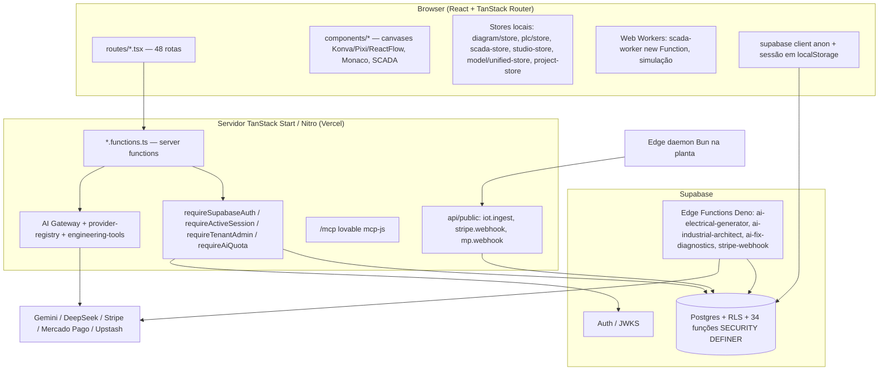

# 03 — Arquitetura do Sistema

Base: código lido neste ciclo, mais a estrutura de diretórios e imports (grep). Documentação anterior não foi usada como evidência.

## Observações estruturais (com evidência)

| ID | Sev. | Observação |
|---|---|---|
| P2-ARCH-001 | P2 | A invariante `IS_PHYSICAL_CONTROL_ALLOWED` é declarada em 6 módulos independentes: não há fonte única da verdade |
| P2-ARCH-018 | P2 | Dois receptores de webhook Stripe (rota Nitro e Edge Function) |
| P2-ARCH-037 | P2 | Múltiplas stores para conceitos sobrepostos: `src/lib/diagram/store.ts`, `src/lib/model/unified-store.ts` + `runtime-store.ts`, `src/lib/studio/studio-store.ts`, `src/lib/compact-studio/*`, `src/lib/plc/store.ts`, `src/lib/scada/scada-store.ts`, `src/lib/project-store.ts`, `src/lib/voltai/store.ts` (citado no histórico). Há uma migration de modelo `model/migration-v2-to-v3.ts`. Evidência de sistemas paralelos; a SSOT efetiva é INSUFFICIENT_EVIDENCE até a leitura do lote B6 |
| P2-ARCH-038 | P2 | Os cálculos elétricos podem estar duplicados: `electrical-calc.ts`, `electrical-sim.ts`, `diagram/electrical-simulation.ts`, `diagnostics/conductor-solver.ts`, `dossier/calculations.ts`, `scada/energy-calculator.ts` (não lidos) |
| P1-DB-006 | P1 | O banco não é reconstruível a partir do repositório (schema base ausente) |
| INFO | — | O browser acessa o PostgREST diretamente: a RLS é a fronteira primária |

## Fluxo de dados por módulo

A rastreabilidade completa (origem → validação → armazenamento → consumo → persistência) está pendente para Unifilar, Multifilar, Ladder, FBD, SCADA e Simulação (lotes B6–B8). Para IA e chat, ver doc 09 §2. Para IoT: dispositivo → `/api/public/iot/ingest` (rate limit, API key hash) → RPC `ingest_iot_reading` (service role) → `iot_readings` (RLS de leitura por membership).
