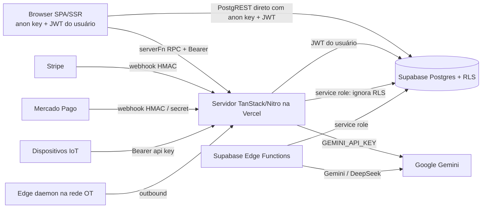

# 07 — Segurança e Modelo de Ameaças

Escopo efetivamente examinado neste ciclo: middleware de autenticação, clientes Supabase, `env.ts`, server functions de tenants, BOM, IoT e exclusão de conta, rotas públicas (IoT ingest, webhooks Stripe e Mercado Pago), rotas MCP, `vercel.json`, `vite.config.ts`, gateway e ferramentas de IA (parcial), Edge Functions (grep), migrations (parser estático) e varredura de segredos em `src/`, `docs/`, `.vercel/output/`, `dist-edge/`, `logs/`, `playwright-report/` e `test-results/`.
**Não examinado:** demais server functions (`projects`, `clients`, `alarm`, `catalog-import`, `diagnostics`, `security-monitor`, `tenant-settings`, `export`, `ai-architect`, `electrical-sim`, `ai-usage`), `src/lib/security/*` (exceto onde citado), edge daemon e componentes. A ausência de achados nessas áreas **não** significa ausência de defeitos.

## 1. Ativos

Projetos de engenharia (diagramas, BOM, programas de CLP) · dados de tenants e membros · conversas de IA · credenciais (service role, JWT secret, chaves Stripe/MP/Gemini/Upstash, API keys IoT, PAT do Supabase) · faturamento · telemetria IoT/SCADA · trava física `IS_PHYSICAL_CONTROL_ALLOWED`.

## 2. Fronteiras de confiança

Ponto central: o browser fala **diretamente** com o PostgREST usando a anon key. Portanto a RLS é a única barreira real para leitura e escrita de dados; as verificações nas server functions são defesa em profundidade.

## 3. Achados de segurança (ordenados por severidade)

| ID | Sev. | Título | Evidência | Estado |
|---|---|---|---|---|
| P0-SEC-020 | P0 | Valor de `SUPABASE_JWT_SECRET` commitado em evidência versionada | `docs/security/GATE_3_8_2_1_TRIVY_EVIDENCE.json` (rastreado desde `81d481f`) contém o valor em claro, idêntico ao `.env` local; o Trivy mascarou a service role, mas não este campo. `auth-middleware.ts:160-170` aceita HS256 assinado com esse segredo. | Comprovado no repo; validade em produção NOT_VERIFIED |
| P0-SEC-001 | P0 | PAT do Supabase (`sbp_…`) em `.env` local fora do formato `CHAVE=valor` | `.env:7`; também apareceu na saída de uma ferramenta desta auditoria | Comprovado; rotacionar |
| P0-DB-005 | **P0** | **Isolamento multi-tenant quebrado (confirmado):** qualquer usuário grava o `tenant_id` de outra empresa no próprio perfil (UPDATE ou INSERT) e lê os projetos, o tenant e os perfis dela; o trigger de proteção é inócuo (`SECURITY DEFINER` + `current_user`) | Doc 08 §5 (teste real em Supabase local) | **CONFIRMADO** |
| P1-SEC-002 | P1 | Bypass `dev-access-token` (userId fixo) habilitado por `NODE_ENV` | `auth-middleware.ts:55-64,119-134`; `auth-attacher.ts:15-26` | Comprovado no código; exposição depende do deploy |
| P1-SEC-009 | P1 | Aceite de convite confia em `claims.email`; o upsert pode rebaixar o papel | `tenants.functions.ts:264-307` | Depende da configuração "confirm email" (NOT_VERIFIED) |
| P1-SEC-010 | P1 | `vite.config.ts` carrega todo o `.env` (prefixo vazio) em `process.env` | `vite.config.ts:13-14` | Comprovado; vazamento de bundle não observado (ver §4) |
| P1-CFG-021 | P1 | `SUPABASE_SERVICE_ROLE_KEY` local é a chave anon (`role=anon`) | Decodificação das claims | Comprovado localmente |
| P2-SEC-004 | P2 | CSP com `script-src 'unsafe-inline'`; `connect-src` inclui `*.upstash.io` | `vercel.json:11` | Comprovado |
| P2-SEC-034 | P2 | Scripts SCADA executados com `new Function` em Web Worker com acesso a rede (`fetch`) | `src/lib/simulation/scada-worker.ts:121` | Comprovado; o impacto depende de quem pode editar scripts compartilhados |
| P2-AI-013 | P2 | `streamChat` não valida acesso ao `projectId` | `ai-chat.functions.ts:287-300` | Comprovado |
| P2-AI-017 | P2 | Rate limit em memória por isolate na Edge Function | `supabase/functions/ai-fix-diagnostics/index.ts:115-135` | Comprovado |
| P2-BILL-012 | P2 | O webhook MP não valida o valor contra o preço do plano; default silencioso `"pro"` | `mp.webhook.ts` (execute), `stripe.webhook.ts:117,142` | Comprovado |
| P3-SEC-003 | P3 | Project ref e anon JWT hardcoded como fallback | `env.ts:21-25` | Público por design |
| P3-RBAC-019 | P3 | Qualquer membro (inclusive viewer) resolve alarmes IoT | `iot.functions.ts:56-92` | Comprovado |

### Detalhe P0-SEC-020: cadeia de exploração
1. Quem tem acesso ao repositório lê o segredo HS256 no JSON de evidência.
2. Forja um JWT `{iss: <url>/auth/v1, aud: authenticated, role: authenticated, sub: <uuid da vítima>}` com HS256.
3. `requireSupabaseAuth` primeiro tenta JWKS (ES256/RS256), falha e cai no ramo legado HS256 (`auth-middleware.ts:160-170`). O token é aceito e `userId` vira o da vítima.
4. Server functions que usam `supabaseAdmin` com `context.userId` passam a agir como a vítima: `acceptInviteByToken`, `generateBomFromCanvas`, `acknowledgeAlert`, `check_ai_quota_for_user` / `increment_ai_tokens_for_user`.
5. Se esse segredo também for o JWT secret legado do projeto Supabase, é possível forjar `role: service_role`, o que permite **bypass total de RLS** em todas as tabelas.

**Remediação:** rotacionar o JWT secret do projeto e migrar para chaves assimétricas; remover o ramo HS256 do middleware (ou exigir `kid`); purgar o arquivo do histórico git (BFG/filter-repo) e tratar o segredo como comprometido.

## 4. Segredos e credenciais (valores sempre omitidos)

| Local | Tipo | Resultado |
|---|---|---|
| `.env` (ignorado) | service role (que na verdade é a anon), JWT secret, PAT `sbp_`, Gemini, Stripe secret e webhook, MP token e secret, Upstash token | Valores com aparência de reais; nunca rastreado. O histórico git do `.env` (`f21ff94`, `b26d35d^`) tinha só URL, project id e chave publishable |
| `docs/security/GATE_3_8_2_1_TRIVY_EVIDENCE.json` | JWT secret | **Vazado (rastreado)** — P0-SEC-020 |
| `src/integrations/supabase/env.ts:24-25` | anon JWT | Público por design |
| `.vercel/output/static/assets/index-*.js`, `functions/__server.func/_ssr/env-*.mjs` | o valor batizado de "service role" | É a anon key (P1-CFG-021): não é vazamento real de service role |
| `dist-edge/*.js`, `logs/`, `playwright-report/`, `test-results/` | — | Nenhum valor do `.env` encontrado |
| Source maps no build | — | 0 arquivos `.map` em `.vercel/output` |

Método: `tools/secret-scan.mjs` compara os valores literais do `.env` (≥16 caracteres) com cada arquivo, e só reporta o nome da chave e o caminho.

## 5. OT / controle físico (§8.9)

- `IS_PHYSICAL_CONTROL_ALLOWED = false as const` é declarado em 6 módulos (P2-ARCH-001) e preservado.
- Caminhos de escrita verificados no backend: `iot.functions.ts:108-121` (`enqueueIotCommand` retorna antes de qualquer acesso ao banco); `engineering-tools.server.ts:627-664` (barreira por denylist de argumentos; as ferramentas são puras e não têm capacidade física); `device-comms-gateway.ts:130-146`, `protocol-engine.ts:91-121,233,277,313` e `cloud-protocol-guard.server.ts:247` (grep; leitura integral pendente).
- O CI executa um grep que proíbe `node:net`/`node:dns` em `modbus-server`/`opcua-server`/`edge/*.server.ts`.
- **NOT_VERIFIED:** edge daemon (`src/edge-daemon/*`, 4 arquivos) e `src/lib/edge/*` (26 arquivos) não foram lidos integralmente, nem a direção da conexão Edge→Cloud. Nenhum teste ativo em CLP ou rede OT foi feito.

## 6. Pontos fortes observados (com evidência)

- JWT verificado localmente via JWKS com `issuer` e `audience` (`auth-middleware.ts:146-158`); operações sensíveis usam `requireActiveSession` com `getUser` remoto.
- Webhook Stripe com HMAC v1, tolerância de 300 s, comparação em tempo constante e idempotência por PK. O webhook MP busca o pagamento na API oficial em vez de confiar no corpo, e valida o id numérico.
- A ingestão IoT aplica rate limit por IP e por hash da chave antes do parse.
- Headers de segurança (HSTS, XFO DENY, nosniff, COOP, Permissions-Policy). MCP com `trustForwardedHost: false`.
- A RPC `generate_bom_from_canvas_for_user` verifica membership de `p_user_id` e é executável só por `service_role`.

## 7. Ciclo 2: novos achados

| ID | Sev. | Título | Evidência |
|---|---|---|---|
| P1-SEC-053 | P1 | Autorização de platform admin pelo **e-mail do JWT**, com o e-mail pessoal do proprietário hardcoded (PII no código). Também isenta esse e-mail de cota e burst de IA | `src/lib/billing.functions.ts:102` (antes da RPC `is_platform_admin`); `src/integrations/supabase/ai-rate-limit-middleware.ts:21,94`. Contradiz a migration `20261012090001` (remoção do admin hardcoded no banco) |
| P0 (amplia P0-SEC-020) | P0 | O PLATFORM_ADMIN de frota é concedido pela claim `platform_role` do JWT; um HS256 forjado pode carregá-la | `src/lib/edge/fleet-auth-context.server.ts:63-72` |
| P2-SEC-049 | P2 | O OPC UA só rejeita `SecurityPolicy None` quando `NODE_ENV=production`; o binário Bun não garante isso | `src/lib/edge/drivers/opcua-driver.ts:186` |
| P2-SEC-054 | P2 | O bypass dev também concede o papel AUDITOR na org demo `org_sp_industrial` | `fleet-auth-context.server.ts:50-58` |

Verificados como corretos: o escopo de tenant na frota é forçado no servidor (`fleet-handlers.server.ts:96-122`), com 403 cross-tenant em `resolveAuthoritativeGatewayForActor`; `catalog-import` e `changePlanManual` exigem `requireActiveSession` + RPC `is_platform_admin` (além do atalho por e-mail).

**OT (§5, atualizado):** os drivers Modbus, OPC UA e Sparkplug **não fazem I/O de rede**: são simulações com memória de laboratório (P1-INC-048, doc 04). A escrita física é impossível por construção (os métodos `write*` lançam `PHYSICAL_CONTROL_BLOCKED`; allowlist FC1..FC4 em `modbus-driver.ts:73-93,165-170`). O health server faz bind em `127.0.0.1:9090`, sem autenticação.
