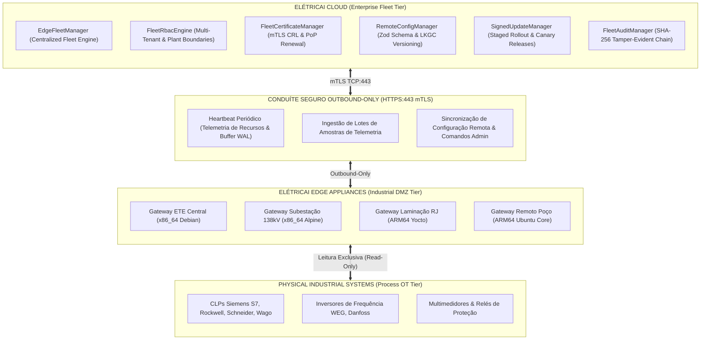
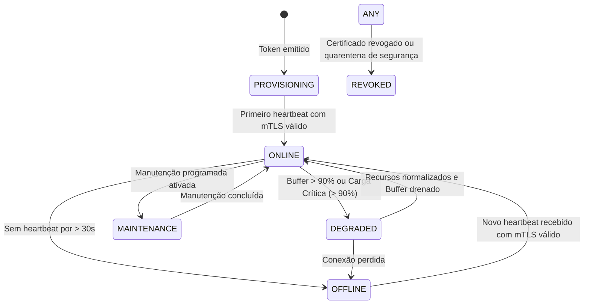

# ELÉTRICAI INDUSTRIAL OS — ARQUITETURA DO EDGE FLEET MANAGER
## GERENCIAMENTO CENTRALIZADO DE FROTA, HIERARQUIA MULTI-TENANT & TELEMETRIA OPERACIONAL (GATE 3.5)

**Documento:** `docs/edge/GATE3_5_FLEET_MANAGEMENT_ARCHITECTURE.md`  
**Versão:** 1.0.0 (Gate 3.5)  
**Classificação:** `APPROVED_FOR_EDGE_FLEET_OPERATIONAL_READINESS`  
**Normas de Referência:** IEC 62443-3-3, IEC 62443-4-2, NIST SP 800-82 Rev. 3, ISO 27001

---

## 1. VISÃO GERAL & OBJETIVOS

O **Edge Fleet Manager** é a camada centralizada do **ElétricAi Cloud** responsável pela governança, monitoramento contínuo, inventário criptográfico, configuração remota e manutenção de múltiplos **ElétricAi Edge Gateways** distribuídos em diferentes organizações, fábricas e subestações industriais.

A arquitetura preserva estritamente o desacoplamento das três camadas aprovadas no Gate 3.4:
1. **ELÉTRICAI CLOUD:** Gestão multi-tenant, autorização RBAC, telemetria agregada, aprovação de configurações e distribuição de versões assinadas.
2. **ELÉTRICAI EDGE:** Appliance autônomo local, buffer persistente SQLite WAL (Store-and-Forward), avaliação de alarmes locais, envio periódico de heartbeats e execução de atualizações locais com rollback automático.
3. **PHYSICAL INDUSTRIAL SYSTEMS:** Controladores lógicos programáveis (PLCs), inversores, multimedidores e sensores de campo.



---

## 2. HIERARQUIA MULTI-TENANT E CANONICAL IDENTITY

Cada gateway registrado no ElétricAi está vinculado à hierarquia canônica do modelo industrial:

```
Organização (Tenant)
  └── Planta Industrial (Plant)
        └── Setor / Área Operacional (Sector)
              └── Edge Gateway Appliance (UUID Único)
                    └── Estação de Aquisição Local (Station Hardware)
                          └── Equipamentos Canônicos (Transformadores, Bombas, CCM)
                                └── Tags Industriais Normalizadas
```

### 2.1. Metadados Canônicos do Gateway (`FleetGatewaySummary`)

- `gatewayId`: UUID v4 persistente e imutável.
- `name`: Nome administrativo para operadores humanos.
- `organizationId`: Tenant proprietário.
- `plantId`: Instalação física vinculada.
- `sector`: Setor operacional interno.
- `hardwareArch`: Arquitetura do processador (`x86_64`, `arm64`, `armv7l`).
- `os`: Distribuição Linux industrial instalada (`Linux Debian 12`, `Linux Alpine 3.19`, `Linux Yocto 4.0`).
- `softwareVersion`: Versão atual do daemon de borda.
- `protocolVersion`: Versão do protocolo de telemetria Cloud–Edge (`1.0.0`).
- `operationalState`: Estado de prontidão determinístico.

---

## 3. MÁQUINA DE ESTADOS OPERACIONAIS DETERMINÍSTICA

> [!IMPORTANT]
> **Regra Anti-Inferência:** Nenhum gateway é considerado `ONLINE` apenas porque existe um registro cadastrado no banco. O estado operacional é calculado determinística e dinamicamente a cada consulta.



### 3.1. Tabela de Estados e Critérios

| Estado | Critério de Transição | Ação do Sistema |
|---|---|---|
| `PROVISIONING` | Gateway criado, aguardando queima do token e emissão do certificado | Permite apenas rota de provisionamento |
| `ONLINE` | Heartbeat recebido há menos de 30 segundos; recursos normais; certificado válido | Coleta e transmissão ativas |
| `OFFLINE` | Ausência de heartbeat por mais de 30 segundos | Grandezas no SCADA marcadas como `STALE_DATA` / `NOT_CONNECTED` |
| `DEGRADED` | Utilização de buffer WAL > 90%, memória > 92% ou CPU > 95% | Alerta visual no dashboard, backpressure ativado |
| `MAINTENANCE` | Gateway colocado em modo de intervenção por administrador | Supressão de alarmes espúrios de desconexão |
| `REVOKED` | Certificado marcado como revogado na CRL | Bloqueio imediato com HTTP 403 Forbidden |

---

## 4. TELEMETRIA DE SAÚDE E CLASSIFICAÇÃO DE DIAGNÓSTICO

O heartbeat do Edge envia periodicamente a telemetria operacional de infraestrutura:
- **Processamento:** `% CPU`, `% RAM`, `% Disco`, `Temperatura (°C)`.
- **Armazenamento WAL:** Tamanho do arquivo SQLite WAL, contagem de amostras pendentes, idade da amostra mais antiga (ms), indicador de degradação.
- **Rede e Conexão:** Taxa de erro de protocolo, contador de reconexões, latência média de sincronização.

### 4.1. Classificação de Falhas (*Root Cause Anomaly Detection*)

Para evitar diagnósticos ambíguos na operação de campo, a engine diferencia com precisão:

| Classificação | Condição Diagnóstica | Causa Raiz Típica |
|---|---|---|
| `GATEWAY_FAILURE` | Ausência de heartbeat; processo do daemon parado | Queda de energia do IPC, falha de OS ou hardware |
| `CLOUD_FAILURE` | Gateway tenta conectar na Cloud e recebe timeout ou 5xx | Indisponibilidade do link WAN ou serviço Cloud |
| `PROTOCOL_FAILURE` | Driver não consegue fechar handshake TCP no Modbus/OPC UA | Cabo Ethernet desconectado, porta 502/4840 bloqueada |
| `INDUSTRIAL_SERVER_FAILURE` | Socket aberto, mas CLP recusa leitura ou Unit ID incorreto | CLP em STOP, proteção de CPU Siemens ativada |
| `DEADBAND_UNCHANGED` | Nenhuma amostra gerada, mas status do canal está GOOD | Processo estável; grandeza física dentro da banda morta |
| `STALE_SAMPLE` | Timestamp da última amostra excede limiar sem nova leitura | Sensor desconectado da entrada analógica do CLP |

---

## 5. INTERTRAVAMENTO DE SEGURANÇA FÍSICA

A plataforma mantém o bloqueio absoluto de comandos físicos:
- O parâmetro `isPhysicalControlAllowed: false` é permanente em todos os módulos.
- O Edge Fleet Manager **não possui métodos de escrita em barramento de campo**.
- Qualquer solicitação de comando remoto restringe-se exclusivamente a:
  - Reinicialização do daemon de software (`REBOOT_GATEWAY`).
  - Atualização do intervalo de varredura ou tags monitoradas (`PROPOSE_CONFIG`).
  - Renovação autenticada de certificados (`REQUEST_CERT_RENEWAL`).
  - Distribuição e instalação de versão assinada do daemon (`TRIGGER_UPDATE`).
