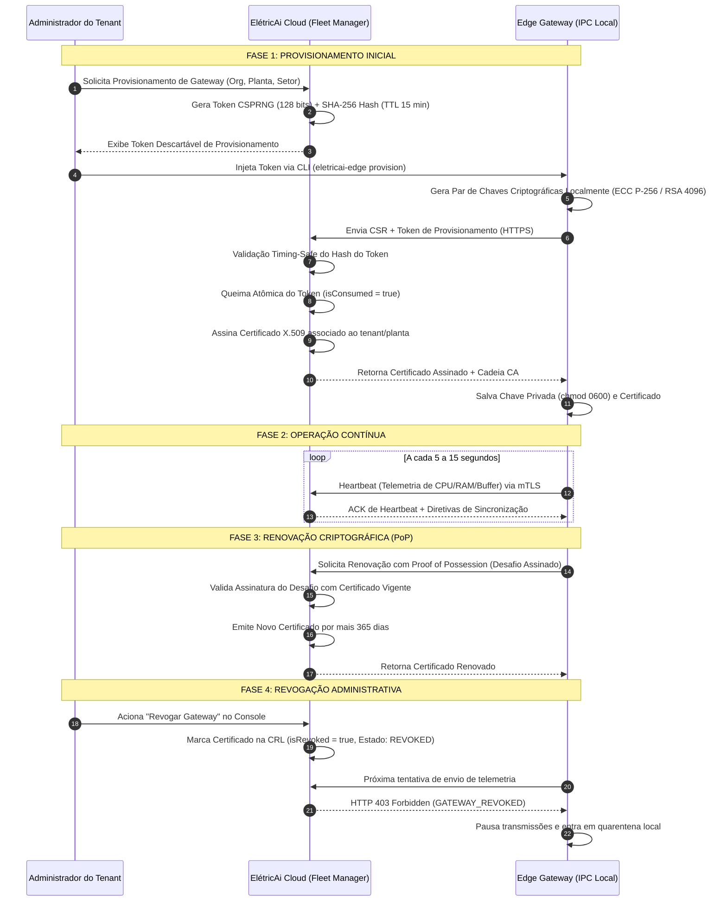

# ELÉTRICAI INDUSTRIAL OS — CICLO DE VIDA DO EDGE GATEWAY
## PROVISIONAMENTO, IDENTIDADE CRIPTOGRÁFICA, RENOVAÇÃO COM PoP E REVOGAÇÃO (GATE 3.5)

**Documento:** `docs/edge/GATE3_5_GATEWAY_LIFECYCLE.md`  
**Versão:** 1.0.0 (Gate 3.5)  
**Classificação:** `APPROVED_FOR_EDGE_FLEET_OPERATIONAL_READINESS`  
**Normas de Referência:** RFC 5280, RFC 8446 (TLS 1.3), IEC 62443-4-2, NIST SP 800-82 Rev. 3

---

## 1. VISÃO GERAL DO CICLO DE VIDA

O ciclo de vida de um **ElétricAi Edge Gateway** abrange cinco estágios fundamentais:
1. **Provisionamento Inicial:** Geração de token de uso único (*one-time token*) com queima atômica (*atomic burn*).
2. **Operação e Monitoramento:** Heartbeats periódicos, telemetria contínua e sincronização segura mTLS.
3. **Renovação Autenticada com Prova de Posse (PoP):** Atualização do certificado digital sem expor a chave privada local.
4. **Revogação Administrativa e Quarentena:** Bloqueio imediato de appliances violados ou aposentados.
5. **Descomissionamento Seguro:** Limpeza de chaves criptográficas locais e descarte seguro de dados.

---

## 2. PROVA DE POSSE (PROOF OF POSSESSION — PoP) NA RENOVAÇÃO

Um dos requisitos mandatórios de segurança do Gate 3.5 é a garantia de que:
> [!IMPORTANT]
> **Nenhuma chave privada deve ser enviada para a Cloud em formato recuperável.**

Para renovar um certificado mTLS sem gerar riscos de interceptação de chaves privadas:
1. O Edge Gateway gera um novo par de chaves localmente para o próximo ciclo de vida.
2. A Cloud emite uma *string* de desafio criptográfico aleatório (*nonce* de 256 bits).
3. O daemon do Edge assina esse desafio utilizando sua **chave privada atual** (comprovando que possui a identidade do gateway ativo).
4. O Edge submete a CSR do novo par de chaves juntamente com a assinatura de comprovação.
5. O `FleetCertificateManager` da Cloud verifica matematicamente a assinatura contra a chave pública atual. Se válida, assina o novo certificado.

---

## 3. MONITORAMENTO DE EXPIRAÇÃO DE CERTIFICADOS

O `FleetCertificateManager` avalia dinamicamente o estado de cada certificado registrado:

| Estado do Certificado | Condição Temporal | Ação no Dashboard | Ação no Gateway |
|---|---|---|---|
| `VALID` | Vencimento em mais de 30 dias | Selo verde `VALID` | Operação normal |
| `EXPIRING_SOON` | Vencimento em menos de 30 dias | Alerta âmbar; exibido nos KPIs | Notificação para o operador renovar |
| `EXPIRED` | Data atual posterior à data de expiração | Alerta vermelho `EXPIRED` | Conexão recusada pela Ingestion API |
| `REVOKED` | Revogação explícita na lista de revogação | Selo vermelho `REVOKED` | Bloqueio imediato com HTTP 403 |

---

## 4. REVOGAÇÃO ADMINISTRATIVA E QUARENTENA

Em situações de incidente de segurança (como invasão física de painel elétrico, roubo de hardware ou descarte não autorizado do IPC):
1. O administrador aciona **Revogar Gateway** com justificativa obrigatória.
2. O `FleetCertificateManager` atualiza a CRL e o `CloudGatewayRegistry` bloqueia as credenciais.
3. A Ingestion API passa a rejeitar qualquer lote com código de erro `GATEWAY_REVOKED` (HTTP 403).
4. Um evento de auditoria de severidade `CRITICAL` é gravado na cadeia SHA-256 com carimbo de tempo e autor.
