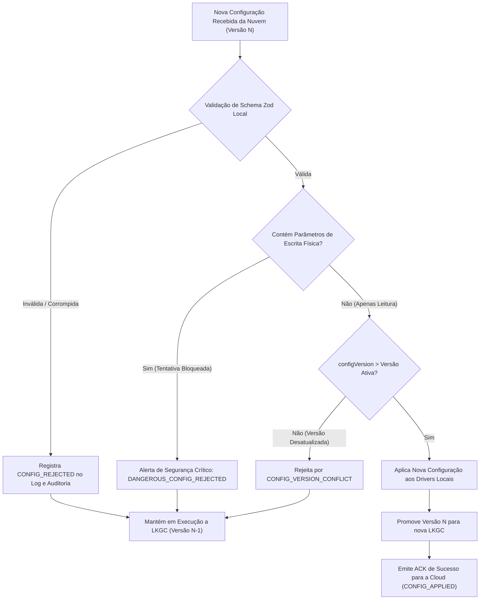

# ELÉTRICAI INDUSTRIAL OS — CONFIGURAÇÃO REMOTA SEGURA
## ESPECIFICAÇÃO DE CONFIGURAÇÃO, VERSIONAMENTO, VALIDAÇÃO LOCAL & ROLLBACK LKGC (GATE 3.5)

**Documento:** `docs/edge/GATE3_5_SECURE_CONFIGURATION.md`  
**Versão:** 1.0.0 (Gate 3.5)  
**Classificação:** `APPROVED_FOR_EDGE_FLEET_OPERATIONAL_READINESS`  
**Normas de Referência:** IEC 62443-4-2, NIST SP 800-82 Rev. 3, RFC 8259

---

## 1. INTRODUÇÃO & ESCOPO

A configuração remota permite aos administradores e engenheiros de automação ajustar parâmetros operacionais dos Edge Gateways (taxas de varredura, tags monitoradas, limites de buffer e políticas de retenção) de forma centralizada e auditada.

Para evitar falhas catastróficas em plantas industriais, o subsistema adota quatro salvaguardas:
1. **Validação de Schema Rigorosa com Zod:** Nenhum campo desconhecido ou tipo incorreto é aceito.
2. **Intertravamento Físico Permanente:** Nenhuma configuração pode habilitar escrita física ou controle de atuadores (`isPhysicalControlAllowed: false`).
3. **Controle de Concorrência Otimista:** Cada versão de configuração deve ser estritamente superior à versão ativa (`configVersion > currentVersion`).
4. **Preservação da Última Configuração Válida (LKGC):** Configurações inválidas ou malformadas são descartadas localmente sem sobrescrever a configuração estável em execução.

---

## 2. ESTRUTURA DO ENVELOPE DE CONFIGURAÇÃO (`RemoteConfigPayload`)

```typescript
export interface RemoteConfigPayload {
  /** Versão sequencial monotônica estrita (1, 2, 3...) */
  configVersion: number;

  /** Identificador único do gateway alvo */
  gatewayId: string;

  /** Identificação do autor (email ou ID de usuário) */
  author: string;

  /** Carimbo de tempo da proposta (Epoch ms) */
  timestamp: number;

  /** Assinatura criptográfica / hash de integridade SHA-256 */
  signature: string;

  /** Intervalo mínimo de amostragem em ms (Mínimo 100ms para evitar sobrecarga de CLP) */
  scanRateMs: number;

  /** Lista estrita de endpoints IP/Porta autorizados para varredura */
  authorizedEndpoints: string[];

  /** Lista de tags industriais habilitadas para aquisição */
  enabledTags: string[];

  /** Configurações específicas de protocolos somente-leitura */
  readProtocols: {
    opcua?: { endpoint: string; enabled: boolean };
    modbus?: { host: string; port: number; enabled: boolean };
    sparkplug?: { brokerUrl: string; enabled: boolean };
  };

  /** Limites do buffer transacional SQLite WAL */
  bufferLimits: {
    maxSamples: number;
    maxDiskMb: number;
    saturationPolicy: "DROP_OLDEST_NON_CRITICAL" | "DROP_NEWEST_WITH_ALARM";
  };

  /** Política de retenção offline em horas */
  retentionPolicy: {
    maxAgeHours: number;
  };

  /** Configurações de observabilidade e telemetria */
  observability: {
    metricsIntervalMs: number;
    logLevel: "DEBUG" | "INFO" | "WARN" | "ERROR";
  };

  /** Registro de aprovação administrativa */
  approval?: {
    approvedBy: string;
    approvedAt: number;
  };
}
```

---

## 3. VALIDAÇÃO LOCAL NO EDGE & POLÍTICA DE LKGC



---

## 4. PROCEDIMENTO DE ROLLBACK MANUAL E AUTOMÁTICO

Caso uma configuração válida cause comportamento indesejado em campo (por exemplo, excesso de tráfego de rede devido a scan rate muito agressivo):
1. O administrador ou engenheiro aciona **Rollback para LKGC** no console.
2. O `RemoteConfigManager` desempilha a configuração atual e restaura a versão estável anterior (`configVersion - 1`).
3. O daemon local recarrega os parâmetros anteriores sem interromper o processo de buffer WAL.
4. Um evento de auditoria `CONFIG_ROLLED_BACK` é registrado na cadeia criptográfica SHA-256.
