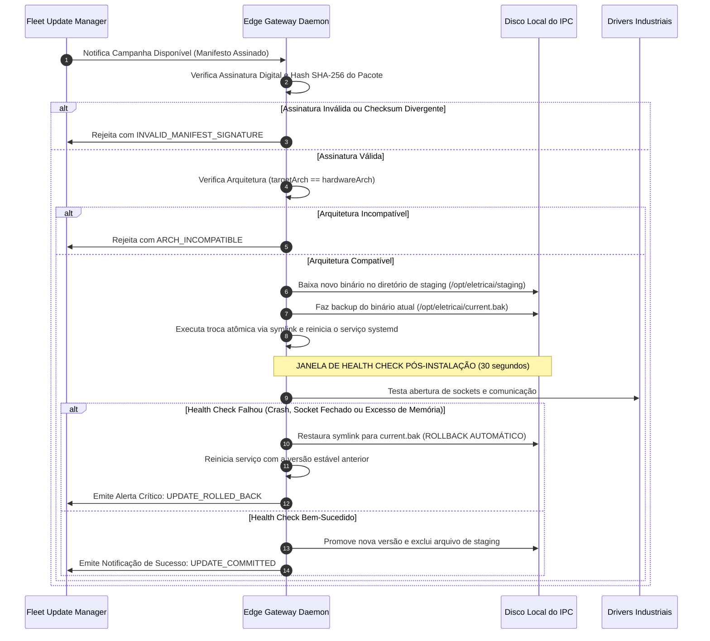

# ELÉTRICAI INDUSTRIAL OS — ATUALIZAÇÕES ASSINADAS & STAGED ROLLOUT
## DISTRIBUIÇÃO CRIPTOGRÁFICA DE VERSÕES, VERIFICAÇÃO DE ARQUITETURA E ROLLBACK AUTOMÁTICO (GATE 3.5)

**Documento:** `docs/edge/GATE3_5_SIGNED_UPDATES.md`  
**Versão:** 1.0.0 (Gate 3.5)  
**Classificação:** `APPROVED_FOR_EDGE_FLEET_OPERATIONAL_READINESS`  
**Normas de Referência:** The Update Framework (TUF), NIST SP 800-82 Rev. 3, IEC 62443-4-2

---

## 1. INTRODUÇÃO & FILOSOFIA DE ATUALIZAÇÃO

A distribuição remota de código em computadores de borda industriais envolve riscos severos de parada de processo e perda de visibilidade operacional. Para garantir que nenhuma atualização comprometa a operação da planta, o ElétricAi adota uma estratégia de atualização baseada no padrão **TUF (The Update Framework)**:

1. **Assinatura Digital Obrigatória:** Todo pacote binário ou imagem de container é assinado com chaves criptográficas da autoridade de release do ElétricAi.
2. **Verificação de Arquitetura Rígida:** O binário x86_64 não pode ser instalado em hardware ARM64 (e vice-versa), eliminando falhas de execução.
3. **Distribuição em Etapas (*Canary & Staged Rollout*):** As atualizações nunca são enviadas simultaneamente para toda a frota. A política inicia em gateways piloto (canário) antes de alcançar plantas inteiras.
4. **Verificação de Saúde Pós-Instalação (*Health Check Gate*):** O daemon executa testes de integridade por 30 segundos após a inicialização. Caso falhe, executa **rollback automático** restaurando o binário anterior.
5. **Capacidade de Interrupção Imediata (*Abort Campaign*):** Administradores podem cancelar uma campanha ativa com um clique, impedindo que gateways pendentes baixem a atualização.

---

## 2. MANIFESTO DE ATUALIZAÇÃO ASSINADA (`SignedUpdateManifest`)

```typescript
export interface SignedUpdateManifest {
  /** Identificador único do pacote (ex: "pkg-edge-daemon-1.3.0") */
  packageId: string;

  /** Versão semântica alvo (ex: "1.3.0") */
  targetVersion: string;

  /** Arquitetura do processador obrigatória */
  targetArch: "x86_64" | "arm64";

  /** Hash criptográfico SHA-256 do binário */
  sha256: string;

  /** Assinatura digital gerada pela autoridade de release */
  signature: string;

  /** Notas de versão e descritivo de correções */
  releaseNotes: string;

  /** Versão mínima exigida do daemon atual para permitir upgrade direto */
  minGatewayVersion: string;

  /** Mapeamento de dependências e bibliotecas do sistema operacional */
  dependencies?: Record<string, string>;
}
```

---

## 3. FLUXO DE EXECUÇÃO DE ATUALIZAÇÃO COM ROLLBACK AUTOMÁTICO



---

## 4. CONTROLE ADMINISTRATIVO DE CAMPANHAS (*ABORT CAMPAIGN*)

Se durante uma distribuição em larga escala o administrador identificar um comportamento adverso nas plantas piloto:
1. O comando `abortCampaign(campaignId)` é disparado no console.
2. O status da campanha na Cloud transita para `ABORTED`.
3. Qualquer gateway subsequente que consulte o endpoint de atualização recebe resposta `CAMPAIGN_ABORTED`.
4. Os gateways que já foram atualizados com sucesso permanecem na nova versão, enquanto os pendentes mantêm a versão estável sem interrupção.
