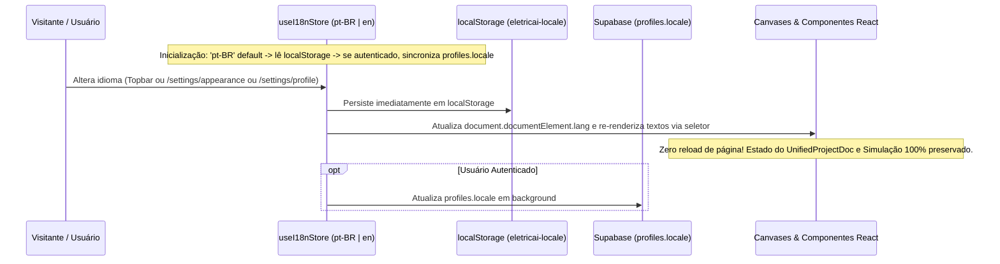

# Auditoria de Internacionalização e Especificação de Comportamento Bilíngue (`pt-BR` / `en`)

> **Status:** Inventário Completo do Código-Fonte e Arquitetura Bilíngue (Partes 4 e 5)  
> **Escopo:** Auditoria de `src/routes/*`, `src/components/*`, `src/lib/*`, `public/legal/*` e definição do sistema unificado `pt-BR` (padrão) e `en`.

---

## PARTE 4 — AUDITORIA DE INTERNACIONALIZAÇÃO NO CÓDIGO ATUAL

### 4.1 Infraestrutura Existente Identificada

1. **Dependências (`package.json`)**:
   - **Nenhuma biblioteca de i18n instalada** (não há `i18next`, `react-i18next`, `use-intl`, `@lingui/*` ou `react-intl`).
   - Está instalado `date-fns@^4.1.0`, utilizado com `ptBR` de `date-fns/locale` em apenas 2 arquivos ([`src/routes/dashboard.tsx`](file:///c:/Users/98911/Desktop/eletric/eletricaip/src/routes/dashboard.tsx) e [`src/routes/settings.security-monitor.tsx`](file:///c:/Users/98911/Desktop/eletric/eletricaip/src/routes/settings.security-monitor.tsx)).
2. **Dois Seletores de Idioma Desconectados e Sem Efeito em Runtime**:
   - **Seletor 1 — Perfil no Supabase ([`src/routes/settings.profile.tsx`](file:///c:/Users/98911/Desktop/eletric/eletricaip/src/routes/settings.profile.tsx#L264-L278))**:
     - Lê e grava a coluna `public.profiles.locale` (`string | null`, default `'pt-BR'`, definida em [`src/integrations/supabase/types.ts`](file:///c:/Users/98911/Desktop/eletric/eletricaip/src/integrations/supabase/types.ts#L576)).
     - Exibe um `<select id="locale">` com `"pt-BR"`, `"en-US"` e `"es-ES"`, mas **nenhum outro arquivo da aplicação lê `profiles.locale`**.
   - **Seletor 2 — Aparência no LocalStorage ([`src/routes/settings.appearance.tsx`](file:///c:/Users/98911/Desktop/eletric/eletricaip/src/routes/settings.appearance.tsx#L24-L45))**:
     - Define a store Zustand local `useAppearance` persistida em `localStorage` sob a chave `"eletricai-appearance"` com `language: "pt-BR"`.
     - Exibe um `<Select>` na linha 100 com `"pt-BR"`, `"en-US"` e `"es-ES"`, mas **`useAppearance.language` nunca é consumido por nenhum componente, rota, servidor ou exportador**, nem é sincronizado com `profiles.locale`.
3. **HTML Root e Página de Erro**:
   - [`src/routes/__root.tsx`](file:///c:/Users/98911/Desktop/eletric/eletricaip/src/routes/__root.tsx#L127) fixa `<html lang="pt-BR" className="dark">` e mistura meta tags em português com descrições OpenGraph/Twitter em inglês (linhas 98–112).
   - [`src/lib/error-page.ts`](file:///c:/Users/98911/Desktop/eletric/eletricaip/src/lib/error-page.ts#L1-L31) está 100% fixo em inglês (`<html lang="en">`, `"This page didn't load"`, `"Try again"`, `"Go home"`).

---

### 4.2 Inventário Quantitativo de Textos Fixos (`src/`)

Foram auditados **194+ arquivos** em `src/`, dos quais **112 arquivos** contêm textos visíveis ao usuário, prompts de IA, relatórios ou mensagens de erro fixos no código, totalizando aproximadamente **2.675 ocorrências de strings** (~2.605 em `pt-BR` e ~70 em `en`):

| Diretório / Categoria | Arquivos Auditados | Arquivos com Textos Fixos | Strings `pt-BR` (aprox.) | Strings `en` (aprox.) |
| :--- | :---: | :---: | :---: | :---: |
| **`src/routes/` (Marketing, Auth, Onboarding, Legal)** | 11 | 11 | ~201 | ~2 |
| **`src/routes/` (Dashboard, Projetos, BOM, Export, Twin, IA, Clientes, Analytics)** | 14 | 14 | ~408 | ~4 |
| **`src/routes/` (Configurações `/settings/*` — 15 telas)** | 15 | 15 | ~466 | 0 |
| **`src/routes/` (Rotas de API/Webhook)** | 5 | 5 | 0 | ~19 |
| **`src/components/` (Shell, Sidebar, Topbar, Painéis Direito/Inferior)** | 7 | 7 | ~92 | ~3 |
| **`src/components/` (Chat IA, Modais, Tour, Notificações, Histórico)** | 11 | 11 | ~106 | ~3 |
| **`src/components/canvases/` (WebGL, Konva, Ladder, FBD, PLC, SCADA, Twin, Sim, Alarmes)** | 15 | 15 | ~322 | ~9 |
| **`src/components/` (Painéis de Propriedades, Paletas, Estudos Elétricos, Cenários)** | 17 | 17 | ~257 | 0 |
| **`src/lib/` (Catálogos, Parâmetros, Validadores Normativos, Planos, PDF, Prompts IA)** | 95+ | 22 | ~640 | ~30 |
| **TOTAL CONSOLIDADO** | **194+** | **112** | **~2.605** | **~70** |

---

### 4.3 Detalhamento por Domínio Funcional

#### 1. Navegação, Botões, Menus e Configurações
- [`src/components/app-sidebar.tsx`](file:///c:/Users/98911/Desktop/eletric/eletricaip/src/components/app-sidebar.tsx) e [`src/components/mobile-menu.tsx`](file:///c:/Users/98911/Desktop/eletric/eletricaip/src/components/mobile-menu.tsx): Itens de navegação (`"Projetos"`, `"Gêmeo Digital"`, `"IA Industrial"`, `"Clientes"`, `"Configurações"`).
- [`src/components/topbar.tsx`](file:///c:/Users/98911/Desktop/eletric/eletricaip/src/components/topbar.tsx): `"Busca global"`, `"Salvar"`, `"Compartilhar"`, status de salvamento.
- [`src/lib/workspace-data.ts`](file:///c:/Users/98911/Desktop/eletric/eletricaip/src/lib/workspace-data.ts): Abas dos 9 modos (`MODES`: `"Unifilar"`, `"Multifilar"`, `"Blocos (FBD)"`, `"Ladder"`, `"CLP"`, `"SCADA / IHM"`, `"Gêmeo 3D"`, `"Simulação"`, `"Alarmes"`) e 5 abas do console (`CONSOLE_TABS`).
- [`src/routes/settings.tsx`](file:///c:/Users/98911/Desktop/eletric/eletricaip/src/routes/settings.tsx) e 14 sub-rotas `settings.*.tsx`: ~466 strings fixas em português cobrindo perfil, aparência, faturamento, equipe, diagnósticos, segurança, protocolos e importação de catálogo.

#### 2. Formulários, Validações, Estados de Carregamento e Estados Vazios
- [`src/lib/editor/property-schemas.ts`](file:///c:/Users/98911/Desktop/eletric/eletricaip/src/lib/editor/property-schemas.ts): Mensagens Zod hardcoded (`"precisa ser numérico"`, `"Mínimo:"`, `"Máximo:"`, `"Tag obrigatória"`, `"Tag inválida"`).
- [`src/components/canvases/lazy.tsx`](file:///c:/Users/98911/Desktop/eletric/eletricaip/src/components/canvases/lazy.tsx) e [`src/components/industrial-workspace.tsx`](file:///c:/Users/98911/Desktop/eletric/eletricaip/src/components/industrial-workspace.tsx): Estados de carregamento (`"Carregando projeto…"`, `"Inicializando motor gráfico…"`) e estados vazios.

#### 3. Editores, Paletas e Propriedades Técnicas
- [`src/lib/palette/component-catalog.ts`](file:///c:/Users/98911/Desktop/eletric/eletricaip/src/lib/palette/component-catalog.ts): 48 definições de componentes industriais (~180 strings de nomes, categorias e rótulos de parâmetros).
- [`src/lib/diagram/param-specs.ts`](file:///c:/Users/98911/Desktop/eletric/eletricaip/src/lib/diagram/param-specs.ts): ~45 rótulos de parâmetros elétricos (`"Corrente nominal"`, `"Tensão bobina"`, `"Potência"`, `"Fator de potência"`).
- [`src/lib/project-store.ts`](file:///c:/Users/98911/Desktop/eletric/eletricaip/src/lib/project-store.ts#L78-L212): `KIND_CATALOG` misturando chaves em inglês (`"Numeric Display"`, `"Level Indicator"`, `"Alarm Banner"`) e português (`"Disjuntor"`, `"Contator"`, `"Transformador"`, `"Motor 3F"`).
- [`src/lib/ladder/definitions.ts`](file:///c:/Users/98911/Desktop/eletric/eletricaip/src/lib/ladder/definitions.ts): ~85 strings em português misturadas com parâmetros em inglês (`"Preset time"`, `"Preset value"`).

#### 4. Simulação, Alarmes, Estudos e Telemetria
- [`src/components/simulation/electrical-study-panel.tsx`](file:///c:/Users/98911/Desktop/eletric/eletricaip/src/components/simulation/electrical-study-panel.tsx) (~45 strings), [`src/components/simulation/test-scenarios-panel.tsx`](file:///c:/Users/98911/Desktop/eletric/eletricaip/src/components/simulation/test-scenarios-panel.tsx) (~42 strings), [`src/components/simulation/unifilar-ladder-bridge-panel.tsx`](file:///c:/Users/98911/Desktop/eletric/eletricaip/src/components/simulation/unifilar-ladder-bridge-panel.tsx) (~22 strings) e [`src/components/plant-sim-panel.tsx`](file:///c:/Users/98911/Desktop/eletric/eletricaip/src/components/plant-sim-panel.tsx) (~28 strings).
- [`src/components/canvases/alarms-canvas.tsx`](file:///c:/Users/98911/Desktop/eletric/eletricaip/src/components/canvases/alarms-canvas.tsx): Cabeçalhos em português com badges de estado ISA-18.2 em inglês (`Active`, `Acked`, `Shelved`, `Suppressed`).

#### 5. IA, Erros do Backend e Validadores Normativos
- [`src/lib/ai-architect.functions.ts`](file:///c:/Users/98911/Desktop/eletric/eletricaip/src/lib/ai-architect.functions.ts#L58), [`src/lib/diagram/ai.functions.ts`](file:///c:/Users/98911/Desktop/eletric/eletricaip/src/lib/diagram/ai.functions.ts#L58) e [`src/lib/ai-chat.functions.ts`](file:///c:/Users/98911/Desktop/eletric/eletricaip/src/lib/ai-chat.functions.ts#L99): System prompts fixos exigindo resposta exclusivamente em `PT-BR`.
- [`src/lib/norm-validator.ts`](file:///c:/Users/98911/Desktop/eletric/eletricaip/src/lib/norm-validator.ts): ~45 diagnósticos normativos (`title`, `detail`, `fixHint`) fixos em português.

#### 6. Relatórios, Memoriais, Exportações, Autenticação e Billing
- [`src/lib/pdf-export.ts`](file:///c:/Users/98911/Desktop/eletric/eletricaip/src/lib/pdf-export.ts): ~28 strings fixas em português (`"EletricAI · Memorial Descritivo"`, aviso legal CREA/CFT, cabeçalhos de tabelas BOM e componentes).
- [`src/lib/plans.ts`](file:///c:/Users/98911/Desktop/eletric/eletricaip/src/lib/plans.ts) e [`src/routes/settings.billing.tsx`](file:///c:/Users/98911/Desktop/eletric/eletricaip/src/routes/settings.billing.tsx): Planos, features e preços formatados manualmente com `"R$"`.

#### 7. Formatação de Datas, Horas e Números
- **Zero** usos de `Intl.NumberFormat` ou `Intl.DateTimeFormat`.
- **37 chamadas diretas** a `toLocaleDateString`, `toLocaleTimeString` e `toLocaleString` espalhadas por 18 arquivos, ora com `"pt-BR"` fixo, ora sem argumento de locale.
- **2 formatadores manuais de tempo relativo** em [`src/components/ui/notification-dropdown.tsx`](file:///c:/Users/98911/Desktop/eletric/eletricaip/src/components/ui/notification-dropdown.tsx#L16-L24) e [`src/components/digital-twin/telemetry-health-panel.tsx`](file:///c:/Users/98911/Desktop/eletric/eletricaip/src/components/digital-twin/telemetry-health-panel.tsx#L14-L21) retornando `"agora"`, `"nunca"`, `"atrás"`.

---

## PARTE 5 — ESPECIFICAÇÃO DO COMPORTAMENTO BILÍNGUE (`pt-BR` e `en`)

### 5.1 Arquitetura da Solução de Internacionalização Centralizada

Consolidaremos os seletores existentes (`profiles.locale` e `useAppearance.language`) em um motor i18n único, leve e 100% tipado em `src/lib/i18n/`:

1. **Idiomas Suportados (`SupportedLocale`)**:
   - `'pt-BR'` (Português Brasileiro — **idioma inicial padrão**).
   - `'en'` (Inglês Internacional Técnico — mapeando automaticamente valores legados `'en-US'` para `'en'`).
2. **Catálogos Tipados e Chaves Estáveis (`src/lib/i18n/catalogs/`)**:
   - `pt-BR.ts` define o contrato mestre `TranslationCatalog`.
   - `en.ts` implementa `satisfies TranslationCatalog`, garantindo em tempo de compilação (`tsc --noEmit`) que **nenhuma chave exista em um idioma sem existir no outro**.
   - As chaves são hierárquicas e semânticas (`nav.projects`, `canvas.modes.unifilar`, `catalog.motor_3p.label`, `diagnostics.CONTROL_BRIDGE_MISSING_CONTACTOR`), proibindo chaves baseadas em frases literais.
3. **Mecanismo de Detecção de Traduções Faltantes (`missingKeyDetector`)**:
   - Qualquer chamada `t(key)` registra em dev/test se uma chave não for encontrada ou se retornar fallback, permitindo que a suíte automatizada (`T9`/`T10`) falhe imediatamente caso surja texto sem tradução.

---

### 5.2 Persistência de Preferência e Troca de Idioma Sem Perda de Estado

- **Acessibilidade do Seletor:** Disponível tanto em **Configurações → Aparência** (`/settings/appearance`), **Configurações → Perfil** (`/settings/profile`) quanto em um **atalho rápido no Topbar / Header público**, todos lendo e escrevendo na mesma store `useI18nStore`.

---

### 5.3 Separação Estrita: Idioma da Interface vs Linguagem de Programação vs Norma Técnica

| Dimensão | O que Muda ao Trocar `pt-BR` $\leftrightarrow$ `en` | O que **NUNCA** Muda ao Trocar o Idioma |
| :--- | :--- | :--- |
| **Interface (UI), Relatórios e IA** | Menus, botões, tooltips, nomes de categorias na paleta, descrições de blocos, mensagens de validação/erro, cabeçalhos do PDF/DXF e idioma da explicação da IA Gemini. | Estado do projeto, coordenadas dos canvases, histórico de undo/redo e sessão de simulação. |
| **Identificadores e Linguagens IEC 61131-3** | Rótulos explicativos da paleta (`"Temporizador TON (Atraso na Energização)"` $\leftrightarrow$ `"TON Timer (On-Delay)"`). | **Mnemônicos e código ST/Ladder/FBD:** `TON`, `TOF`, `CTU`, `CTD`, `R_TRIG`, `PID`, `VAR ... END_VAR`, `IF ... THEN`, endereços `%I0.0`, `%Q0.0`, `%MW10`, nomes de tags (`KM1_CMD`) e códigos de equipamentos (`QF1`, `KM1`, `M1`). |
| **Normas de Engenharia e Cálculos** | Textos dos diagnósticos normativos (`"Queda de tensão acima do limite (NBR 5410)"` $\leftrightarrow$ `"Voltage drop exceeds limit (NBR 5410)"`). | **Equações, fatores de correção, tabelas de ampacidade, limites normativos e normas ativas no projeto** (`NBR 5410`, `NBR 14039`, `NR-10`, `NR-12`, `IEC 60909`). Mudar a UI para `en` **jamais** altera um cálculo elétrico nem desativa a NBR 5410. |
| **Unidades e Formatação Numérica** | Separador decimal/milhar visual via `Intl.NumberFormat(locale)` (`1.500,50` em `pt-BR` vs `1,500.50` em `en`) e datas via `Intl.DateTimeFormat(locale)`. | **Unidades internas SI/IEC nos modelos e cálculos:** `kW`, `kVA`, `V`, `kV`, `A`, `kA`, `mm²`, `Hz`, `Ω`, `°C`, `bar`, `m³/h`, `s`, `ms`. |

---

### 5.4 Glossário Industrial Padronizado (`pt-BR` $\leftrightarrow$ `en`)

| Conceito Técnico | Termo Oficial `pt-BR` | Termo Oficial `en` | Código/ID Canônico (Invariante) |
| :--- | :--- | :--- | :--- |
| Diagrama Unifilar | Diagrama Unifilar | Single-Line Diagram (SLD) | `unifilar` |
| Diagrama Multifilar | Diagrama Multifilar | Multi-Line / Three-Line Diagram | `multifilar` |
| Diagrama Ladder | Diagrama Ladder (LD) | Ladder Diagram (LD) | `ladder` |
| Diagrama de Blocos Funcionais | Blocos Funcionais (FBD) | Function Block Diagram (FBD) | `fbd` |
| Controlador Lógico Programável | CLP / Hardware PLC | PLC / Hardware Rack | `plc` |
| Supervisório e IHM | SCADA / IHM | SCADA / HMI | `scada` |
| Gêmeo Digital | Gêmeo Digital 3D | 3D Digital Twin | `twin` |
| Disjuntor Termomagnético | Disjuntor Termomagnético | Circuit Breaker (MCB/MCCB) | `disjuntor_3p` / `breaker` |
| Dispositivo Diferencial Residual | Dispositivo DR (IDR/DDR) | Residual Current Device (RCD) | `dr` / `rcd` |
| Contator de Potência | Contator | Contactor | `contator` / `contactor` |
| Relé de Sobrecarga (Térmico) | Relé Térmico de Sobrecarga | Thermal Overload Relay | `rele_termico` / `relay` |
| Inversor de Frequência | Inversor de Frequência (VFD) | Variable Frequency Drive (VFD) | `inversor_vfd` / `vfd` |
| Quadro Geral de Baixa Tensão | QGBT / Barramento Principal | Main LV Switchboard (MSB) | `qgbt` / `busbar` |
| Centro de Controle de Motores | Centro de Controle de Motores (CCM) | Motor Control Center (MCC) | `ccm` |
| Memorial Descritivo e de Cálculo | Memorial Descritivo e de Cálculo | Engineering Calculation & Design Report | `engineering_report` |
| Lista de Materiais | Lista de Materiais (BOM) | Bill of Materials (BOM) | `bom` |
