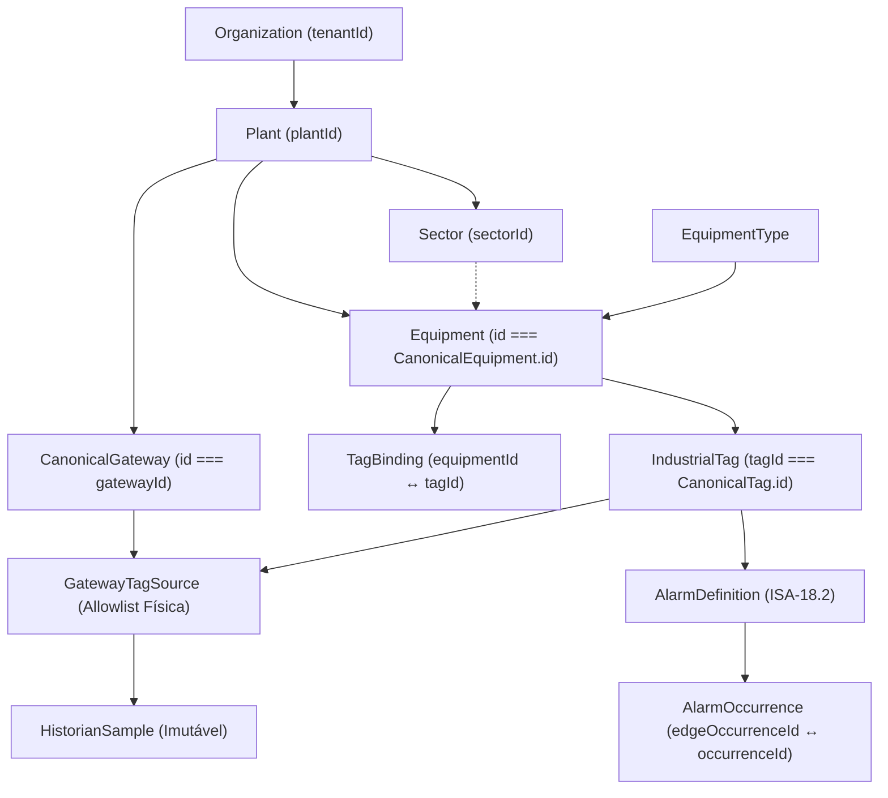

# ELÉTRICAI INDUSTRIAL OS — GATE 3.6
# MODELO CANÔNICO DE DADOS INDUSTRIAIS (`GATE3_6_CANONICAL_DATA_MODEL.md`)

## 1. Visão Geral e Objetivo Arquitetural

O **Gate 3.6** consolida a fundação de dados industriais do ElétricAi em uma hierarquia canônica única, eliminando duplicações entre Engenharia Elétrica (`UnifiedProjectDoc` v3: Unifilar, Multifilar, Ladder, FBD e PLC), Registro de Equipamentos, Tags Industriais, Frota de Edge Gateways, SCADA Supervisório, Motor de Alarmes (ISA-18.2) e Historian de Séries Temporais.

### Hierarquia Canônica Oficial

---

## 2. Invariantes de Identidade e Reutilização Direta

| Entidade Canônica (`src/lib/industrial/types.ts`) | Identidade Persistente | Fonte / Equivalência Direta | Regra de Imutabilidade |
| :--- | :--- | :--- | :--- |
| `Organization` | `id` (`tenantId`) | `public.tenants.id` | Imutável |
| `Plant` | `id` (`plantId`) | `public.industrial_plants.id` | Vinculada permanentemente a `tenantId` (`IDENTITY_TRANSFER_FORBIDDEN`) |
| `Sector` | `id` (`sectorId`) | `public.industrial_sectors.id` | Vinculado permanentemente a `(tenantId, plantId)` |
| `Equipment` | `id` | `CanonicalEquipment.id` (`UnifiedProjectDoc`) | O **mesmo UUID** é usado em Unifilar, Multifilar, Ladder, FBD, PLC, SCADA, Alarmes e Historian |
| `IndustrialTag` | `tagId` | `CanonicalTag.id` (`UnifiedProjectDoc`) | O **mesmo UUID** é usado em CLP, Ladder, FBD, Edge Gateway, SCADA, Alarmes e Historian |
| `CanonicalGateway` | `id` | `RegisteredGatewayRecord.gatewayId` | Vinculado permanentemente a `(tenantId, plantId)` |
| `GatewayTagSource` | `(gatewayId, tagId, sourceId)` | Allowlist de aquisição física | `writeEnabled: false` permanente e imutável |

---

## 3. Versionamento e Histórico de Revisões Sem Quebra de Identidade

Alterar `tagCode`, `canonicalName`, `displayName`, `description`, `engineeringUnit`, `scale` ou `offset` **jamais altera o UUID** do equipamento ou da tag:

1. `registerOrUpdateEquipment()` preserva `Equipment.id`, incrementa `revision` (`1 → 2 → ...`) e grava um registro imutável `EquipmentRevision` com `changedFields`, `changedBy`, `changedAt` e `snapshot`.
2. `registerOrUpdateTag()` preserva `IndustrialTag.tagId`, incrementa `revision` e `configurationVersion`, e grava `TagRevision`.
3. O reposicionamento visual nos diagramas (`views.unifilar.nodes`, `views.multifilar.nodes`, `views.scada.widgets`) altera exclusivamente as coordenadas de layout sem criar ou substituir entidades de engenharia.

---

## 4. Sincronização Unificada com Engenharia Elétrica (`UnifiedProjectDoc`)

O método `CanonicalIndustrialDataService.syncFromUnifiedProjectDoc()` e a ponte `syncUnifiedDocToScada()` (`src/lib/scada/canonical-bridge.ts`) projetam:
- `doc.engineering.equipments` → `Equipment` + `EquipmentTelemetry`
- `doc.engineering.tags` → `IndustrialTag` + `ScadaTagDefinition`
- `doc.engineering.controlBindings` → `TagBinding` (`role`, `plcChannelId`, `terminalId`)

Nenhum cadastro paralelo é criado.
