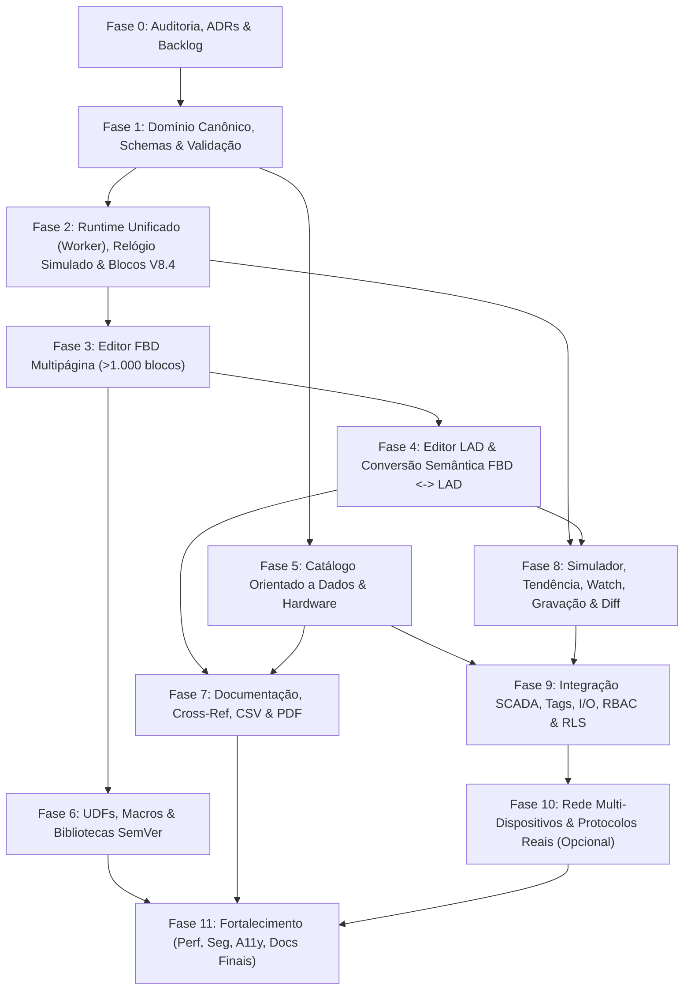

# Roadmap — Módulo `eletric Studio` (Paridade CLP Compacto V8/V8.4 + Evolução ElétricAi)

**Feature Flag:** `logoStudio` (desabilitada ou controlada por tenant até conclusão das fases aplicáveis)  
**Constante Configurável:** `PRODUCT_NAME`  
**Princípio:** Fases incrementais com portões explícitos de revisão e aprovação do dono do produto (`STOP -> VERIFY -> APROVAR`).

---

## Visão Geral das Fases e Dependências

---

## Cronograma Técnico e Critérios de Saída por Fase

| Fase | Nome | Branch | Escopo Principal | Critério de Saída (Portão) | Status |
| :---: | :--- | :--- | :--- | :--- | :---: |
| **0** | Auditoria e Decisões | `feat/logo-studio-fase-0` | Inventário do repo, matriz de reuso, ADRs, backlog, perguntas em aberto, zero código de funcionalidade. | Documentos completos em `docs/logo-studio/` revisados e perguntas respondidas. | **Concluída (aguardando revisão)** |
| **1** | Fundamentos de Domínio | `feat/logo-studio-fase-1` | `PRODUCT_NAME`, flag `logoStudio`, modelo canônico multipágina, Zod schemas, migrações de formato, regras de validação estática (sem UI). | Testes unitários + property-based de domínio/validação 100% verdes; zero `any`; `tsc`/`lint`/`build` OK. | **Concluída** |
| **2** | Runtime e Biblioteca Base + V8.4 | `feat/logo-studio-fase-2` | Núcleo determinístico único, `SimulatedClock`, Worker adapter, lógica, bordas, todos os temporizadores, contadores, horímetro, relógios semanal/anual, blocos analógicos, PI, rampa, shift register, msg, datalog. | Testes de propriedade com tempo simulado para cada bloco; paridade Worker ≡ Node; zero `eval`/`new Function`. | **Concluída** |
| **3** | Editor FBD | `feat/logo-studio-fase-3` | Canvas FBD multipágina, Undo/Redo, multi-seleção, copy/paste, zoom, alinhamento, roteamento ortogonal, virtualização + LOD >1.000 blocos, conectores entre páginas. | UI responsiva com 1.000 blocos; navegação por teclado; diagnósticos clicáveis no dock. | **Concluída** |
| **4** | Editor LAD e Conversão Semântica | `feat/logo-studio-fase-4` | Projeção LAD sobre o mesmo modelo canônico, contatos/ramos paralelos + Box EN/ENO, conversão bidirecional FBD ↔ LAD, sinalização explícita de não representáveis. | Provas automáticas de equivalência (exaustivas + aleatórias no mesmo IR); testes E2E de troca FBD ↔ LAD sem alterar saídas. | **Concluída** |
| **5** | Catálogo e Engenharia de Hardware | `feat/logo-studio-fase-5` | Catálogo data-driven versionado (com fonte/data/status de verificação), montador visual SVG autoral, endereçamento automático, compatibilidade e BOM. | Alterar hardware recalcula limites de blocos/memória e valida E/S automaticamente; BOM atualizado. | **Concluída** |
| **6** | UDFs, Macros e Bibliotecas SemVer | `feat/logo-studio-fase-6` | Criação de blocos próprios e hierárquicos (UDFs/macros), empacotamento em bibliotecas SemVer (`library-manager.ts`) e migração segura entre versões. | Testes de ciclo UDF, isolamento de instâncias internas e migração v1 → v2 sem corrupção. | **Concluída** |
| **7** | Documentação, Páginas, CSV e PDF | `feat/logo-studio-fase-7` | Comentários ricos, tabela simbólica de E/S, referências cruzadas, impressão PDF multipágina, import/export CSV sanitizado e PLCopen XML. | Testes de segurança CSV (Formula Injection) + validação de geração de PDF multipágina e cross-ref. | **Concluída** |
| **8** | Monitoramento, Tendência, Diff e Data Log | `feat/logo-studio-fase-8` | Painel interativo de chaves/analógicos, controle temporal/passo, watch table, forcing, tendência ao vivo, gravação/reprodução determinística, diff estrutural e visualizador de data log. | Replay determinístico idêntico bit a bit; comparação entre revisões detectando diferenças estruturais. | **Concluída** |
| **9** | Integração SCADA, Variáveis, I/O e Permissões | `feat/logo-studio-fase-9` | Fonte única para tags SCADA/Unifilar/Banco de I/O, resolução de conflitos, histórico do projeto, RBAC por tenant e testes RLS nas novas tabelas Supabase (se houver). | Renomeações propagadas com UUID único; testes RLS multi-tenant (tenant A não acessa/edita tenant B). | **Concluída** |
| **10** | Rede e Dispositivos Reais (Opcional) | `feat/logo-studio-fase-10` | Rede virtual multi-CLP (`NI/NQ/NAI/NAQ`) e integração opcional somente leitura (ou escrita condicionada à revisão da trava `IS_PHYSICAL_CONTROL_ALLOWED`) com auditoria. | Isolamento por feature flag dedicada; testes de protocolo e auditoria; zero bypass da trava de segurança. | **Concluída** |
| **11** | Fortalecimento (Hardening) & Release | `feat/logo-studio-fase-11` | Auditoria final de performance (>1.000 blocos), segurança (XSS/CSRF/SSRF/Supply Chain), acessibilidade WCAG, revisão 100% i18n e homologação E2E Playwright. | `typecheck`, `lint`, `vitest`, `playwright`, `trivy` e `vite build` 100% aprovados; documentação consolidada. | **Concluída** |
