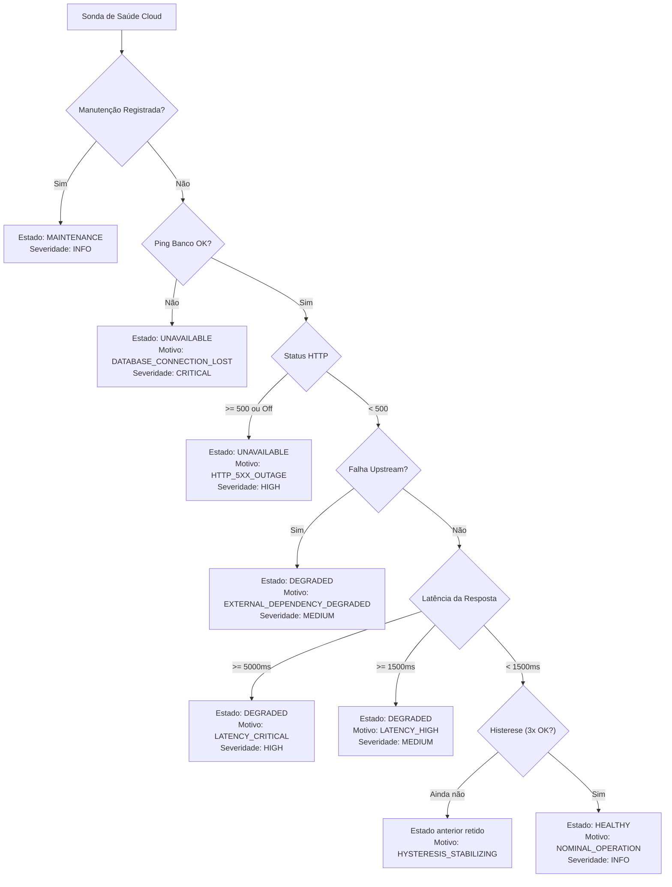

# ELÉTRICAI INDUSTRIAL OS — GATE 3.7
## DOCUMENTO 2: SAÚDE E CONFIABILIDADE DOS SERVIÇOS CLOUD

---

**Normas:** SRE Google, IEC 62443-4-2, RFC 7231  
**Responsabilidade:** Avaliação Contínua da Camada Central ElétricAi Cloud  

---

## 1. ESCOPO DA AVALIAÇÃO CLOUD

A camada Cloud do ElétricAi é avaliada determinística e continuamente em seus três componentes essenciais:
1. **APIs e Server Functions:** Endpoints de ingestão telemétrica e chamadas RPC TanStack Start.
2. **Banco de Dados (PostgreSQL / Supabase):** Conectividade do pool, latência de transação e integridade RLS.
3. **Serviços Dependentes Upstream:** APIs de inteligência artificial (Google Gemini) e serviços externos.

---

## 2. REGRAS DE CLASSIFICAÇÃO DETERMINÍSTICA

---

## 3. THRESHOLDS E INDICADORES OPERACIONAIS

| Métrica | Limiar de Alerta | Limiar Crítico | Ação Operacional |
| :--- | :--- | :--- | :--- |
| **Latência HTTP p95** | $\ge 1.500\text{ ms}$ | $\ge 5.000\text{ ms}$ | Diagnosticar pool de conexões e rotas lentas. |
| **Taxa de Erro 5xx** | $> 0.1\%$ | $> 1.0\%$ | Acionar incidente automático de infraestrutura. |
| **Latência de Pool DB** | $\ge 100\text{ ms}$ | $\ge 500\text{ ms}$ | Verificar saturação de workers e locks residuais. |
| **Upstream AI Outage** | 1 falha de timeout | 3 falhas consecutivas | Isolar dependência sem derrubar os serviços industriais. |
