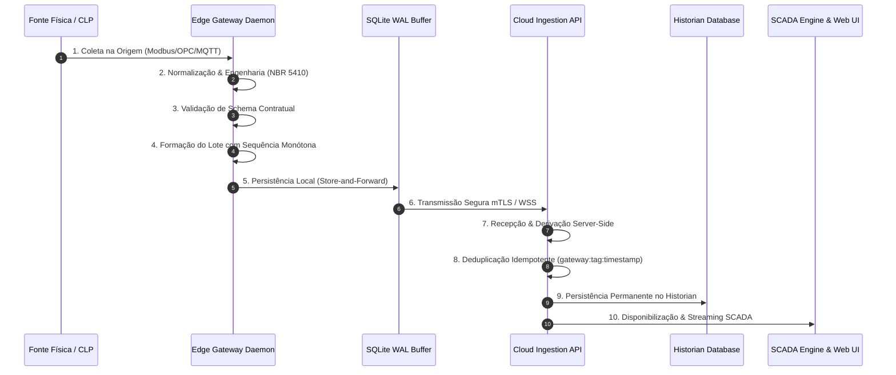

# ELÉTRICAI INDUSTRIAL OS — GATE 3.7
## DOCUMENTO 5: CONFIABILIDADE DE PIPELINE DE DADOS & DEADBAND

---

**Normas:** ISA-95 Part 2, ISA-18.2, IEC 62443  
**Garantia Central:** Rastreabilidade Ponta a Ponta através dos 10 Estágios Industriais  

---

## 1. OS 10 ESTÁGIOS FORMAIS DO PIPELINE

---

## 2. PRESERVAÇÃO DE METADADOS & NÃO-REPÚDIO

Cada amostra telemétrica preserva estritamente:
- `tag_id` (UUID canônico imutável).
- `equipment_id` (UUID canônico do ativo elétrico).
- `gateway_id` (Identificador do gateway autenticado).
- `plant_id` e `tenant_id` (Fronteiras multi-tenant).
- `sourceTimestamp` (Momento exato da leitura na borda).
- `ingestionTimestamp` (Momento da gravação no Cloud).
- `sequenceNumber` (Contador monótono incremental por tag).
- `quality` (`GOOD`, `BAD`, `UNCERTAIN`, `STALE`, `NOT_CONNECTED`, `FORCED`).
- `provenance` (`PHYSICAL_DATA`, `CALCULATED`, `INTERNAL_RUNTIME`, etc.).

> [!IMPORTANT]
> O `sourceTimestamp` NUNCA é substituído pelo `ingestionTimestamp`. A sequência original NUNCA é reescrita para camuflar pacotes fora de ordem.

---

## 3. TRATAMENTO DE DEADBAND VS STALE_DATA

Uma tag cujo valor permaneceu estático devido à filtragem por banda morta (deadband de ruído de leitura) **NÃO PODE** ser classificada como defeituosa ou parada.

O motor distingue formalmente:
1. **DEADBAND_UNCHANGED:** A fonte está conectada e comunicando normalmente; a variação do valor esteve dentro do limiar de histerese $\Delta V < \text{Deadband}$. O estado do componente permanece `HEALTHY`.
2. **STALE_DATA_TIMEOUT:** O tempo decorrido desde o último registro excedeu $\max(3 \times \text{ScanRate}, 30.000\text{ ms})$ SEM flag de supressão por deadband. O estado transiciona para `DEGRADED`.
3. **NOT_CONNECTED:** A fonte física ou o driver perdeu comunicação com o equipamento. O estado transiciona para `UNAVAILABLE`.
