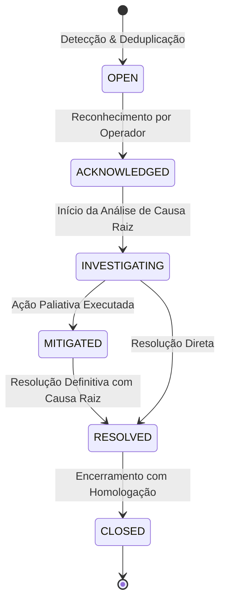

# ELÉTRICAI INDUSTRIAL OS — GATE 3.7
## DOCUMENTO 6: GESTÃO DE INCIDENTES OPERACIONAIS E RASTREABILIDADE

---

**Normas:** ITIL v4 Industrial, ISA-18.2, IEC 62443-4-2  
**Princípio:** Separação Categórica, Deduplicação Inteligente e Auditoria Imutável  

---

## 1. SEPARAÇÃO CATEGÓRICA DE EVENTOS

O ElétricAi separa com rigor estrutural quatro tipos de eventos para evitar que ruído de infraestrutura polua a operação de fábrica:

1. **Alarme Industrial (`INDUSTRIAL_PROCESS`):** Condições anormais de grandezas de processo ou segurança elétrica (ex: corrente térmica acima do disjuntor, sobretensão NBR 5410, nível de reservatório crítico). Gerenciado segundo a norma ISA-18.2.
2. **Alerta de Infraestrutura (`INFRASTRUCTURE`):** Condições de hardware, sistema operacional e conectividade (ex: uso de disco em 93%, timeout Modbus, saturação de memória RAM).
3. **Alerta de Segurança (`SECURITY_EVENT`):** Ocorrências de proteção cibernética (ex: certificado revogado, tentativa de login inválido, acesso cross-tenant bloqueado, rejeição de manifesto).
4. **Incidente Operacional (`INCIDENT`):** Ocorrência consolidada que demanda investigação, acompanhamento e ação de mitigação por engenheiros ou operadores.

---

## 2. CICLO DE VIDA DO INCIDENTE & TRANSIÇÕES DE ESTADO

### Regras do Ciclo de Vida:
- **Proibição de Exclusão:** Incidentes e transições NÃO podem ser apagados do banco de dados (preservação histórica obrigatória).
- **Resolução Obrigatória:** A transição para o estado `RESOLVED` exige obrigatoriamente a descrição formal da causa raiz e da ação de correção executada.
- **Cadeia de Custódia SHA-256:** Cada transição de status gera um hash encadeado ligando o registro atual ao anterior. Qualquer tentativa de adulteração de nota, ator ou timestamp quebra a cadeia e é imediatamente detectada pela função `verifyIncidentAuditIntegrity`.
