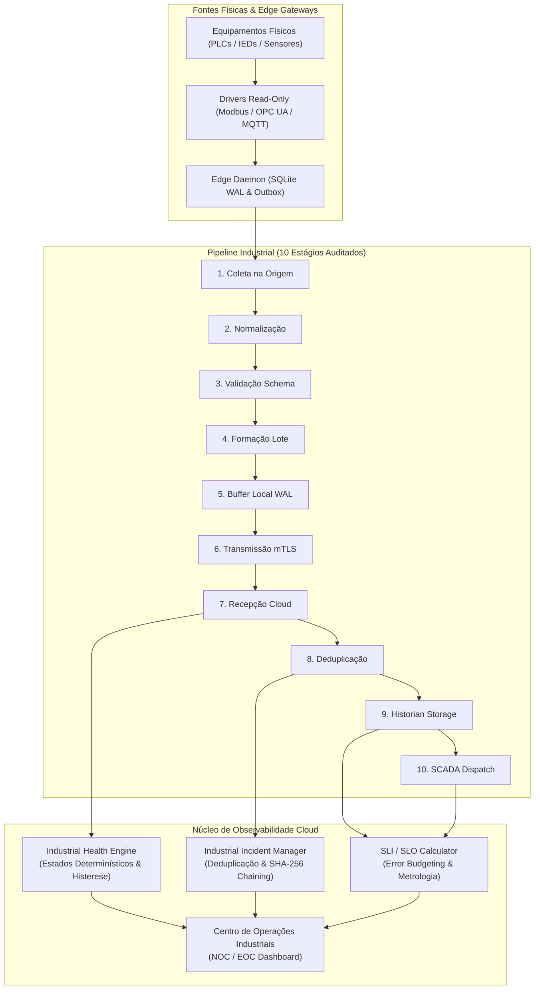

# ELÉTRICAI INDUSTRIAL OS — GATE 3.7
## INDUSTRIAL OBSERVABILITY, RELIABILITY & OPERATIONAL INTELLIGENCE
### DOCUMENTO 1: ARQUITETURA GERAL DE OBSERVABILIDADE INDUSTRIAL

---

**Versão:** 3.7.0  
**Data:** 2026-11-08  
**Classificação:** Arquitetura Técnica Transversal  
**Normas:** IEC 62443, NIST SP 800-82 Rev. 3, OpenTelemetry Semantic Conventions, SRE Google  
**Regra Permanente:** `IS_PHYSICAL_CONTROL_ALLOWED = false` (Somente Leitura e Monitoramento)  

---

## 1. VISÃO E ESCOPO

O Gate 3.7 eleva o ElétricAi Industrial OS a uma plataforma corporativa com observabilidade contínua de ponta a ponta, monitorando e correlacionando os 12 pilares do ecossistema:
1. **ElétricAi Cloud:** Aplicações, APIs, Server Functions, Filas e IA.
2. **ElétricAi Edge:** Daemon Linux/POSIX, SQLite WAL, Process Health e Watchdog.
3. **Edge Fleet:** Gerenciamento multi-gateway, rotação mTLS e heartbeat.
4. **Equipamentos e Fontes Industriais:** Motores, transformadores, painéis CCM, IEDs e PLCs.
5. **Conectividade Industrial:** Drivers Modbus TCP, OPC UA e MQTT Sparkplug B.
6. **Pipeline de Aquisição de Dados:** 10 estágios rastreados com garantia de não-repúdio.
7. **SCADA:** Telas em tempo real, streaming de tags e alarmes ISA-18.2.
8. **Alarmes:** Classificação categórica (Industrial vs Infraestrutura vs Segurança).
9. **Historian:** Gravação de séries temporais particionadas e integridade de consultas.
10. **Autenticação e Segurança:** Derivação server-side de tenant/plant e auditoria imutável.
11. **Banco de Dados:** Supabase PostgreSQL com RLS ativo e diagnóstico de pool.
12. **Engenharia e Projetos:** Validações normativas NBR 5410, solver elétrico e IEC 61131-3.

---

## 2. PILARES DA OBSERVABILIDADE INDUSTRIAL

| Pilar | Descrição Técnica | Implementação no ElétricAi |
| :--- | :--- | :--- |
| **Métricas** | Séries temporais numéricas de desempenho, consumo de recursos e contadores de eventos com baixa cardinalidade. | `HealthThresholdProfile`, contadores de pipeline e taxas de erro HTTP. |
| **Logs Estruturados** | Registros JSON canonizados com contexto de tenant, planta, componente e mascaramento de segredos. | `error-capture.ts` com sanitização por regex de senhas, JWTs e chaves. |
| **Distributed Tracing** | Propagação de `correlationId` desde a borda até o SCADA e banco de dados. | `EdgeSamplePayload.correlationId` e `IndustrialIncident.correlationId`. |
| **Health Checks** | Avaliação determinística baseada em evidências positivas com histerese contra oscilações. | `IndustrialHealthEngine` (6 estados: `HEALTHY`, `DEGRADED`, `UNAVAILABLE`, `UNKNOWN`, `MAINTENANCE`, `NOT_INSTRUMENTED`). |
| **Gestão de Incidentes** | Triagem, atribuição, resolução auditada e correlação de eventos. | `IndustrialIncidentManager` com histórico imutável SHA-256. |
| **SLI / SLO** | Medição de disponibilidade com fórmulas explícitas e expurgo formal de manutenções. | `SliSloCalculator` com error budgets configuráveis. |
