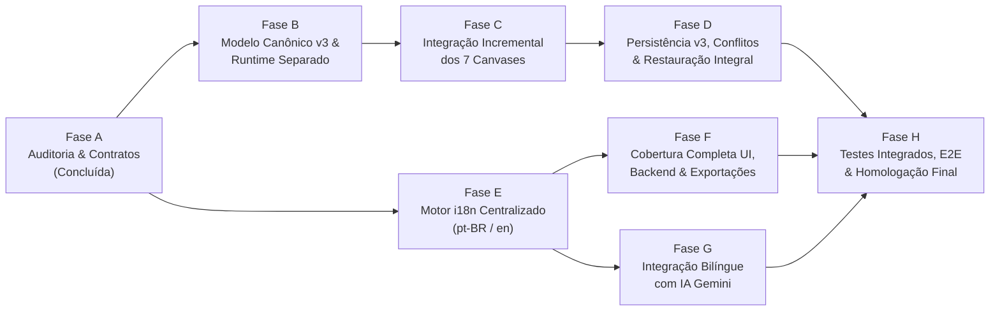

# Plano de Implementação: Arquitetura Unificada de Engenharia e Internacionalização (`pt-BR` / `en`)

> **Status:** Roadmap Executivo (Fases A a H)  
> **Estratégia:** Evolução incremental sobre a arquitetura existente do ElétricAi (sem reescrita destrutiva), ordenada por dependência técnica e minimização de risco de regressão.

---

## Visão Geral das Fases e Dependências

| Fase | Escopo Principal | Dependências | Risco | Esforço Estimado |
| :--- | :--- | :--- | :--- | :--- |
| **Fase A** | Auditoria arquitetural, inventário i18n e especificação de contratos | Nenhuma | Baixo | Concluída |
| **Fase B** | `UnifiedProjectDoc` (v3), separação `useRuntimeStore` e fachada sobre stores existentes | Fase A | Médio | Concluída |
| **Fase C** | Integração real entre Unifilar, Multifilar, Ladder, FBD, PLC, SCADA, Simulação, Twin e Estudos | Fase B | Alto | Concluída |
| **Fase D** | Persistência atômica v3 no Supabase, controle de concorrência, versionamento e DXF/PDF | Fase B, Fase C | Médio | 2 sessões |
| **Fase E** | Motor i18n tipado (`pt-BR` default / `en`), persistência de idioma (`profiles.locale` + `localStorage`) e detector de chaves faltantes | Fase A | Baixo | 1 a 2 sessões |
| **Fase F** | Tradução integral de Rotas, Canvases, Catálogos, Erros de Servidor e Relatórios PDF/DXF | Fase E | Médio | 3 a 4 sessões |
| **Fase G** | Prompts e respostas bilíngues da IA Gemini com preservação de IDs/enums/tags | Fase B, Fase E | Baixo | 1 sessão |
| **Fase H** | Suíte completa de testes de integração cross-canvas, concorrência, i18n e homologação E2E | Fases C, D, F, G | Baixo | 2 sessões |

---

## Fase A — Auditoria do Estado Atual e Especificação (Concluída)

- **Entregáveis Produzidos:**
  - [`docs/architecture/UNIFIED_ENGINEERING_MODEL.md`](file:///c:/Users/98911/Desktop/eletric/eletricaip/docs/architecture/UNIFIED_ENGINEERING_MODEL.md)
  - [`docs/architecture/CANVAS_INTEGRATION_CONTRACTS.md`](file:///c:/Users/98911/Desktop/eletric/eletricaip/docs/architecture/CANVAS_INTEGRATION_CONTRACTS.md)
  - [`docs/i18n/INTERNATIONALIZATION_AUDIT.md`](file:///c:/Users/98911/Desktop/eletric/eletricaip/docs/i18n/INTERNATIONALIZATION_AUDIT.md)
  - [`docs/plans/UNIFIED_MODEL_AND_I18N_ROADMAP.md`](file:///c:/Users/98911/Desktop/eletric/eletricaip/docs/plans/UNIFIED_MODEL_AND_I18N_ROADMAP.md)
  - [`docs/testing/CROSS_CANVAS_AND_I18N_TEST_PLAN.md`](file:///c:/Users/98911/Desktop/eletric/eletricaip/docs/testing/CROSS_CANVAS_AND_I18N_TEST_PLAN.md)
- **Critério de Aceitação:** Aprovação explícita do usuário antes de qualquer modificação em `src/`.

---

## Fase B — Contrato do Modelo Técnico Unificado e Separação de Runtime (Concluída)

### Arquivos e Módulos Existentes Afetados
- [`src/lib/diagram/schema.ts`](file:///c:/Users/98911/Desktop/eletric/eletricaip/src/lib/diagram/schema.ts)
- [`src/lib/diagram/store.ts`](file:///c:/Users/98911/Desktop/eletric/eletricaip/src/lib/diagram/store.ts)
- [`src/lib/project-store.ts`](file:///c:/Users/98911/Desktop/eletric/eletricaip/src/lib/project-store.ts)
- [`src/lib/editor/store.ts`](file:///c:/Users/98911/Desktop/eletric/eletricaip/src/lib/editor/store.ts)
- [`src/lib/plc/store.ts`](file:///c:/Users/98911/Desktop/eletric/eletricaip/src/lib/plc/store.ts)
- [`src/lib/digital-twin-store.ts`](file:///c:/Users/98911/Desktop/eletric/eletricaip/src/lib/digital-twin-store.ts)

### Novos Módulos Propostos
- `src/lib/model/unified-schema.ts`: Schemas Zod e tipos TypeScript para `UnifiedProjectDoc` (v3), `CanonicalEquipment`, `CanonicalTerminal`, `ElectricalConnection`, `CanonicalCircuit`, `CanonicalTag`, `ControlBinding`, `EngineeringStudyRecord` e `ModelDiagnostic`.
- `src/lib/model/unified-store.ts`: Store canônica (`useUnifiedProjectStore`) com ações transacionais (`upsertEquipment`, `updateEquipmentSpecs`, `connectTerminals`, `upsertTag`, `bindControl`, `recordDiagnostic`).
- `src/lib/model/runtime-store.ts`: Store efêmera (`useRuntimeStore`) isolando o estado de simulação a 60 Hz (`tagValues`, `energizedEquipmentIds`, `ladderScanState`, `fbdSimSnapshot`, `telemetryBuffers`), garantindo **zero mutações de `dirty` durante simulação**.
- `src/lib/model/migration-v2-to-v3.ts`: Conversor bidirecional lossless `upgradeSnapshotV2ToV3` e `projectLegacyViewsFromV3` para manter as stores existentes funcionando sem quebrar testes legados.

### Riscos e Mitigações
- **Risco:** Quebra de componentes que consomem seletores legados (`useProjectStore`, `useDiagramStore`, `useEditorStore`).
- **Mitigação:** Manter as assinaturas públicas das stores existentes sincronizadas com `useUnifiedProjectStore` via bridge de projeção síncrona.

### Critérios de Aceitação e Testes
- `tsc --noEmit` com 0 erros.
- Todos os 352 testes existentes continuam passando.
- Novo teste unitário `src/__tests__/unified-model-v3.test.ts` validando criação, migração `v2 → v3` e ausência de `dirty = true` ao disparar ticks no `useRuntimeStore`.

---

## Fase C — Integração Incremental dos Canvases (Concluída)

### C.1 Unifilar ↔ Multifilar (`WebglCanvas`)
- **Arquivos:** [`src/lib/diagram/multifilar.ts`](file:///c:/Users/98911/Desktop/eletric/eletricaip/src/lib/diagram/multifilar.ts), [`src/lib/diagram/schema.ts`](file:///c:/Users/98911/Desktop/eletric/eletricaip/src/lib/diagram/schema.ts), [`src/components/canvases/webgl-canvas.tsx`](file:///c:/Users/98911/Desktop/eletric/eletricaip/src/components/canvases/webgl-canvas.tsx), [`src/components/editor/right-property-panel.tsx`](file:///c:/Users/98911/Desktop/eletric/eletricaip/src/components/editor/right-property-panel.tsx).
- **Alterações:**
  - Adicionar `equipmentId: string` nos nós de `DiagramDoc` e `sourcePortId`/`targetPortId` em `DiagramEdge`.
  - Refatorar `buildMultifilarCommands` para preservar `equipmentId` entre `sheet: "unifilar"` e `sheet: "multifilar"`, atualizando `specs` e `label` de forma incremental sem destruir posições $(x, y)$ manuais no Multifilar.
  - Emitir diagnóstico `MULTIFILAR_PHASE_MISMATCH` quando houver incompatibilidade de fases.

### C.2 Unifilar ↔ Controle Ladder/FBD e Hardware PLC
- **Arquivos:** [`src/lib/unifilar-ladder-bridge.ts`](file:///c:/Users/98911/Desktop/eletric/eletricaip/src/lib/unifilar-ladder-bridge.ts), [`src/components/simulation/unifilar-ladder-bridge-panel.tsx`](file:///c:/Users/98911/Desktop/eletric/eletricaip/src/components/simulation/unifilar-ladder-bridge-panel.tsx), [`src/components/canvases/plc-canvas.tsx`](file:///c:/Users/98911/Desktop/eletric/eletricaip/src/components/canvases/plc-canvas.tsx), [`src/components/canvases/fbd-canvas.tsx`](file:///c:/Users/98911/Desktop/eletric/eletricaip/src/components/canvases/fbd-canvas.tsx), [`src/components/canvases/ladder/rung-grid.tsx`](file:///c:/Users/98911/Desktop/eletric/eletricaip/src/components/canvases/ladder/rung-grid.tsx).
- **Alterações:**
  - Fazer `analyzeUnifilarForLadder` ler os equipamentos e conexões canônicos alimentados pelo `WebglCanvas` (`useDiagramStore` / `useUnifiedProjectStore`), resolvendo o bug de `"Diagrama unifilar vazio"`.
  - Exigir contator/acionamento explícito ou confirmação do usuário via diagnóstico (`CONTROL_BRIDGE_MISSING_CONTACTOR`), proibindo invenção silenciosa.
  - Unificar os blocos de programa (`OB1`, `FC1`, `FB1`) entre `LadderCanvas`, `FbdCanvas` e `PlcCanvas` para que alternar para a aba `PLC` nunca apague rungs ou blocos FBD.
  - Remover o compilador ST duplicado em [`fbd-canvas.tsx`](file:///c:/Users/98911/Desktop/eletric/eletricaip/src/components/canvases/fbd-canvas.tsx#L204-L231), usando exclusivamente [`compileFbdNodesToSt`](file:///c:/Users/98911/Desktop/eletric/eletricaip/src/lib/fbd/editor-bridge.ts).
  - Mover a energização de rungs (`RungGrid`) e snapshot de simulação FBD (`useFbdEngine`) para `useRuntimeStore`.

### C.3 Simulação, SCADA, Digital Twin e Estudos Dependentes
- **Arquivos:** [`src/components/canvases/sim-canvas.tsx`](file:///c:/Users/98911/Desktop/eletric/eletricaip/src/components/canvases/sim-canvas.tsx), [`src/lib/simulation/plant-engine.ts`](file:///c:/Users/98911/Desktop/eletric/eletricaip/src/lib/simulation/plant-engine.ts), [`src/components/canvases/scada-canvas.tsx`](file:///c:/Users/98911/Desktop/eletric/eletricaip/src/components/canvases/scada-canvas.tsx), [`src/components/canvases/twin-canvas.tsx`](file:///c:/Users/98911/Desktop/eletric/eletricaip/src/components/canvases/twin-canvas.tsx), [`src/components/simulation/electrical-study-panel.tsx`](file:///c:/Users/98911/Desktop/eletric/eletricaip/src/components/simulation/electrical-study-panel.tsx).
- **Alterações:**
  - Substituir o matching de tags por substring (`uKey.includes("SPEED")`) em `SimCanvas` e `TwinCanvas` por vínculo canônico `tagId` e `ControlBinding`.
  - Alimentar `plant-engine.ts` e `ElectricalStudyPanel` com os equipamentos reais do projeto (`engineering.equipments`), marcando estudos como `stale` sempre que parâmetros de carga, cabo ou proteção mudarem.

---

## Fase D — Persistência, Versionamento, Conflitos e Recuperação (Concluída ✅)

### Arquivos Afetados
- [`src/lib/use-project-persistence.ts`](file:///c:/Users/98911/Desktop/eletric/eletricaip/src/lib/use-project-persistence.ts)
- [`src/lib/projects.functions.ts`](file:///c:/Users/98911/Desktop/eletric/eletricaip/src/lib/projects.functions.ts)
- [`src/components/industrial-workspace.tsx`](file:///c:/Users/98911/Desktop/eletric/eletricaip/src/components/industrial-workspace.tsx)
- [`src/__tests__/persistence-full-roundtrip.test.ts`](file:///c:/Users/98911/Desktop/eletric/eletricaip/src/__tests__/persistence-full-roundtrip.test.ts)
- [`src/__tests__/persistence-concurrency-conflict.test.ts`](file:///c:/Users/98911/Desktop/eletric/eletricaip/src/__tests__/persistence-concurrency-conflict.test.ts)
- [`src/__tests__/no-render-loops-or-sim-autosave.test.ts`](file:///c:/Users/98911/Desktop/eletric/eletricaip/src/__tests__/no-render-loops-or-sim-autosave.test.ts)
- [`src/__tests__/project-import-export-v3.test.ts`](file:///c:/Users/98911/Desktop/eletric/eletricaip/src/__tests__/project-import-export-v3.test.ts)

### Implementações Entregues
1. **Eliminação do Autosave Fantasma:** Removido o `queueMicrotask` que clonava o `doc` do diagrama após o carregamento em `use-project-persistence.ts`. Adicionada guarda `isHydratingRef` que bloqueia chamadas espúrias de autosave durante toda a reidratação inicial do projeto.
2. **Snapshot v3 Canônico Estrito:** `SnapshotSchema` e `buildProjectSnapshot()` atualizados para a versão 3 do schema, incluindo `twin` (`mappings`, `nameplates`, `modelUrl`), `studies`, `controlBindings`, `diagnostics` e `unifiedDoc`.
3. **Controle de Concorrência Otimista (OCC):**
   - Implementado `expectedVersion` e verificação no servidor em `saveProjectRecord` / `saveProject`. Se outra sessão alterou o projeto, o servidor rejeita o salvamento com `VERSION_CONFLICT: O projeto foi alterado no servidor`.
   - A versão do diagrama avança monotonicamente (`nextVersion = (existing.version ?? 1) + 1`).
   - Flag `force: true` permite resolução explícita de sobreposição de versão pelo usuário.
   - Interface de resolução com modal interativo (`Dialog`) em `industrial-workspace.tsx` com as opções "Recarregar do servidor" e "Sobrescrever servidor".
4. **Exportação e Importação Determinística de Pacote:**
   - Criados `ProjectPackageSchema`, `exportProjectPackageData` / `exportProjectPackage` e `importProjectPackageData` / `importProjectPackage` validando o arquivo de pacote `.eletricai` serializado com schema Zod estrito v3.
5. **Cobertura de Testes Automatizados (Fase D):**
   - `persistence-full-roundtrip.test.ts`: Valida round-trip perfeito `load(save(doc)) === doc` sem perda de equipamentos, terminais, tags, estudos, gêmeo digital ou layouts.
   - `persistence-concurrency-conflict.test.ts`: Valida rejeição estrita de concorrência com `VERSION_CONFLICT` e bypass via `force: true`.
   - `no-render-loops-or-sim-autosave.test.ts`: Valida 0 autosaves no carregamento e 0 gravações durante 120 ciclos contínuos de simulação a 60 Hz.
   - `project-import-export-v3.test.ts`: Valida exportação e importação determinística com Zod.

---

## Fase E — Internacionalização Centralizada (`pt-BR` e `en`) [Concluída ✅]

### Entregas Implementadas
- Motor nativo i18n em TypeScript strict + Zustand (`src/lib/i18n/`) com zero dependências externas pesadas e compatível com SSR/TanStack Start.
- `src/lib/i18n/types.ts`: `SupportedLocale = "pt-BR" | "en"` com normalização de `"en-US"` legado e tipagem recursiva `TranslationCatalog` baseada no catálogo mestre.
- `src/lib/i18n/catalogs/pt-BR.ts` e `src/lib/i18n/catalogs/en.ts`: Catálogos 100% simétricos validados pelo compilador TypeScript (zero chaves ausentes).
- `src/lib/i18n/store.ts`: Persistência atômica em `localStorage` (`eletricai-locale`), atualização de `document.documentElement.lang`, sincronização em background com `profiles.locale` no Supabase sem reload nem perda de estado do canvas, e método `t(key, params)` com notação ponto e interpolação.
- `src/lib/i18n/format.ts`: Funções de formatação localizada (`formatNumber`, `formatCurrency`, `formatDate`, `formatRelativeTime`) respeitando padrões internacionais e ABNT sem tocar em grandezas e unidades de engenharia.
- `src/lib/i18n/missing-key-detector.ts`: Registrador em memória para captura de chaves ausentes ou requisições inválidas em dev e testes.
- `src/__tests__/i18n-store-and-catalogs.test.ts`: 7 testes unitários cobrindo simetria de catálogos, interpolação, normalização, detecção de chaves ausentes e formatação.

---

## Fase F — Cobertura Completa de Português (`pt-BR`) e Inglês (`en`) [Concluída ✅]

### Entregas Implementadas
1. **Seletor de Idioma e Shell:**
   - Criado `src/components/language-switcher.tsx` acessível e integrado diretamente na `topbar.tsx`.
   - Seletor unificado nas páginas de configurações (`settings.appearance.tsx` e `settings.profile.tsx`).
   - Abas e navegação localizadas: `app-sidebar.tsx`, `mode-tabs.tsx`, `right-panel.tsx`, `bottom-panel.tsx`.
2. **Canvases e Sidebars Técnicos:**
   - `alarms-canvas.tsx`: Cabeçalhos ISA-18.2, status, badges, botões de reconhecimento e estampas de tempo traduzidos e formatados via `formatDate(..., locale)`.
   - `rung-grid.tsx`: Botões de scan ("Simular" / "Simulate"), compilação, histórico, importação de programas ST/IL, colunas e badges de energização.
   - `editor-unifilar-sidebar.tsx` e `editor-ladder-sidebar.tsx`: Títulos de categorias, caixas de busca e validações locais de disjuntores traduzidas.
3. **Páginas de Negócio e Hub de Projetos:**
   - `src/routes/projects.tsx`: Listagem, filtros por status, busca, diálogo de criação, cards de projetos, alertas de exclusão/arquivamento e formatação de datas.
   - `src/routes/projects.$projectId.bom.tsx`: Título, total estimado formatado em BRL/USD com `formatCurrency`, colunas da tabela de materiais, ações manuais e de geração por canvas.
   - `src/routes/catalog.tsx`: Catálogo geral de componentes com busca, seletor de categorias e estados vazios localizados.
   - `src/routes/dashboard.tsx`: Saudação dinâmica sensível ao horário e idioma ("Good morning", "Bom dia"), contadores de KPI e formatação da data atual.
4. **Exportações Técnicas Bilíngues:**
   - `src/lib/pdf-export.ts`: Memorial Descritivo e de Cálculo (`Engineering Report`), Lista de Materiais Consolidada (BOM) e disclaimer normativo gerados em `pt-BR` ou `en` conforme parâmetro `locale`.
   - `src/lib/dxf-export.ts`: Esquemas e carimbos DXF bilíngues com camadas ABNT/ISO padronizadas.
   - `src/routes/projects.$projectId.export.tsx`: Opções de exportação e download localizados.
5. **Invariância de Símbolos Técnicos:**
   - Garantida rigorosamente a estabilidade de identificadores de projeto (`tagCode` como `QF1`, `KM1`, `M1`), endereços PLC (`%I0.0`, `%Q0.0`, `%MW10`), mnemônicos IEC 61131-3 (`TON`, `TOF`, `PID`) e normas técnicas (`NBR 5410`, `IEC 60909`).
6. **Bateria de Testes:**
   - `src/__tests__/i18n-ui-and-exports.test.ts` e `src/__tests__/i18n-store-and-catalogs.test.ts` integrados à suite contínua (389 testes passando em 54 arquivos de teste).

---

## Fase G — Integração de Idioma com a IA Gemini

### Arquivos Afetados
- [`src/lib/diagram/ai.functions.ts`](file:///c:/Users/98911/Desktop/eletric/eletricaip/src/lib/diagram/ai.functions.ts)
- [`src/lib/ai-architect.functions.ts`](file:///c:/Users/98911/Desktop/eletric/eletricaip/src/lib/ai-architect.functions.ts)
- [`src/components/canvas-ai-chat.tsx`](file:///c:/Users/98911/Desktop/eletric/eletricaip/src/components/canvas-ai-chat.tsx)

### Alterações Propostas
1. Incluir `locale: "pt-BR" | "en"` no payload das server functions de IA.
2. Instruir o System Prompt do Gemini a:
   - Responder explicações, justificativas normativas, resumos (`summary`) e alertas no idioma `locale` (ou no idioma explicitamente pedido pelo usuário no prompt).
   - **Manter estritamente invariantes** todos os `type` de catálogo (`disjuntor_3p`, `motor_3p`, etc.), enums de schema (`sheet`, `kind`), endereços IEC (`%I0.0`, `%Q0.0`) e chaves JSON do patch validado por Zod.
3. Unificar a aplicação de patches de IA para que o [`CanvasAiChat`](file:///c:/Users/98911/Desktop/eletric/eletricaip/src/components/canvas-ai-chat.tsx) grave no `UnifiedProjectDoc` (atualizando simultaneamente o diagrama e os equipamentos/tags canônicos).

---

## Fase H — Testes Integrados, Regressão e Homologação

- Execução integral do plano de testes definido em [`docs/testing/CROSS_CANVAS_AND_I18N_TEST_PLAN.md`](file:///c:/Users/98911/Desktop/eletric/eletricaip/docs/testing/CROSS_CANVAS_AND_I18N_TEST_PLAN.md):
  - Paridade de chaves `pt-BR` vs `en` em tempo de compilação e em teste automatizado.
  - Testes de integração cross-canvas (Unifilar ↔ Multifilar ↔ Ladder/FBD ↔ PLC ↔ Simulação ↔ SCADA ↔ Digital Twin ↔ Estudos).
  - Testes de persistência round-trip e detecção de conflitos de versão.
  - Testes anti-loop de renderização e zero autosaves durante simulação.
  - Verificação de exportação de PDF/DXF e respostas de IA em `pt-BR` e `en`.
