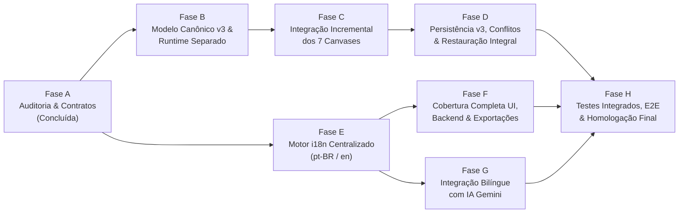

# Plano de Implementação: Arquitetura Unificada de Engenharia e Internacionalização (`pt-BR` / `en`)

> **Status:** Roadmap Executivo (Fases A a H)  
> **Estratégia:** Evolução incremental sobre a arquitetura existente do ElétricAi (sem reescrita destrutiva), ordenada por dependência técnica e minimização de risco de regressão.

---

## Visão Geral das Fases e Dependências

| Fase | Escopo Principal | Dependências | Risco | Esforço Estimado |
| :--- | :--- | :--- | :--- | :--- |
| **Fase A** | Auditoria arquitetural, inventário i18n e especificação de contratos | Nenhuma | Baixo | Concluída |
| **Fase B** | `UnifiedProjectDoc` (v3), separação `useRuntimeStore` e fachada sobre stores existentes | Fase A | Médio | 2 a 3 sessões |
| **Fase C** | Integração real entre Unifilar, Multifilar, Ladder, FBD, PLC, SCADA, Simulação, Twin e Estudos | Fase B | Alto | 4 a 5 sessões |
| **Fase D** | Persistência atômica v3 no Supabase, controle de concorrência, versionamento e DXF/PDF | Fase B, Fase C | Médio | 2 sessões |
| **Fase E** | Motor i18n tipado (`pt-BR` default / `en`), persistência de idioma (`profiles.locale` + `localStorage`) e detector de chaves faltantes | Fase A | Baixo | 1 a 2 sessões |
| **Fase F** | Tradução integral de Rotas, Canvases, Catálogos, Erros de Servidor e Relatórios PDF/DXF | Fase E | Médio | 3 a 4 sessões |
| **Fase G** | Prompts e respostas bilíngues da IA Gemini com preservação de IDs/enums/tags | Fase B, Fase E | Baixo | 1 sessão |
| **Fase H** | Suíte completa de testes de integração cross-canvas, concorrência, i18n e homologação E2E | Fases C, D, F, G | Baixo | 2 sessões |

---

## Fase A — Auditoria do Estado Atual e Especificação (Concluída)

- **Entregáveis Produzidos:**
  - [`docs/architecture/UNIFIED_ENGINEERING_MODEL.md`](file:///c:/Users/98911/Desktop/eletric/eletricaip/docs/architecture/UNIFIED_ENGINEERING_MODEL.md)
  - [`docs/architecture/CANVAS_INTEGRATION_CONTRACTS.md`](file:///c:/Users/98911/Desktop/eletric/eletricaip/docs/architecture/CANVAS_INTEGRATION_CONTRACTS.md)
  - [`docs/i18n/INTERNATIONALIZATION_AUDIT.md`](file:///c:/Users/98911/Desktop/eletric/eletricaip/docs/i18n/INTERNATIONALIZATION_AUDIT.md)
  - [`docs/plans/UNIFIED_MODEL_AND_I18N_ROADMAP.md`](file:///c:/Users/98911/Desktop/eletric/eletricaip/docs/plans/UNIFIED_MODEL_AND_I18N_ROADMAP.md)
  - [`docs/testing/CROSS_CANVAS_AND_I18N_TEST_PLAN.md`](file:///c:/Users/98911/Desktop/eletric/eletricaip/docs/testing/CROSS_CANVAS_AND_I18N_TEST_PLAN.md)
- **Critério de Aceitação:** Aprovação explícita do usuário antes de qualquer modificação em `src/`.

---

## Fase B — Contrato do Modelo Técnico Unificado e Separação de Runtime

### Arquivos e Módulos Existentes Afetados
- [`src/lib/diagram/schema.ts`](file:///c:/Users/98911/Desktop/eletric/eletricaip/src/lib/diagram/schema.ts)
- [`src/lib/diagram/store.ts`](file:///c:/Users/98911/Desktop/eletric/eletricaip/src/lib/diagram/store.ts)
- [`src/lib/project-store.ts`](file:///c:/Users/98911/Desktop/eletric/eletricaip/src/lib/project-store.ts)
- [`src/lib/editor/store.ts`](file:///c:/Users/98911/Desktop/eletric/eletricaip/src/lib/editor/store.ts)
- [`src/lib/plc/store.ts`](file:///c:/Users/98911/Desktop/eletric/eletricaip/src/lib/plc/store.ts)
- [`src/lib/digital-twin-store.ts`](file:///c:/Users/98911/Desktop/eletric/eletricaip/src/lib/digital-twin-store.ts)

### Novos Módulos Propostos
- `src/lib/model/unified-schema.ts`: Schemas Zod e tipos TypeScript para `UnifiedProjectDoc` (v3), `CanonicalEquipment`, `CanonicalTerminal`, `ElectricalConnection`, `CanonicalCircuit`, `CanonicalTag`, `ControlBinding`, `EngineeringStudyRecord` e `ModelDiagnostic`.
- `src/lib/model/unified-store.ts`: Store canônica (`useUnifiedProjectStore`) com ações transacionais (`upsertEquipment`, `updateEquipmentSpecs`, `connectTerminals`, `upsertTag`, `bindControl`, `recordDiagnostic`).
- `src/lib/model/runtime-store.ts`: Store efêmera (`useRuntimeStore`) isolando o estado de simulação a 60 Hz (`tagValues`, `energizedEquipmentIds`, `ladderScanState`, `fbdSimSnapshot`, `telemetryBuffers`), garantindo **zero mutações de `dirty` durante simulação**.
- `src/lib/model/migration-v2-to-v3.ts`: Conversor bidirecional lossless `upgradeSnapshotV2ToV3` e `projectLegacyViewsFromV3` para manter as stores existentes funcionando sem quebrar testes legados.

### Riscos e Mitigações
- **Risco:** Quebra de componentes que consomem seletores legados (`useProjectStore`, `useDiagramStore`, `useEditorStore`).
- **Mitigação:** Manter as assinaturas públicas das stores existentes sincronizadas com `useUnifiedProjectStore` via bridge de projeção síncrona.

### Critérios de Aceitação e Testes
- `tsc --noEmit` com 0 erros.
- Todos os 352 testes existentes continuam passando.
- Novo teste unitário `src/__tests__/unified-model-v3.test.ts` validando criação, migração `v2 → v3` e ausência de `dirty = true` ao disparar ticks no `useRuntimeStore`.

---

## Fase C — Integração Incremental dos Canvases

### C.1 Unifilar ↔ Multifilar (`WebglCanvas`)
- **Arquivos:** [`src/lib/diagram/multifilar.ts`](file:///c:/Users/98911/Desktop/eletric/eletricaip/src/lib/diagram/multifilar.ts), [`src/lib/diagram/schema.ts`](file:///c:/Users/98911/Desktop/eletric/eletricaip/src/lib/diagram/schema.ts), [`src/components/canvases/webgl-canvas.tsx`](file:///c:/Users/98911/Desktop/eletric/eletricaip/src/components/canvases/webgl-canvas.tsx), [`src/components/editor/right-property-panel.tsx`](file:///c:/Users/98911/Desktop/eletric/eletricaip/src/components/editor/right-property-panel.tsx).
- **Alterações:**
  - Adicionar `equipmentId: string` nos nós de `DiagramDoc` e `sourcePortId`/`targetPortId` em `DiagramEdge`.
  - Refatorar `buildMultifilarCommands` para preservar `equipmentId` entre `sheet: "unifilar"` e `sheet: "multifilar"`, atualizando `specs` e `label` de forma incremental sem destruir posições $(x, y)$ manuais no Multifilar.
  - Emitir diagnóstico `MULTIFILAR_PHASE_MISMATCH` quando houver incompatibilidade de fases.

### C.2 Unifilar ↔ Controle Ladder/FBD e Hardware PLC
- **Arquivos:** [`src/lib/unifilar-ladder-bridge.ts`](file:///c:/Users/98911/Desktop/eletric/eletricaip/src/lib/unifilar-ladder-bridge.ts), [`src/components/simulation/unifilar-ladder-bridge-panel.tsx`](file:///c:/Users/98911/Desktop/eletric/eletricaip/src/components/simulation/unifilar-ladder-bridge-panel.tsx), [`src/components/canvases/plc-canvas.tsx`](file:///c:/Users/98911/Desktop/eletric/eletricaip/src/components/canvases/plc-canvas.tsx), [`src/components/canvases/fbd-canvas.tsx`](file:///c:/Users/98911/Desktop/eletric/eletricaip/src/components/canvases/fbd-canvas.tsx), [`src/components/canvases/ladder/rung-grid.tsx`](file:///c:/Users/98911/Desktop/eletric/eletricaip/src/components/canvases/ladder/rung-grid.tsx).
- **Alterações:**
  - Fazer `analyzeUnifilarForLadder` ler os equipamentos e conexões canônicos alimentados pelo `WebglCanvas` (`useDiagramStore` / `useUnifiedProjectStore`), resolvendo o bug de `"Diagrama unifilar vazio"`.
  - Exigir contator/acionamento explícito ou confirmação do usuário via diagnóstico (`CONTROL_BRIDGE_MISSING_CONTACTOR`), proibindo invenção silenciosa.
  - Unificar os blocos de programa (`OB1`, `FC1`, `FB1`) entre `LadderCanvas`, `FbdCanvas` e `PlcCanvas` para que alternar para a aba `PLC` nunca apague rungs ou blocos FBD.
  - Remover o compilador ST duplicado em [`fbd-canvas.tsx`](file:///c:/Users/98911/Desktop/eletric/eletricaip/src/components/canvases/fbd-canvas.tsx#L204-L231), usando exclusivamente [`compileFbdNodesToSt`](file:///c:/Users/98911/Desktop/eletric/eletricaip/src/lib/fbd/editor-bridge.ts).
  - Mover a energização de rungs (`RungGrid`) e snapshot de simulação FBD (`useFbdEngine`) para `useRuntimeStore`.

### C.3 Simulação, SCADA, Digital Twin e Estudos Dependentes
- **Arquivos:** [`src/components/canvases/sim-canvas.tsx`](file:///c:/Users/98911/Desktop/eletric/eletricaip/src/components/canvases/sim-canvas.tsx), [`src/lib/simulation/plant-engine.ts`](file:///c:/Users/98911/Desktop/eletric/eletricaip/src/lib/simulation/plant-engine.ts), [`src/components/canvases/scada-canvas.tsx`](file:///c:/Users/98911/Desktop/eletric/eletricaip/src/components/canvases/scada-canvas.tsx), [`src/components/canvases/twin-canvas.tsx`](file:///c:/Users/98911/Desktop/eletric/eletricaip/src/components/canvases/twin-canvas.tsx), [`src/components/simulation/electrical-study-panel.tsx`](file:///c:/Users/98911/Desktop/eletric/eletricaip/src/components/simulation/electrical-study-panel.tsx).
- **Alterações:**
  - Substituir o matching de tags por substring (`uKey.includes("SPEED")`) em `SimCanvas` e `TwinCanvas` por vínculo canônico `tagId` e `ControlBinding`.
  - Alimentar `plant-engine.ts` e `ElectricalStudyPanel` com os equipamentos reais do projeto (`engineering.equipments`), marcando estudos como `stale` sempre que parâmetros de carga, cabo ou proteção mudarem.

---

## Fase D — Persistência, Versionamento, Conflitos e Recuperação

### Arquivos Afetados
- [`src/lib/use-project-persistence.ts`](file:///c:/Users/98911/Desktop/eletric/eletricaip/src/lib/use-project-persistence.ts)
- [`src/lib/projects.functions.ts`](file:///c:/Users/98911/Desktop/eletric/eletricaip/src/lib/projects.functions.ts)
- [`src/lib/dxf-export.ts`](file:///c:/Users/98911/Desktop/eletric/eletricaip/src/lib/dxf-export.ts)
- [`src/lib/pdf-export.ts`](file:///c:/Users/98911/Desktop/eletric/eletricaip/src/lib/pdf-export.ts)

### Alterações Propostas
1. Remover o `queueMicrotask` que clona `doc` após o load em `use-project-persistence.ts` (eliminando o autosave fantasma ao abrir projeto).
2. Incluir `views.twin`, `studies`, `controlBindings` e `diagnostics` no `ProjectSnapshot` salvo no Supabase.
3. Adicionar verificação de `expectedVersion` em `saveProject` (`projects.functions.ts`) para detectar conflitos de concorrência (`VERSION_CONFLICT`) e apresentar modal de resolução ao usuário.
4. Garantir exportação e importação determinística de projeto completo com validação Zod v3.

---

## Fase E — Internacionalização Centralizada (`pt-BR` e `en`)

### Diagnóstico da Infraestrutura Existente
- Não há biblioteca externa de i18n em `package.json`.
- Existem dois seletores de idioma desconectados:
  1. [`src/routes/settings.appearance.tsx`](file:///c:/Users/98911/Desktop/eletric/eletricaip/src/routes/settings.appearance.tsx#L33-L45) (`useAppearance.language` em `localStorage` chave `eletricai-appearance`).
  2. [`src/routes/settings.profile.tsx`](file:///c:/Users/98911/Desktop/eletric/eletricaip/src/routes/settings.profile.tsx#L264-L278) (`profiles.locale` no Supabase).

### Solução Recomendada
Consolidar em um motor i18n nativo em TypeScript strict + Zustand (`src/lib/i18n/`), zero dependências pesadas externas, compatível com SSR/TanStack Start:
- `src/lib/i18n/types.ts`: Define `SupportedLocale = "pt-BR" | "en"` (normalizando `"en-US"` legado para `"en"`) e o tipo recursivo de chaves `TranslationKey` derivado de `ptBRCatalog` (`typeof ptBRCatalog`).
- `src/lib/i18n/catalogs/pt-BR.ts` e `src/lib/i18n/catalogs/en.ts`: Catálogos estritamente tipados (o compilador TypeScript falha se `en.ts` omitir qualquer chave presente em `pt-BR.ts`).
- `src/lib/i18n/store.ts`:
  - Idioma inicial padrão: `"pt-BR"`.
  - Para visitantes não autenticados: lê/persiste em `localStorage` (`eletricai-locale`) e sincroniza com `useAppearance`.
  - Para usuários autenticados: sincroniza bidirecionalmente com `profiles.locale` no Supabase sem recarregar a página nem perder estado do canvas.
- `src/lib/i18n/format.ts`: Formatadores `formatNumber(value, locale, options)`, `formatCurrency(value, locale, currency)`, `formatDateTime(date, locale)` usando `Intl.NumberFormat` e `Intl.DateTimeFormat`, mantendo unidades técnicas SI/IEC intactas (`kW`, `kVA`, `mm²`, `A`, `V`, `Hz`, `Ω`).
- `src/lib/i18n/missing-key-detector.ts`: Registra e alerta em dev/test qualquer tentativa de acesso a chave ausente ou texto não traduzido.

---

## Fase F — Cobertura Completa de Português (`pt-BR`) e Inglês (`en`)

### Escopo de Tradução (Baseado no Inventário da Parte 4)
1. **Navegação, Shell e Configurações:** `app-sidebar.tsx`, `topbar.tsx`, `mode-tabs.tsx`, `right-panel.tsx`, `bottom-panel.tsx`, `onboarding-tour.tsx`, todas as rotas `/settings/*`, `/login`, `/signup`, `/dashboard`, `/projects`, `/billing`, `/team`.
2. **Editores, Paletas e Propriedades Técnicas:** `COMPONENT_CATALOG` (`src/lib/diagram/catalog.ts`), `PALETTE` (`src/lib/palette/component-catalog.ts`), `KIND_CATALOG` (`src/lib/project-store.ts`), `RightPropertyPanel`, `LadderCanvas`, `FbdCanvas`, `PlcCanvas`, `ScadaCanvas`, `SimCanvas`, `TwinCanvas`.
   - **Regra Crítica:** Os identificadores técnicos (`tagCode` como `QF1`, `KM1`, `M1`, endereços `%I0.0`, `%Q0.0`, mnemônicos IEC 61131-3 `TON`, `TOF`, `CTU`, `PID`, e códigos de normas `NBR 5410`, `IEC 60909`, `NR-12`) **NÃO são alterados** ao trocar o idioma; apenas rótulos de UI, descrições de catálogo, tooltips e diagnósticos mudam entre `pt-BR` e `en`.
3. **Backend, Validações e Mensagens de Erro:** Códigos de erro estruturados nos `.functions.ts` (`auth`, `billing`, `projects`, `team`, `catalog`) mapeados para mensagens localizadas em `pt-BR` e `en`.
4. **Relatórios, Memoriais e Exportações:** [`src/lib/pdf-export.ts`](file:///c:/Users/98911/Desktop/eletric/eletricaip/src/lib/pdf-export.ts) e [`src/lib/dxf-export.ts`](file:///c:/Users/98911/Desktop/eletric/eletricaip/src/lib/dxf-export.ts) passam a receber `locale: SupportedLocale`, gerando cabeçalhos, tabelas de materiais (BOM), memoriais de cálculo e carimbos ABNT/ISO no idioma escolhido.

---

## Fase G — Integração de Idioma com a IA Gemini

### Arquivos Afetados
- [`src/lib/diagram/ai.functions.ts`](file:///c:/Users/98911/Desktop/eletric/eletricaip/src/lib/diagram/ai.functions.ts)
- [`src/lib/ai-architect.functions.ts`](file:///c:/Users/98911/Desktop/eletric/eletricaip/src/lib/ai-architect.functions.ts)
- [`src/components/canvas-ai-chat.tsx`](file:///c:/Users/98911/Desktop/eletric/eletricaip/src/components/canvas-ai-chat.tsx)

### Alterações Propostas
1. Incluir `locale: "pt-BR" | "en"` no payload das server functions de IA.
2. Instruir o System Prompt do Gemini a:
   - Responder explicações, justificativas normativas, resumos (`summary`) e alertas no idioma `locale` (ou no idioma explicitamente pedido pelo usuário no prompt).
   - **Manter estritamente invariantes** todos os `type` de catálogo (`disjuntor_3p`, `motor_3p`, etc.), enums de schema (`sheet`, `kind`), endereços IEC (`%I0.0`, `%Q0.0`) e chaves JSON do patch validado por Zod.
3. Unificar a aplicação de patches de IA para que o [`CanvasAiChat`](file:///c:/Users/98911/Desktop/eletric/eletricaip/src/components/canvas-ai-chat.tsx) grave no `UnifiedProjectDoc` (atualizando simultaneamente o diagrama e os equipamentos/tags canônicos).

---

## Fase H — Testes Integrados, Regressão e Homologação

- Execução integral do plano de testes definido em [`docs/testing/CROSS_CANVAS_AND_I18N_TEST_PLAN.md`](file:///c:/Users/98911/Desktop/eletric/eletricaip/docs/testing/CROSS_CANVAS_AND_I18N_TEST_PLAN.md):
  - Paridade de chaves `pt-BR` vs `en` em tempo de compilação e em teste automatizado.
  - Testes de integração cross-canvas (Unifilar ↔ Multifilar ↔ Ladder/FBD ↔ PLC ↔ Simulação ↔ SCADA ↔ Digital Twin ↔ Estudos).
  - Testes de persistência round-trip e detecção de conflitos de versão.
  - Testes anti-loop de renderização e zero autosaves durante simulação.
  - Verificação de exportação de PDF/DXF e respostas de IA em `pt-BR` e `en`.
