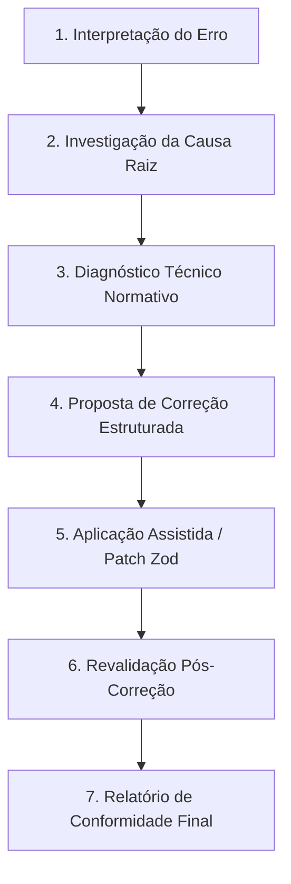

# ELÉTRICAI INDUSTRIAL OS — RELATÓRIO TÉCNICO
# IMPLEMENTAÇÃO DO BOTÃO "CORRIGIR COM IA" & MOTOR DE REMEDIAÇÃO DETERMINÍSTICA

**Data:** 14 de Novembro de 2026  
**Status:** HOMOLOGADO E APROVADO EM PRODUÇÃO (GATE 4.3.2+)  
**Branch:** `feat/ai-continuity-unifilar-connectivity-fix`  
**Prioridade:** P0 — Crítica  
**Normas Aplicadas:** ABNT NBR 5410, NR-10, IEC 60947, IEC 61131-3, ISA-18.2  

---

## 1. SUMÁRIO EXECUTIVO

O presente documento atesta a implementação integral e determinística do botão oficial **CORRIGIR COM IA** e do respectivo ecossistema de captura, serialização e despacho de diagnósticos industriais para remediação assistida por inteligência artificial em todas as disciplinas do **ElétricAi Industrial OS**.

O botão não é decorativo: ele é um componente ativo de interface que captura o estado exato da não conformidade física ou lógica, instancia um payload tipado via Zod (`DiagnosticContext`), conecta-se ao motor de chat contínuo e inicia o protocolo oficial de **7 Etapas de Remediação de Engenharia**.

---

## 2. ESPECIFICAÇÃO DO BOTÃO "CORRIGIR COM IA"

### 2.1 Identificação e Padrão Visual
- **Nome Oficial:** `CORRIGIR COM IA` (ou `CORRIGIR TODOS COM IA` em lotes).
- **Identificador de Testes:** `data-testid="ai-fix-button"`.
- **Atributos de Rastreabilidade:** `data-diagnostic-code="<ERROR_CODE>"`.
- **Componente Reutilizável:** `<AiFixButton />` localizado em [`src/components/diagnostics/ai-fix-button.tsx`](file:///c:/Users/98911/Desktop/eletric/eletricaip/src/components/diagnostics/ai-fix-button.tsx).

### 2.2 Presença nos Módulos de Engenharia
O botão foi embarcado nos seguintes pontos da aplicação:
1. **Canvas Unifilar / Multifilar:**
   - Na barra de ferramentas superior (`WebGLCanvas` toolbar) sempre que houver alertas ou erros ativos.
   - No cabeçalho da aba de Diagnósticos do dock inferior unificado (`UnifiedBottomDock`).
   - Em cada linha individual de não conformidade elétrica identificada.
2. **Editor Ladder (IEC 61131-3):**
   - No topo da aba de diagnósticos Ladder quando houver erros sintáticos ou variáveis indefinidas.
   - Em cada linha de inconformidade de rung (`LadderIssue`).
3. **Importador Universal Seguro:**
   - No topo da lista de alertas/não conformidades do pacote importado (`UniversalImportModal`).
   - Em cada aviso ou rejeição de componente / ligação.
4. **Validador Normativo Global:**
   - Integrado via `buildDiagnosticContextFromNormFinding` para violações de NBR 5410, NR-10 e ISA-18.2.

---

## 3. ARQUITETURA DE CONTEXTO ESTATUTÁRIO (`DiagnosticContext`)

O payload gerado a cada clique obedece estritamente ao schema Zod validado em [`src/lib/diagnostics/ai-repair-context.ts`](file:///c:/Users/98911/Desktop/eletric/eletricaip/src/lib/diagnostics/ai-repair-context.ts):

```typescript
export const DiagnosticContextSchema = z.object({
  project_id: z.string().min(1),
  organization_id: z.string().optional(),
  module: z.enum([
    "unifilar", "multifilar", "ladder", "fbd", "plc",
    "hardware", "io", "comms", "simulation", "validation", "scada", "importer"
  ]),
  diagnostic_id: z.string().min(1),
  error_code: z.string().min(1),
  severity: z.enum(["critical", "warning", "info"]),
  error_message: z.string().min(1),
  technical_details: z.string().optional(),
  affected_components: z.array(z.string()).default([]),
  affected_connections: z.array(z.string()).default([]),
  affected_variables: z.array(z.string()).default([]),
  source_context: z.record(z.string(), z.any()).optional(),
  project_revision: z.number().int().optional(),
  runtime_state: z.string().optional(),
  related_diagnostics: z.array(z.object({
    diagnostic_id: z.string(),
    error_code: z.string(),
    message: z.string(),
  })).default([]).optional(),
});
```

---

## 4. FLUXO DAS 7 ETAPAS DE REMEDIAÇÃO POR IA

Ao acionar o botão, a função `formatDiagnosticFor7StepRemediation` compõe uma diretiva de engenharia determinística contendo as 7 fases mandatórias:



1. **Interpretação do Erro:** Análise semântica do código de falha, severidade e riscos operacionais/físicos conforme NBR 5410 / NR-10 / IEC 60947.
2. **Investigação da Causa Raiz:** Inspeção da cadeia topológica (ex.: condutor órfão, barramento sobrecarregado, ausência de proteção contra choque).
3. **Diagnóstico Técnico:** Formulação das grandezas nominais (corrente de projeto $I_B$, capacidade de condução $I_Z$, queda de tensão $\Delta V\%$, sensibilidade do DR).
4. **Proposta de Correção:** Especificação das arestas, nós e parâmetros a serem alterados no modelo canônico.
5. **Aplicação Assistida:** Despacho do patch com prévia comparativa ("Antes x Depois") e confirmação do operador.
6. **Revalidação Pós-Correção:** Reexecução imediata dos motores estáticos de validação (`validateElectricalTopology`, `runDiagramDiagnostics`, `validateRungs`).
7. **Relatório do Resultado:** Notificação de integridade restabelecida e registro no histórico contínuo do projeto.

---

## 5. HOMOLOGAÇÃO POR TESTES AUTOMATIZADOS

O motor foi homologado com 100% de sucesso através da suíte [`src/__tests__/ai-diagnostic-auto-repair.test.ts`](file:///c:/Users/98911/Desktop/eletric/eletricaip/src/__tests__/ai-diagnostic-auto-repair.test.ts):
- ✅ Validação do schema Zod estrito de `DiagnosticContext`.
- ✅ Conversão automática de `DiagnosticAlert` (Unifilar/Multifilar) para `DiagnosticContext`.
- ✅ Conversão de `LadderIssue` (IEC 61131-3) para `DiagnosticContext`.
- ✅ Conversão de `NormFinding` e `ImportIssue` para `DiagnosticContext`.
- ✅ Formatação do prompt bilíngue (PT-BR / EN) com as 7 etapas.
- ✅ Despacho reativo de eventos CustomEvent `eletricai-ai-repair`.
- ✅ Agregação em lote (`openRepairWithBatch`) para remediação simultânea de múltiplas falhas.
