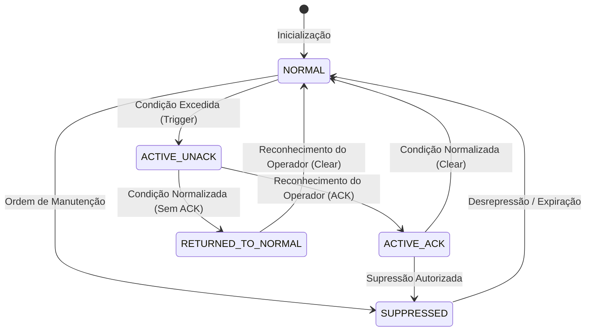

# ELÉTRICAI INDUSTRIAL OS — SCADA SUPERVISÓRIO
## MANUAL DE IMPLEMENTAÇÃO DO ALARM ENGINE (ISA-18.2)

**Documento:** SCADA_ALARM_ENGINE_IMPLEMENTATION.md  
**Status:** APROVADO — GATE 2  
**Normas:** ANSI/ISA-18.2-2016, IEC 62682, EEMUA Publication 191

---

## 1. MÁQUINA DE ESTADOS DETERMINÍSTICA ISA-18.2

O motor de alarmes (`DeterministicAlarmEngine`) implementa a máquina de estados formal conforme especificado na norma internacional ISA-18.2:

### 1.1 Estados Operacionais
1. **NORMAL:** A variável opera dentro das tolerâncias especificadas. Nenhum alarme ativo.
2. **ACTIVE (UNACKNOWLEDGED):** Condição física ultrapassou o limite parametrizado e ainda não foi visualizada/reconhecida pelo operador. Apresenta indicação visual pulsante e sinalização sonora.
3. **ACTIVE (ACKNOWLEDGED):** Condição de alarme permanece fisicamente presente, mas o operador já confirmou ciência através de registro assinado.
4. **RETURNED_TO_NORMAL (UNACKNOWLEDGED):** O processo retornou à faixa segura, mas o operador ainda não reconheceu o evento transitório (retenção obrigatória para auditoria de eventos fugazes).
5. **SUPPRESSED / SHELVED:** Alarme temporariamente retirado de serviço com justificativa técnica registrada para intervenção preventiva ou corretiva.

---

## 2. PARÂMETROS ANALÓGICOS E DINÂMICA DE DISPARO

Cada configuração de alarme (`ExtendedAlarmDefinition`) suporta parametrização detalhada:

### 2.1 Limites de Severidade
- **HH (High-High):** Severidade `CRITICAL`. Condição extrema com potencial de dano material ou risco operacional.
- **H (High):** Severidade `HIGH`. Desvio operacional acima da faixa esperada.
- **L (Low):** Severidade `HIGH` ou `MEDIUM`. Subvazão, subtensão ou nível baixo.
- **LL (Low-Low):** Severidade `CRITICAL`. Cavitação iminente de bombas ou esvaziamento crítico de reservatórios.

### 2.2 Histerese Operacional
Para evitar que uma variável oscilando exatamente sobre o setpoint gere disparos contínuos:
- Alarme de Alta: dispara em $V \ge H$; retorna ao normal apenas quando $V < (H - \text{hysteresis})$.
- Alarme de Baixa: dispara em $V \le L$; retorna ao normal apenas quando $V > (L + \text{hysteresis})$.

### 2.3 Temporizadores DelayOn e DelayOff
- **`delayOnMs`:** Tempo contínuo em que a condição deve permanecer em violação antes de efetivar o disparo (eliminação de transitórios elétricos de partida de motores).
- **`delayOffMs`:** Tempo contínuo em que a condição deve permanecer normalizada antes de transicionar para o estado normal (estabilização de processo).

---

## 3. SUPRESSÃO DE CHATTERING (ALARMES OSCILANTES)

Alarmes que alternam de estado mais de 3 vezes em um intervalo móvel de 10 segundos são classificados como **chattering**:
- O motor marca `isChattering = true` e armazena o contador `chatterCount`.
- O console operacional sinaliza o alarme como instável, prevenindo fadiga de alarmes e permitindo ao operador aplicar ação de `shelve` (prateleira) com tempo de expiração programado.

---

## 4. GESTÃO DE FALHAS DE COMUNICAÇÃO

Quando o runtime de tags detecta que um dispositivo de campo ou protocolo (Modbus TCP, OPC UA, MQTT) entrou em estado de estagnação (`STALE`) ou queda de enlace (`NOT_CONNECTED`):
1. O Alarm Engine gera imediatamente um alarme da classe `COMMUNICATION` com severidade `HIGH`.
2. **Regra de Segurança Fundamental:** Condições físicas de processo pré-existentes (como sobrecorrente no motor M-01) **NÃO são canceladas nem mascaradas** pela perda de telemetria. Ambas as instâncias permanecem ativas simultaneamente no painel do operador até restauração confirmada.
