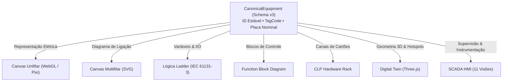

# ELÉTRICAI SCADA — ARQUITETURA CANÔNICA DE EQUIPAMENTOS
# ESPECIFICAÇÃO DE IDENTIDADE E SINGLE SOURCE OF TRUTH

- **Data de Emissão:** 01 de Novembro de 2026
- **Normas Aplicadas:** IEC 61131-3, IEC 60617, ANSI/ISA-5.1, ISA-101
- **Versão do Modelo:** Unified Engineering Schema Version 3

---

## 1. PRINCÍPIO DA SINGLE SOURCE OF TRUTH

Na plataforma ElétricAi Industrial OS, um equipamento industrial possui uma **única identidade persistente** compartilhada entre todos os módulos de projeto e operação:



---

## 2. DIFERENCIAÇÃO ENTRE CONCEITOS

| Conceito | Definição no Sistema | Exemplo |
|---|---|---|
| **Equipamento Canônico** | Ativo físico real com especificações elétricas e mecânicas nominais. | Motor M-01 (75 kW, 380V, 138A) |
| **Nó Gráfico / Símbolo** | Elemento visual posicionado em coordenadas $(x, y)$ de um diagrama específico. | Símbolo de motor no Unifilar |
| **Bloco Lógico** | Função de controle executada no CLP que comanda o equipamento. | Bloco `TON` de partida estrela-triângulo |
| **TAG Canônica** | Variável padronizada de engenharia vinculada a um terminal ou endereço. | `M01.RUNNING`, `M01.CURRENT` |
| **Canal de I/O** | Ponto físico de borne em módulo digital ou analógico do CLP. | Rack 0, Slot 2, Canal DI_0 |
| **Widget SCADA** | Componente HMI visual na tela de operação (bomba animada, gauge, display). | Bomba no sinótico P&ID |

---

## 3. ESTRUTURA DO CANONICAL EQUIPMENT

```typescript
export interface CanonicalEquipment {
  id: string; // Identificador unívoco e estável
  tagCode: string; // TAG de engenharia (ex: P-01, TR-01, M-01)
  displayName: string; // Nome descritivo (ex: Bomba de Recalque de Lodo 01)
  catalogType: string; // Fabricante / Modelo (ex: WEG W22 Premium IE3)
  category: EquipmentCategory; // drive, source, protection, switching, instrumentation, safety, plc_module
  phases: PhasesConfig; // 3F, 3F+N, 3F+N+PE, 1F, DC
  terminals: CanonicalTerminal[]; // Terminais elétricos (L1, L2, L3, N, PE, etc.)
  specs: EquipmentSpecs; // Potência (kW), Tensão (V), Corrente (A), FP, Curva
  circuitId?: string; // Circuito alimentador de potência
}
```

---

## 4. CICLO DE VIDA E PRESERVAÇÃO

1. **Criação:** Adicionar um motor no Canvas Unifilar gera uma instância em `doc.engineering.equipments[equipmentId]` e cria um nó correspondente em `doc.views.unifilar.nodes[nodeId]`.
2. **Propagação para o SCADA:** A ponte `canonicalToScadaTelemetry` sincroniza o motor com a tabela de equipamentos do SCADA (`useScadaStore.equipments[equipmentId]`), preservando valores nominais e ID.
3. **Remoção de Representação Gráfica:** Se o operador excluir o nó gráfico do Unifilar, apenas `doc.views.unifilar.nodes` tem o elemento removido. A entidade `CanonicalEquipment` permanece intacta no banco de dados e na supervisão, protegendo o histórico de telemetria e vínculos lógicos de CLP.
