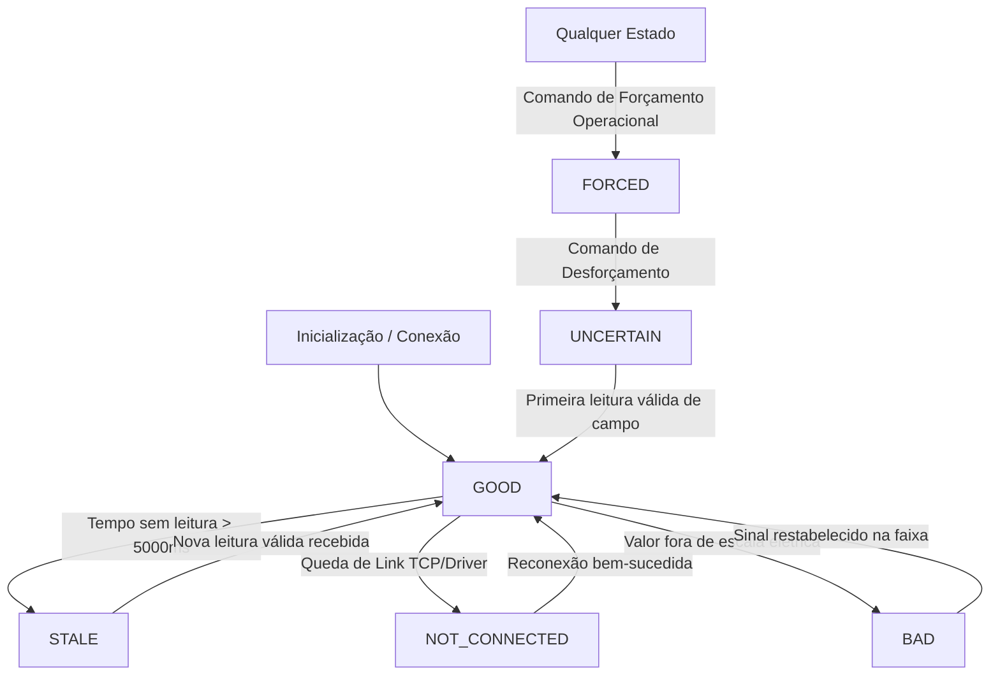

# ELÉTRICAI INDUSTRIAL OS — SCADA SUPERVISÓRIO
## POLÍTICA E MATRIZ DE QUALIDADE DE DADOS INDUSTRIAIS

**Documento:** SCADA_DATA_QUALITY.md  
**Status:** APROVADO — GATE 2  
**Normas:** OPC Unified Architecture (IEC 62541-8: Data Access), ISO 27001

---

## 1. ESTADOS DE QUALIDADE NORMATIVOS

Toda variável de processo no ElétricAi Industrial OS transporta obrigatoriamente um indicador de qualidade de acordo com o padrão internacional OPC UA DA:

| Código de Qualidade | Descrição Técnica | Critério de Transição | Comportamento na Interface |
|---|---|---|---|
| `GOOD` | Leitura válida e confiável | Telemetria recebida dentro do scan rate com verificação de integridade CRC/driver aprovada | Valor exibido em cor normal; curvas contínuas nas tendências |
| `UNCERTAIN` | Dado duvidoso ou em calibração | Variável forçada em desforçamento recente ou sensor fora de calibração | Valor exibido com badge âmbar de advertência |
| `BAD` | Falha de hardware ou sensor corrompido | Erro de paridade, curto-circuito de laço 4-20mA ou leitura fora de escala elétrica | Valor tachado ou exibido como "ERR"; destaque vermelho |
| `STALE` | Sinal estagnado / perda de atualização | Tempo desde a última atualização válida superior ao timeout ($t > 5000\text{ms}$) | Sinalizado como "STALE"; disparo de alarme de comunicação |
| `NOT_CONNECTED` | Enlace de rede rompido | Socket TCP fechado, timeout Modbus ou broker MQTT indisponível | Disparo de alarme crítico de comunicação; retenção de último valor com indicação de desconectado |
| `FORCED` | Imposição manual por operador | Comando de forçamento emitido com autorização RBAC | Destaque magenta com ícone de cadeado forçado e registro em auditoria |

---

## 2. REGRAS DE TRANSIÇÃO E PRIORIDADE DE QUALIDADE

### 2.1 Prevalência do Forçamento Operacional
Quando um operador autorizado força um valor:
1. O valor forçado substitui a leitura de campo no supervisório.
2. O atributo `forced` é marcado como `true`.
3. A qualidade é fixada em `FORCED`.
4. Leituras provenientes de simulador, CLP ou drivers de rede são **estritamente ignoradas** até que o operador emita o comando de desforçamento.
5. O desforçamento transiciona a tag temporariamente para `UNCERTAIN` até que a próxima leitura de campo seja confirmada com integridade.

---

## 3. IMPACTO DA QUALIDADE NAS ANÁLISES HISTÓRICAS

1. **Cálculos de Estatísticas (Min / Max / Média):**
   - Amostras com qualidade `BAD`, `NOT_CONNECTED` ou `STALE` são segregadas nas agregações estatísticas para evitar distorções espúrias (ex: zeros artificiais por desconexão).
2. **Cálculo de Energia (Regra dos Trapézios):**
   - Períodos prolongados com qualidade `STALE` ou `NOT_CONNECTED` são integrados com sinalização explícita de descontinuidade de dados no relatório BDO.
3. **Filtro de Exportação CSV:**
   - O arquivo de exportação inclui a coluna de qualidade individual de cada amostra para assegurar rastreabilidade pericial completa.
