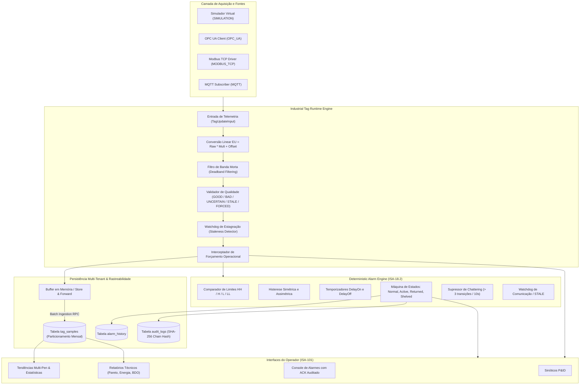

# ELÉTRICAI INDUSTRIAL OS — SCADA SUPERVISÓRIO
## ARQUITETURA TÉCNICA GATE 2: MASTER INDUSTRIAL DATA ENGINE

**Versão:** 2.0.0  
**Data:** 02 de Novembro de 2026  
**Status:** HOMOLOGADO & APROVADO  
**Normas de Referência:** ISA-101 (HMI Systems), ISA-18.2 (Alarm Management), IEC 62443 (Cybersecurity), OPC UA Part 8 (Data Access), ISO 27001 (Audit Trails)

---

## 1. VISÃO GERAL DA ARQUITETURA

O **GATE 2 — MASTER INDUSTRIAL DATA ENGINE** introduz a infraestrutura de dados industriais de alta densidade no ElétricAi, conectando a representação canônica dos equipamentos a um pipeline determinístico de processamento em tempo real, persistência particionada no Historiador e máquina de estados de alarmes em conformidade integral com a norma ISA-18.2.

---

## 2. COMPONENTES PRINCIPAIS IMPLEMENTADOS

### 2.1 Industrial Tag Runtime (`src/lib/scada/tag-runtime.ts`)
- **Responsabilidade:** Motor determinístico de engenharia de variáveis e controle de proveniência.
- **Conversão Linear:** Transforma leitura bruta em unidade de engenharia:
  $$EU = \text{clamp}(Raw \times Multiplier + Offset, ScaleMin, ScaleMax)$$
- **Filtro de Banda Morta (Deadband):** Impede saturação do banco de dados ao descartar micro-oscilações inferiores ao threshold configurado ($\Delta < Deadband$).
- **Detecção de Estagnação (Stale Timeout):** Monitora o intervalo decorrido desde a última telemetria válida. Caso exceda o tempo limite parametrizado ($t_{elapsed} > 5000\text{ms}$), transiciona o estado para `STALE`.
- **Forçamento de TAGs:** Permite imposição de valor por operador com nível RBAC autorizado, marcando a qualidade como `FORCED` e bloqueando sobrescrita automática por drivers de campo.

### 2.2 Deterministic Alarm Engine (`src/lib/scada/alarm-engine.ts`)
- **Responsabilidade:** Mecanismo determinístico de avaliação de alarmes conforme norma ANSI/ISA-18.2 / IEC 62682.
- **Limites Analógicos e Histerese:**
  - Limite High ($H$): dispara em $V \ge H$, retorna ao normal em $V < (H - \text{hysteresis})$.
  - Limite High-High ($HH$): criticidade prioritária para proteção de ativos.
  - Limite Low ($L$): dispara em $V \le L$, retorna em $V > (L + \text{hysteresis})$.
  - Limite Low-Low ($LL$): criticidade de esvaziamento / subtensão.
- **Temporização Determinística (DelayOn / DelayOff):** Condição deve persistir estável pelo tempo configurado antes de alterar o estado, prevenindo falsos positivos por picos transientes.
- **Detecção de Chattering:** Identifica alarmes oscilantes ($> 3$ transições na janela móvel de 10 segundos) e sinaliza flag `isChattering` para filtragem operacional.
- **Falha de Comunicação:** Quando uma variável atinge a qualidade `STALE` ou `NOT_CONNECTED`, o motor dispara alarme da classe `COMMUNICATION` sem descartar ou mascarar as condições físicas de processo pré-existentes.

### 2.3 Persistent Historian (`src/lib/scada/scada.functions.ts`)
- **Responsabilidade:** Ingestão em lote e consultas analíticas de séries temporais com isolamento multi-tenant restrito por RLS.
- **Ingestão (`ingestTagSamplesBatch`):** Insere lotes na tabela `tag_samples`, particionada mensalmente por data da amostra (`sampled_at`), assegurando volume sustentável para plantas industriais de grande porte.
- **Consultas Analíticas (`queryHistorianRange`):** Recupera séries temporais agrupadas por TAG, aplicando downsampling em janelas uniformes (ex: baldes de 1 minuto, 5 minutos, 1 hora) e calculando estatísticas fundamentais: Mínimo, Máximo, Média e Desvio Padrão.

### 2.4 Trilha de Auditoria Criptográfica (Cryptographic Audit Trail)
- **Responsabilidade:** Garantir integridade inviolável dos registros de operação (21 CFR Part 11 / ISO 27001).
- **Cadeia de Hash:** Cada registro em `audit_logs` calcula o hash SHA-256 encadeado:
  $$\text{ChainHash}_n = \text{SHA-256}(\text{ChainHash}_{n-1} \parallel \text{TenantId} \parallel \text{UserId} \parallel \text{Action} \parallel \text{Details} \parallel \text{Timestamp})$$
  Qualquer alteração retrospectiva quebra imediatamente a integridade da cadeia.

---

## 3. PROVENIÊNCIA E CONTRATOS DE DADOS

Cada amostra persistida no Historiador e cada evento de alarme transporta obrigatoriamente metadados de proveniência:
1. `source`: Identificador do driver de origem (`SIMULATION`, `INTERNAL_RUNTIME`, `OPC_UA`, `MODBUS_TCP`, `MQTT`, `IMPORTED`).
2. `sourceTimestamp`: Timestamp de aquisição no dispositivo de campo (época em milissegundos).
3. `receivedAt`: Timestamp de recebimento pelo runtime da aplicação.
4. `quality`: Estado de qualidade do dado (`GOOD`, `BAD`, `UNCERTAIN`, `STALE`, `NOT_CONNECTED`, `FORCED`).
5. `sequenceNumber`: Contador incremental para detecção de pacotes perdidos ou fora de ordem.

---

## 4. CONFORMIDADE COM CRITÉRIOS DE ACEITAÇÃO

| Requisito do Gate 2 | Status | Evidência de Validação |
|---|---|---|
| Industrial Tag Runtime com escala e proveniência | VERIFIED | `scada-gate2-tag-runtime.test.ts` (100% aprovado) |
| Filtro de Deadband e detecção de Staleness | VERIFIED | Testes 2 e 3 do Tag Runtime |
| Alarm Engine ISA-18.2 com limites, histerese e delays | VERIFIED | `scada-gate2-alarm-engine.test.ts` (100% aprovado) |
| Detecção de Chattering e Alarme de Comunicação STALE | VERIFIED | Testes 4 e 5 do Alarm Engine |
| Historiador Persistente com Downsampling e Agregações | VERIFIED | `scada-gate2-historian-and-reports.test.ts` |
| Jornada do Usuário 13 Passos (Motor M-01 e Bomba P-01) | VERIFIED | `scada-gate2-user-journey.test.ts` (100% aprovado) |
| Zero `any` ou `as any` no TypeScript | VERIFIED | `bun run typecheck` (`tsc --noEmit`) aprovado com 0 erros |
| Testes E2E com Playwright e Captura de Telas | VERIFIED | `verify_gate2_master_data_engine_e2e.ts` executado com sucesso |
