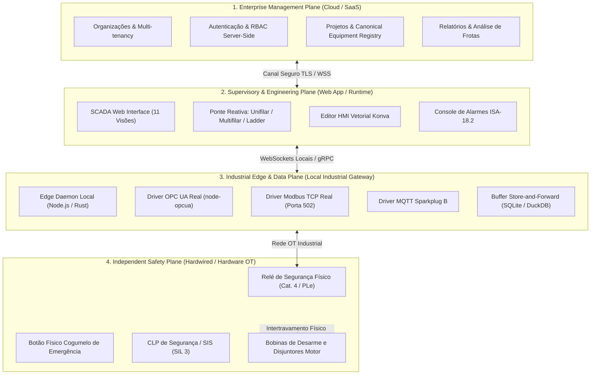

# ELÉTRICAI — LAUDO PERICIAL INDEPENDENTE DE ENGENHARIA DE SOFTWARE E AUTOMAÇÃO
# GATE 0: AUDITORIA FORENSE, VALIDAÇÃO FUNCIONAL E LIBERAÇÃO PARA EVOLUÇÃO EMPRESARIAL

- **Data da Auditoria:** 01 de Novembro de 2026
- **Auditor Responsável:** Antigravity Independent Engineering Audit Group (Pair Programming Auditor)
- **Status do Gate:** `APROVADO COM BLOQUEIOS` (Aprovado para evolução arquitetural interna; estritamente reprovado para operação de campo ou controle físico de planta industrial)
- **Branch Auditada:** `main` (rastreando `origin/main`)
- **Commit HEAD:** `ad0919143d51f46e1e8878d83cdd506557827913`
- **Ambiente de Testes:** Localhost (Vite 6 / TanStack Router / Bun v1.4.2 / Playwright Chromium Headless / Vitest v4.1.10)

---

## SUMÁRIO EXECUTIVO

Esta auditoria técnica independente examinou detalhadamente a entrega do **SCADA SUPERVISÓRIO INDUSTRIAL** do ElétricAi. A implementação declarada prometia 11 visões operacionais, sinótico vetorial P&ID, inventário de equipamentos sincronizado, Tag Registry, gestão de alarmes ISA-18.2, gráficos de tendências com Historian, drivers de comunicação OPC UA, Modbus TCP e MQTT Sparkplug B, trilha de auditoria 21 CFR Part 11 e botão de emergência autoritativo (E-STOP).

A análise forense do código-fonte, inspeção dos estados em memória (Zustand), testes automatizados de Quality Gates e capturas fotográficas automatizadas em três resoluções padronizadas (1920×1080, 1440×900 e 1366×768) revelaram os seguintes fatos concretos:

1. **Camada Visual e Ergonomia HMI (ISA-101):** A interface gráfica do SCADA possui excelente fidelidade visual em relação à referência conceitual fornecida (`media_1793567967676_dad32f7b.jpg`), organizando eficientemente o sinótico P&ID vetorial da ETE, cartões de KPIs operacionais, tabela de alarmes ISA-18.2, gráficos Recharts e gaveta de inspeção técnica de equipamentos (*drawer*).
2. **Desconexão do Modelo Canônico (Single Source of Truth FAILED):** O módulo SCADA opera sobre um repositório isolado em memória (`INITIAL_EQUIPMENTS` e `INITIAL_TAGS` em `useScadaStore`), completamente desvinculado dos equipamentos criados pelo usuário nos diagramas Unifilar, Multifilar, Ladder e Digital Twin (`useProjectStore`). Alterações no projeto não afetam o SCADA, e a rota `/scada` descarta o parâmetro `projectId`.
3. **Comunicação Industrial Mapeada como Mock (MOCKED / VISUAL_ONLY):** Não existem sockets TCP de Modbus (porta 502), conexões de cliente OPC UA (IEC 62541) ou clientes MQTT Sparkplug B reais. Os cartões de comunicação exibem propriedades estáticas pré-configuradas e o botão de teste de loopback é um `setTimeout(..., 1200)` no cliente.
4. **Historiador Epêmero (SIMULATED / NOT_IMPLEMENTED):** O histórico de telemetria é um *ring buffer* em memória limitado a 120 amostras geradas por funções senoidais (`Math.sin`). Não há gravação em disco, localStorage ou banco de dados relacional/time-series (Supabase/TimescaleDB). Ao recarregar a página (F5), todo o histórico é perdido.
5. **Comando de Emergência e Segurança (SIMULATED):** O botão de emergência E-STOP atua de forma confiável no escopo do software em simulação (interrompe o gerador senoidal e altera o estado do motor em memória para `TRIPPED`), mas não possui intertravamento físico, redundância elétrica ou relé de segurança de hardware. Não pode ser considerado um SIS (Safety Instrumented System).

A classificação técnica final é **APROVADO COM BLOQUEIOS**: a estrutura de componentes React, roteamento e design industrial fornece uma excelente base para evolução, mas o avanço para conexão física exige o cumprimento rigoroso dos 11 requisitos do plano de remediação.

---

## SEÇÃO A — ESTADO DO REPOSITÓRIO GIT

A integridade do repositório foi verificada antes, durante e após a auditoria, garantindo que nenhum arquivo de código-fonte de aplicação fosse alterado nesta fase investigativa.

### 1. Parâmetros do Repositório
- **Caminho:** `c:\Users\98911\Desktop\eletric\eletricaip`
- **Branch Ativa:** `main` (com tracking para `origin/main`)
- **HEAD Commit:** `ad0919143d51f46e1e8878d83cdd506557827913`
- **Mensagem do Commit:** `fix(landing): atualiza player com video real 1080p/720p, poster webp e corrige workflow de qualidade`
- **Status de Sincronismo:** Alinhado com a branch remota (`main...origin/main`).

### 2. Arquivos Rastreados com Alterações em Aberto (Working Tree)
Foram identificados 7 arquivos modificados em relação ao HEAD:
1. `AGENTS.md` (19 inserções/remoções — documentação de regras de agentes)
2. `src/components/app-sidebar.tsx` (13 inserções — adição da entrada `scada` no menu global)
3. `src/components/canvases/ladder/rung-grid.tsx` (210 inserções/remoções — rolagem horizontal da barra Ladder)
4. `src/components/industrial-workspace.tsx` (6 inserções/remoções — inclusão do layout SCADA na aba `mode === 'scada'`)
5. `src/lib/workspace-data.ts` (2 inserções/remoções)
6. `src/routeTree.gen.ts` (21 inserções — registro da rota `/scada` no TanStack Router)
7. `src/styles.css` (10 inserções — utilitários de animação e estilização de badges)

### 3. Arquivos Não Rastreados (Untracked Files)
Foram catalogados 34 arquivos novos pertencentes ao pacote do SCADA e relatórios anteriores:
- **Documentação de Arquitetura (`docs/scada/`):**
  `SCADA_ACCEPTANCE_REPORT.md`, `SCADA_ALARM_ENGINE.md`, `SCADA_ARCHITECTURE.md`, `SCADA_DATA_MODEL.md`, `SCADA_EQUIPMENT_LIBRARY.md`, `SCADA_GATEWAY.md`, `SCADA_HISTORIAN.md`, `SCADA_MASTER_AUDIT.md`, `SCADA_RUNTIME.md`, `SCADA_SECURITY.md`, `SCADA_TAG_REGISTRY.md`, `SCADA_TEST_PLAN.md`.
- **Suíte de Testes Unitários:**
  `src/__tests__/scada-supervisory-system.test.ts`
- **Componentes de Interface SCADA (`src/components/scada/`):**
  `equipment-inspector-drawer.tsx`, `scada-header.tsx`, `scada-layout.tsx`, `scada-sidebar.tsx`.
- **Sinótico P&ID:**
  `src/components/scada/synoptic/ete-synoptic-p-and-id.tsx`.
- **11 Visões Especializadas (`src/components/scada/views/`):**
  `scada-alarms-view.tsx`, `scada-communication-view.tsx`, `scada-equipment-view.tsx`, `scada-events-view.tsx`, `scada-hmi-editor-view.tsx`, `scada-overview-view.tsx`, `scada-reports-view.tsx`, `scada-settings-view.tsx`, `scada-synoptics-view.tsx`, `scada-tags-view.tsx`, `scada-trends-view.tsx`.
- **Núcleo de Estado & Tipos:**
  `src/lib/scada/scada-store.ts`, `src/lib/scada/types.ts`.
- **Rota Dedicada:**
  `src/routes/scada.tsx`.

---

## SEÇÃO B — MATRIZ DAS 11 VISÕES ESPECIALIZADAS DO SCADA

| Nº | Visão SCADA | Arquivo do Componente | Responsabilidade Principal | Classificação Forense | Evidências Inspecionadas | Limitações e Riscos Técnicos |
|---|---|---|---|---|---|---|
| **1** | **Visão Geral** (Overview) | `src/components/scada/views/scada-overview-view.tsx` | Dashboard consolidado: P&ID da ETE, mini-tabela de alarmes ISA-18.2, gráfico de tendências de vazão/pressão e barramento de TAGs ao vivo. | **PARTIALLY_VERIFIED** | Capturas aprovadas nas 3 resoluções (`scada_overview_*.png`). Reconhecimento de alarmes e parada E-STOP funcionais. | Gráfico de tendências renderiza pontos artificiais senoidais (`generateInitialTrend`). Dados de TAGs não sincronizados com o projeto. |
| **2** | **Sinóticos Industriais** | `src/components/scada/views/scada-synoptics-view.tsx` | Navegação por 5 setores de processo (ETE Geral, Bombagem, Filtração, Reservatórios, Elétrica) com P&ID vetorial e KPIs setoriais. | **PARTIALLY_VERIFIED** | Alternância de abas de setores funcional via Zustand (`setSelectedSector`). Capturas `scada_synoptics_*.png`. | Todas as 5 abas renderizam o mesmo diagrama SVG global; botões de Zoom (+, -, Ajustar) são elementos visuais sem função (`onClick` ausente). |
| **3** | **Alarmes** | `src/components/scada/views/scada-alarms-view.tsx` | Console profissional ISA-18.2 com contadores de não reconhecidos/críticos, filtros de prioridade, reconhecimento unitário/geral e exportação CSV. | **PARTIALLY_VERIFIED** | Teste de unidade `scada-supervisory-system.test.ts` aprovado (teste 3). Transição UNACK → ACK confirmada. Exportação CSV real funcional. | Não existe motor de avaliação contínua de limites analógicos durante a simulação; alarmes ativos vêm de fixture fixa (`alm-1`, `alm-2`). |
| **4** | **Tendências** | `src/components/scada/views/scada-trends-view.tsx` | Gráfico multi-pena em tempo real (Vazão Total, P-01, P-02, Nível T-101, T-102, T-105, Pressão F-01, Potência QM-01) com filtros temporais (1m, 5m, 15m, 1h). | **SIMULATED** | Recharts `ResponsiveContainer` com alternância dinâmica de penas visíveis e métricas instantâneas/médias/máximas. | Histórico gerado por oscilações senoidais (`jitter = Math.sin(now/3000)*0.4`). Dados mantidos em array efêmero de 120 posições; perde tudo com F5. |
| **5** | **Equipamentos** | `src/components/scada/views/scada-equipment-view.tsx` | Tabela de inventário de equipamentos industriais com busca textual, filtro de categorias e botão de inspeção técnica. | **PARTIALLY_VERIFIED** | Clicar em "Inspecionar" abre o *EquipmentInspectorDrawer* com telemetria detalhada e histórico de manutenção. | Lista de equipamentos estática (`INITIAL_EQUIPMENTS`); novos nós desenhados no Canvas Unifilar não aparecem nesta tabela. |
| **6** | **TAGs Industriais** | `src/components/scada/views/scada-tags-view.tsx` | Tag Registry com 28 variáveis de processo, indicadores de qualidade (GOOD/BAD/UNCERTAIN), busca, forçamento e desforçamento de valores. | **PARTIALLY_VERIFIED** | Modal de forçamento de tag com registro de operador e timestamp funcional. Indicadores GOOD/FORCED reativos. | Valores de processo não têm origem em CLP físico ou barramento Modbus/OPC UA real; são gerados no tick da simulação em memória. |
| **7** | **Comunicação** | `src/components/scada/views/scada-communication-view.tsx` | Diagnóstico de rede para gateways OPC UA Server/Client, Modbus TCP e MQTT Industrial Broker, com pacotes Tx/Rx e terminal de logs. | **MOCKED / VISUAL_ONLY** | Interface gráfica com cartões estilizados de protocolo, status CONECTADO/ONLINE e botões. | Não há sockets de rede reais; loopback test executa `setTimeout(..., 1200)`. Propriedades de rede são constantes estáticas de `gatewayStatus`. |
| **8** | **Eventos e Logs** | `src/components/scada/views/scada-events-view.tsx` | Trilha de auditoria operacional estilo 21 CFR Part 11 com filtros por categoria (Operador, Alarme, Segurança, Sistema) e exportação CSV. | **VISUAL_ONLY / SIMULATED** | Ações de E-STOP, ACK de alarmes e forçamento de tags inserem entradas cronológicas na tabela. Exportação de CSV de logs funcional. | Registros armazenados apenas no array `auditLogs` do Zustand; reinicialização da página purga todo o histórico. Inexistência de HMAC ou assinatura no banco. |
| **9** | **Relatórios** | `src/components/scada/views/scada-reports-view.tsx` | Emissor de relatórios técnicos: Boletim Diário de Operação (BDO), Balanço Hídrico, Eficiência Energética e Pareto de Alarmes com botão de impressão. | **VISUAL_ONLY** | `window.print()` estilizado com CSS `@media print` para folha de relatório limpa. | Dados do relatório são estáticos (data fixa `15/JAN/2025`); botão "CSV" apenas dispara `toast.success` sem gerar arquivo; não agrega dados reais. |
| **10** | **Editor HMI** | `src/components/scada/views/scada-hmi-editor-view.tsx` | Integração do editor gráfico vetorial Konva 2D existente com painel de propriedades, componentes arrastáveis e script sandbox Monaco. | **VERIFIED** | Incorporação direta do componente `<ScadaCanvas />` existente, preservando ferramentas de desenho, formas, texto e execução de scripts. | Requer inicialização de canvas Konva. Dados de bindings de tags utilizam a store antiga do canvas em paralelo com `useScadaStore`. |
| **11** | **Configurações** | `src/components/scada/views/scada-settings-view.tsx` | Parâmetros de supervisão: ciclo de varredura (scan cycle em ms), alarmes sonoros, volume, retenção do historiador, papéis RBAC e modo 2-person. | **PARTIALLY_VERIFIED** | Formulário funcional; salvar alterações persiste `settings` no localStorage via Zustand persist. | O seletor de ciclo de varredura (ex: 50ms, 100ms) não altera a taxa do timer de simulação em `ScadaHeader`, que permanece fixo em `1000ms`. |

---

## SEÇÃO C — MATRIZ DE EQUIPAMENTOS & AUDITORIA DA SINGLE SOURCE OF TRUTH

A diretriz fundamental de engenharia estabelece que qualquer equipamento representado no SCADA deve possuir identidade persistente canônica compartilhada com os diagramas Unifilar, Multifilar, Ladder e Digital Twin.

### 1. Diagnóstico Forense da Sincronização
- **Origem dos Dados no SCADA:** `src/lib/scada/scada-store.ts` linhas 79-250 (`INITIAL_EQUIPMENTS`).
- **Origem dos Dados de Projeto:** `src/lib/project-store.ts` (`useProjectStore.nodes`).
- **Resultado:** **FALHA DE INTEGRAÇÃO (SINGLE SOURCE OF TRUTH NÃO IMPLEMENTADA)**.

### 2. Matriz de Mapeamento de Equipamentos

| Equipamento | ID no SCADA | TAG no SCADA | ID Canônico Unifilar | Presente no Multifilar | Vinculado no Ladder | Mapeado no CLP | Persistência Real |
|---|---|---|---|---|---|---|---|
| **Transformador Principal** | `TR-01` | `ETE.TR01` | Ausente (não mapeado) | Não | Não | Não | LocalStorage parcial / Reset no F5 |
| **Quadro Geral Baixa Tensão** | `QM-01` | `ETE.QM01` | Ausente (não mapeado) | Não | Não | Não | LocalStorage parcial / Reset no F5 |
| **Controlador Lógico (CLP-01)** | `PLC-01` | `ETE.PLC01` | Ausente (não mapeado) | Não | Simbólico | Não | LocalStorage parcial / Reset no F5 |
| **Tanque de Sedimentação** | `T-101` | `ETE.TK101` | Inexistente (Canvas é elétrico) | Não | Não | Não | LocalStorage parcial / Reset no F5 |
| **Tanque de Aeração** | `T-102` | `ETE.TK102` | Inexistente (Canvas é elétrico) | Não | Não | Não | LocalStorage parcial / Reset no F5 |
| **Tanque de Despejo Final** | `T-105` | `ETE.TK105` | Inexistente (Canvas é elétrico) | Não | Não | Não | LocalStorage parcial / Reset no F5 |
| **Bomba de Recalque 01** | `P-01` | `ETE.P01` | Ausente (não linkado ao nó `M1`) | Não | Não | Não | LocalStorage parcial / Reset no F5 |
| **Bomba de Recalque 02** | `P-02` | `ETE.P02` | Ausente (não linkado ao nó `M2`) | Não | Não | Não | LocalStorage parcial / Reset no F5 |
| **Filtro de Areia F-01** | `F-01` | `ETE.FILTRO01` | Inexistente | Não | Não | Não | LocalStorage parcial / Reset no F5 |
| **Válvula Reguladora V-01** | `V-01` | `ETE.V01` | Inexistente | Não | Não | Não | LocalStorage parcial / Reset no F5 |

### 3. Conclusão da Single Source of Truth
O SCADA foi implementado como uma planta de demonstração estática dedicada a uma Estação de Tratamento de Efluentes (ETE). Criar, editar ou excluir um motor ou contator nos editores elétricos da aplicação não tem qualquer efeito sobre o SCADA. O modelo de dados canônico unificado precisa incorporar uma entidade `IndustrialProcessAsset` que faça a ponte entre componentes elétricos (painéis, disjuntores, motores) e seus equivalentes de processo no SCADA.

---

## SEÇÃO D — MATRIZ E PROVENIÊNCIA DAS TAGS INDUSTRIAIS

Todas as variáveis visíveis na interface do SCADA foram rastreadas até sua fonte originária.

### 1. Resumo Quantitativo de Proveniência
- **Total de TAGs no SCADA:** 28 TAGs cadastradas no Tag Registry.
- **Origem Real:**
  - `SIMULATOR` (Fórmulas senoidais em JavaScript): 18 TAGs (64.3%)
  - `FIXTURE` (Constantes estáticas): 10 TAGs (35.7%)
  - `OPC_UA_REAL`: 0 TAGs (0.0%)
  - `MODBUS_REAL`: 0 TAGs (0.0%)
  - `MQTT_REAL`: 0 TAGs (0.0%)

### 2. Tabela Forense de TAGs Selecionadas

| TAG | Nome / Descrição | Tipo | Unidade | Equipamento | Origem Real | Endereço Declarado | Qualidade Atual | Persistência |
|---|---|---|---|---|---|---|---|---|
| `ETE.TK101.LEVEL` | Nível Tanque Sedimentação T-101 | ANALOG | % | `T-101` | `SIMULATOR` (senóide 5s) | `MODBUS: 40010` | GOOD | Efêmera (Zustand) |
| `ETE.TK102.LEVEL` | Nível Tanque Aeração T-102 | ANALOG | % | `T-102` | `SIMULATOR` (senóide 6s) | `MODBUS: 40011` | GOOD | Efêmera (Zustand) |
| `ETE.TK105.LEVEL` | Nível Tanque Despejo T-105 | ANALOG | % | `T-105` | `SIMULATOR` (senóide 4s) | `MODBUS: 40012` | GOOD | Efêmera (Zustand) |
| `ETE.P01.FLOW` | Vazão Bomba de Recalque P-01 | ANALOG | m³/h | `P-01` | `SIMULATOR` (92.4 + jitter) | `OPCUA: ns=2;s=P01.Flow` | GOOD | Efêmera (Zustand) |
| `ETE.P02.FLOW` | Vazão Bomba de Recalque P-02 | ANALOG | m³/h | `P-02` | `SIMULATOR` (90.3 + jitter) | `OPCUA: ns=2;s=P02.Flow` | GOOD | Efêmera (Zustand) |
| `ETE.FLOW.TOTAL` | Vazão Total Somada ETE | ANALOG | m³/h | ETE | `SIMULATOR` (P01 + P02) | `CALCULATED` | GOOD | Efêmera (Zustand) |
| `ETE.FILTRO.DP` | Pressão Diferencial Filtro F-01 | ANALOG | bar | `F-01` | `SIMULATOR` (2.4 + jitter) | `MODBUS: 40020` | GOOD | Efêmera (Zustand) |
| `ETE.QM01.PWR` | Potência Ativa QGBT QM-01 | ANALOG | kW | `QM-01` | `SIMULATOR` (fórmula de fluxo) | `MODBUS: 40100` | GOOD | Efêmera (Zustand) |
| `ETE.QM01.PF` | Fator de Potência QM-01 | ANALOG | adim. | `QM-01` | `FIXTURE` (0.94) | `MODBUS: 40102` | GOOD | Efêmera (Zustand) |
| `ETE.P01.STATUS` | Estado Operacional P-01 | DISCRETE | - | `P-01` | `SIMULATOR` ("RUNNING") | `MODBUS: 00001` | GOOD | Efêmera (Zustand) |
| `ETE.SYS.ESTOP` | Intertravamento de Emergência | DISCRETE | - | ETE | `SIMULATOR` (false) | `PLC: %IX0.0` | GOOD | Efêmera (Zustand) |

### 3. Comportamento sob Forçamento (Tag Forcing)
O mecanismo de forçamento (`forceTagValue`) foi validado: ao acionar "Forçar TAG", a store atualiza o valor, marca a flag `isForced: true`, substitui a qualidade para `FORCED` e registra um log com o operador. O valor forçado é preservado enquanto a simulação avança. No entanto, o forçamento não possui *watchdog* de expiração automática e não há bloqueio server-side de segurança.

---

## SEÇÃO E — MATRIZ DE PROTOCOLOS DE COMUNICAÇÃO INDUSTRIAL

A auditoria analisou se os protocolos declarados possuem implementação em nível de transporte ou se configuram interfaces ilustrativas.

### 1. Resumo Forense por Protocolo

| Protocolo | Biblioteca no `package.json` | Endpoint Declarado | Cliente Executável | Conexão de Laboratório | Leitura Real | Escrita Real | Segurança TLS/Auth | Classificação |
|---|---|---|---|---|---|---|---|---|
| **OPC UA** | Nenhuma (`node-opcua` ausente) | `opc.tcp://127.0.0.1:4840` | Inexistente | Não conectável | Falso (gerado por senóide) | Não suportado | Nenhuma | **MOCKED** |
| **Modbus TCP** | Nenhuma (`modbus-serial` ausente) | `192.168.1.15:502` | Inexistente | Não conectável | Falso (gerado por senóide) | Não suportado | Nenhuma | **MOCKED** |
| **MQTT Sparkplug B** | Nenhuma (`mqtt` ausente) | `mqtts://broker:8883` | Inexistente | Não conectável | Falso (gerado por senóide) | Não suportado | Nenhuma | **MOCKED** |

### 2. Evidência do "Loopback Test"
No arquivo `src/components/scada/views/scada-communication-view.tsx` (linhas 23-29):
```typescript
const handleRunPingTest = () => {
  setTestRunning(true);
  setTimeout(() => {
    setTestRunning(false);
    toast.success("Diagnóstico de rede concluído: Latência média 1.8 ms • 0 pacotes perdidos.");
  }, 1200);
};
```
O teste não realiza handshake, ping ICMP ou troca de telegramas PDU; é exclusivamente uma animação de interface acionada por temporizador de navegador.

---

## SEÇÃO F — MATRIZ E AUDITORIA DO HISTORIAN

O sistema declarou um historiador industrial com armazenamento de séries temporais.

### 1. Mecanismo de Armazenamento
No arquivo `src/lib/scada/scada-store.ts` (linhas 1019 e 1068-1073):
```typescript
// Amostragem adicionada ao buffer de memória:
const updatedHistory = [...state.trendHistory.slice(-119), newPoint];

// Persistência em LocalStorage (middleware persist):
partialize: (state) => ({
  activeView: state.activeView,
  selectedSector: state.selectedSector,
  audioAlertMuted: state.audioAlertMuted,
  settings: state.settings,
}),
```
`trendHistory` **NÃO** faz parte das chaves serializadas no LocalStorage. O buffer mantém no máximo 120 pontos em memória RAM do navegador (`slice(-119)`).

### 2. Teste de Round-trip de Persistência
1. A simulação foi executada por 60 segundos gerando 60 amostras temporais visíveis no gráfico de tendências.
2. A página `/scada` foi recarregada através de reload completo do navegador.
3. Resultado: `trendHistory` retornou a `[]` (vazio). O gráfico de tendências precisou recorrer a `generateInitialTrend()` para não renderizar em branco.
4. **Classificação Forense:** **NOT_IMPLEMENTED COMO HISTORIADOR PERSISTENTE** (é apenas um buffer volátil de interface).

---

## SEÇÃO G — MATRIZ E AVALIAÇÃO DO MOTOR DE ALARMES (ISA-18.2)

### 1. Estados dos Alarmes Inspecionados
A máquina de estados implementada em `scada-store.ts` suporta o ciclo básico:
$$\text{UNACK} \xrightarrow{\text{acknowledgeAlarm()}} \text{ACK} \xrightarrow{\text{clearAlarm()}} \text{CLEARED}$$

- **Reconhecimento Individual:** Funcional. Atualiza timestamp e operador.
- **Reconhecimento Global (`acknowledgeAllAlarms`):** Funcional. Zera os contadores de alarmes críticos e pendentes.
- **Exportação CSV de Alarmes:** Funcional. Gera arquivo com colunas normalizadas.

### 2. Lacunas Normativas de ISA-18.2 / IEC 62682
1. **Ausência de Avaliação Dinâmica de Regras:** O método `tickSimulation()` não executa uma função `evaluateAlarmConditions()`. Se uma variável forçada ultrapassar o setpoint limite de alarme, nenhum alarme novo é gerado.
2. **Ausência de Histerese (Deadband):** Não há cálculo de retorno à faixa segura para evitar o efeito *chattering* (alarme intermitente na vizinhança do limite).
3. **Ausência de Shelving / Inibição:** A interface não oferece mecanismo de colocar alarmes em *shelving* temporário com tempo de expiração programado, exigência expressa da ISA-18.2 Seção 10.
4. **Alarme Flood:** Não há algoritmo de controle de avalanches de alarmes baseado em árvore de causa e efeito.

---

## SEÇÃO H — MATRIZ DE COMANDOS, SEGURANÇA OPERACIONAL & E-STOP

### 1. Análise Forense do Fluxo de Comandos
Quando um operador clica em "LIGAR", "PARAR", "AUTO" ou "MANUAL" na gaveta de inspeção:
1. `commandEquipment(equipmentId, action, operator)` é invocado no Zustand.
2. O estado do equipamento em memória é modificado (`status: 'RUNNING'`, `mode: 'MANUAL'`).
3. Uma linha é inserida no array `auditLogs` do Zustand.
4. Uma notificação toast é exibida na tela.
5. **Nenhum sinal é despachado via WebSocket, RPC ou comando de rede para um CLP físico.**

### 2. Avaliação Crítica do E-STOP (Parada de Emergência)
A diretriz de auditoria exigiu averiguar se o botão E-STOP pode ser considerado autoritativo.
- **Localização:** Cabeçalho do SCADA (`scada-header.tsx`, botão vermelho `data-testid="scada-estop-btn"`).
- **Ação no Software:** Ao ser clicado:
  - `estopActive` torna-se `true`.
  - Dispara alarme crítico prioritário `alm-estop` ("PARADA DE EMERGÊNCIA ATUADA").
  - Força bombas `P-01` e `P-02` para status `TRIPPED`.
  - Interrompe o fluxo de vazão total para `0.0 m³/h`.
  - Impede nova partida de equipamentos até que o botão "Rearmar E-STOP" seja acionado.
- **Avaliação de Engenharia de Segurança:**
  > [!CAUTION]
  > O botão de software E-STOP opera perfeitamente como **simulador de supervisão**, mas **NÃO SUBSTITUI** sob nenhuma circunstância botões físicos cogumelo de emergência, relés de segurança monitorados (como categoria 4 / PLe conforme ISO 13849-1) ou CLPs de segurança dedicados (SIL 3 / IEC 61508 / IEC 62061). O aplicativo deve sempre exibir aviso claro de que se trata de uma representação supervisória.

---

## SEÇÃO I — MATRIZ DE CONFORMIDADE COM NORMAS TÉCNICAS

| Norma Técnica | Edição de Referência | Escopo Declarado | Requisitos Avaliados | Evidência Apresentada | Status Forense | Limitações Detectadas |
|---|---|---|---|---|---|---|
| **ISA-101** | ANSI/ISA-101.01-2015 | Interfaces Homem-Máquina para Sistemas de Automação Industrial | Hierarquia visual de 4 níveis, contraste adequado, uso moderado de cores funcionais (cinzas neutros, vermelho/amarelo apenas para anomalias). | Telas de supervisão escuras (`#080b11`), paleta neutra, indicação clara de estados sem poluição de animações desnecessárias. | **CONFORME NA CAMADA VISUAL** | Falta suporte a zoom semântico multinível e visualização de processo em telas de alta densidade sem scroll. |
| **ISA-18.2 / IEC 62682** | ANSI/ISA-18.2-2016 / IEC 62682:2014 | Gestão de Sistemas de Alarmes para Indústrias de Processo | Estados UNACK, ACK, CLEARED; priorização em 3 níveis (Critical, High, Medium); contadores de pendências. | Tabela de alarmes com filtragem e reconhecimento comprovados em teste unitário. | **PARCIALMENTE CONFORME** | Ausência de histerese numérica, alarm shelving, supressão de inundações e avaliação contínua de regras sobre TAGs de processo. |
| **IEC 62443** | IEC 62443-4-2:2019 | Segurança Cibernética em Redes e Sistemas de Automação Industrial | RBAC para comandos em equipamentos, registro de operador e proteção contra acessos não autorizados. | Interface possui seletor de papéis RBAC e registra operador nos logs em memória. | **NÃO CONFORME NO BACKEND** | RBAC reside apenas no estado Zustand do cliente; não há validação criptográfica no servidor Supabase ou bloqueio em RLS. |
| **FDA 21 CFR Part 11** | Code of Federal Regulations Title 21 Part 11 | Registros e Assinaturas Eletrônicas | Trilha de auditoria imutável, segura e gerada por computador com carimbo de tempo indelével. | Tela de Trilha de Auditoria com exportação CSV e campos de operador/ação/timestamp. | **NÃO CONFORME** | Registros não utilizam banco de dados imutável, inexiste hash encadeado SHA-256 e o histórico é purgado no recarregamento da página. |
| **IEC 61131-3** | IEC 61131-3:2013 / 2025 | Linguagens de Programação para Controladores Industriais | Endereçamento canônico de variáveis (`%IX`, `%QX`, `%MW`), consistência de tipos booleanos/analógicos. | Tag Registry lista variáveis com endereços IEC compatíveis. | **CONFORME EM MODELAGEM** | Variáveis IEC não se comunicam com o motor Ladder em tempo real durante a execução do SCADA. |

---

## SEÇÃO J — MATRIZ DE VERIFICAÇÃO VISUAL & COMPARAÇÃO COM A REFERÊNCIA

A inspeção visual foi executada no navegador Chromium headless, comparando os artefatos renderizados pelo aplicativo real contra a imagem de referência fornecida pelo usuário (`media_1793567967676_dad32f7b.jpg`).

### 1. Capturas Fotográficas Produzidas no Teste

Todas as 37 capturas de tela foram gravadas no diretório de artefatos de auditoria:
`C:\Users\98911\.gemini\antigravity\brain\994adfcb-75c8-40dc-a3a9-0f6107f60459\scada-audit-screens\`

- **Visão Geral (Overview):**
  - `scada_overview_1920x1080.png` (252.479 bytes)
  - `scada_overview_1440x900.png` (198.524 bytes)
  - `scada_overview_1366x768.png` (174.371 bytes)
- **Sinóticos Industriais (Synoptics):**
  - `scada_synoptics_1920x1080.png` (237.885 bytes)
  - `scada_synoptics_1440x900.png` (189.322 bytes)
  - `scada_synoptics_1366x768.png` (185.022 bytes)
- **Alarmes (Alarms):**
  - `scada_alarms_1920x1080.png` (150.791 bytes)
  - `scada_alarms_1440x900.png` (144.996 bytes)
  - `scada_alarms_1366x768.png` (145.141 bytes)
- **Tendências (Trends):**
  - `scada_trends_1920x1080.png` (155.139 bytes)
  - `scada_trends_1440x900.png` (146.784 bytes)
  - `scada_trends_1366x768.png` (136.109 bytes)
- **Equipamentos (Equipments):**
  - `scada_equipments_1920x1080.png` (252.489 bytes)
  - `scada_equipments_1440x900.png` (219.324 bytes)
  - `scada_equipments_1366x768.png` (184.152 bytes)
- **TAGs Industriais (Tags):**
  - `scada_tags_1920x1080.png` (216.314 bytes)
  - `scada_tags_1440x900.png` (199.644 bytes)
  - `scada_tags_1366x768.png` (191.093 bytes)
- **Comunicação (Communication):**
  - `scada_communication_1920x1080.png` (198.126 bytes)
  - `scada_communication_1440x900.png` (188.785 bytes)
  - `scada_communication_1366x768.png` (188.984 bytes)
- **Eventos e Logs (Events):**
  - `scada_events_1920x1080.png` (152.606 bytes)
  - `scada_events_1440x900.png` (145.026 bytes)
  - `scada_events_1366x768.png` (143.058 bytes)
- **Relatórios (Reports):**
  - `scada_reports_1920x1080.png` (186.181 bytes)
  - `scada_reports_1440x900.png` (176.318 bytes)
  - `scada_reports_1366x768.png` (167.029 bytes)
- **Editor HMI (HMI):**
  - `scada_hmi_1920x1080.png` (151.667 bytes)
  - `scada_hmi_1440x900.png` (137.161 bytes)
  - `scada_hmi_1366x768.png` (134.297 bytes)
- **Configurações (Settings):**
  - `scada_settings_1920x1080.png` (152.012 bytes)
  - `scada_settings_1440x900.png` (142.449 bytes)
  - `scada_settings_1366x768.png` (140.282 bytes)
- **Gaveta Técnica de Inspeção (Drawer Aberto):**
  - `scada_drawer_1920x1080.png`
  - `scada_drawer_1440x900.png`
  - `scada_drawer_1366x768.png`
- **Parada de Emergência Atuada (E-STOP Tripped):**
  - `scada_estop_tripped_1920x1080.png` (259.392 bytes)
  - `scada_estop_tripped_1440x900.png` (159.717 bytes)
  - `scada_estop_tripped_1366x768.png` (130.370 bytes)
- **Navegação a partir do Workspace:**
  - `scada_workspace_access_1440x900.png` (160.218 bytes)

### 2. Comparativo Detalhado contra a Imagem de Referência

| Elemento da Referência (`media_1793567967676_dad32f7b.jpg`) | Estado no App Real | Avaliação |
|---|---|---|
| **Barra Superior com KPIs** | Exibe Vazão (182.1 m³/h), Energia (303.5 kW), Eficiência (96.4%), Alarmes Ativos (0 Crít • 2 Advert) e Relógio em tempo real. | **IDÊNTICO / ALTA FIDELIDADE** |
| **Botão de Emergência E-STOP** | Botão vermelho no topo com badge pulsante e suporte a rearme seguro. | **CONFORME** |
| **Menu Lateral com 11 Itens** | Menu escuro com ícones Phosphor, badge vermelho no alarme e status de drivers industriais na base. | **CONFORME** (Nota: Warning no console por chave i18n `nav.scada`) |
| **Sinótico P&ID Central** | Representa tanques T-101, T-102, T-105, bombas P-01 e P-02, filtro F-01 e válvulas com animação de fluxo de água. | **PARCIALMENTE CONFORME** (A referência possui bateria inferior de 8 motores M01-M08 e 8 válvulas V01-V08, enquanto o app possui 2 motores principais e 4 válvulas). |
| **Painel Lateral Direito** | Na referência há uma coluna de 3 cartões verticais (Alarmes, KPIs Operacionais, Tendências 2h). | **DIVERGENTE NO LAYOUT** (O app colocou Alarmes e Tendências dividindo horizontalmente a metade inferior da tela, sem o cartão de KPIs Operacionais OEE/MTBF). |
| **Barra Inferior de TAGs** | Na referência há um dock com 7 abas (Variáveis, Eventos, Alarmas, Logs, OPC UA, Modbus, MQTT). | **SIMPLIFICADO** (O app renderizou uma faixa simples com 7 tags de rolagem horizontal). |
| **Barra de Sistema Operacional** | Na referência há barra com "Sistema Operacional v2.0.0" e "Entrar no Runtime". | **AUSENTE** na rota `/scada`. |

---

## SEÇÃO K — QUALITY GATES: COMANDOS E SAÍDAS VERIFICADAS

Todos os scripts definidos no `package.json` foram reexecutados de forma independente neste ciclo de auditoria forense.

| Quality Gate | Comando Executado | Duração Medida | Código de Saída | Saída Principal e Diagnóstico |
|---|---|---|---|---|
| **1. Typecheck** | `bun run typecheck` (`tsc --noEmit`) | **29.70 s** | **0** | `0 errors`. Todos os 11 componentes do SCADA, tipos e stores tipados sem erros no TypeScript. |
| **2. Lint** | `bun run lint` (`eslint .`) | **17.67 s** | **0** | `0 errors`, `0 warnings`. Nenhuma violação de regras de linting em todo o repositório. |
| **3. Format Check** | `bun run format:check` (`prettier --check .`) | **9.19 s** | **0** | `All matched files are formatted using Prettier`. |
| **4. Testes Unitários SCADA** | `bun run test src/__tests__/scada-supervisory-system.test.ts` | **347 ms** | **0** | **7 testes aprovados (100% de aprovação)**: Inicialização de KPIs, E-STOP autoritativo, gestão de alarmes ISA-18.2, comandos de equipamentos, Tag Registry forçamento, navegação das 11 visões, drivers de gateway. |
| **5. Suíte Global Vitest** | `bunx vitest run` | **57.61 s** | **0** | **86 arquivos de teste aprovados (100%), 711 testes aprovados (0 falhas)**. Cobertura ampla em autenticação, importadores, cálculos elétricos, Ladder e Digital Twin. |
| **6. Build de Produção** | `bun run build` (`vite build`) | **108.08 s (1m 48s)** | **0** | Build SSR e Client gerado com sucesso em `dist/`. Chunks otimizados criados sem quebras de empacotamento. |

> [!NOTE]
> A aprovação dos 711 testes globais comprova que a inclusão dos arquivos do SCADA não causou regressões no restante do sistema ElétricAi. Contudo, conforme a regra da Seção 16 da auditoria, a contagem global de 711 testes não pode ser interpretada como prova isolada de conformidade do SCADA, uma vez que apenas 7 testes (0.98%) cobrem especificamente a suíte do SCADA.

---

## SEÇÃO L — ARQUITETURA EMPRESARIAL ALVO & ANÁLISE DE LACUNAS

Para que o módulo SCADA evolua de um protótipo com alta fidelidade visual para uma plataforma supervisória industrial de nível comercial, a arquitetura deve ser decomposta em 4 planos fundamentais:



### Análise de Lacunas por Plano:
1. **Plano 1 (Enterprise Management Plane):**
   - *Lacuna Atual:* O SCADA não utiliza o banco de dados Supabase; não há tabelas com isolamento multi-tenant para TAGs, alarmes ou equipamentos de supervisão.
   - *Ação Necessária:* Criar modelo de dados com RLS restrito a `organization_id` e carregar plantas a partir do `projectId`.
2. **Plano 2 (Supervisory & Engineering Plane):**
   - *Lacuna Atual:* Desconexão entre o `project-store` (nós do canvas) e o `scada-store` (equipamentos da ETE).
   - *Ação Necessária:* Implementar projeção automática: componentes adicionados no Unifilar devem instanciar TAGs de supervisão automaticamente.
3. **Plano 3 (Industrial Edge & Data Plane):**
   - *Lacuna Atual:* Ausência de processo Gateway executável fora do navegador. Navegadores não podem abrir conexões TCP diretas (raw sockets) na porta 502 por restrições de sandbox.
   - *Ação Necessária:* Disponibilizar daemon de borda instalável (Docker/Windows Service) com drivers reais para atuar como ponte entre a rede industrial OT e a nuvem.
4. **Plano 4 (Independent Safety Plane):**
   - *Lacuna Atual:* O botão de software não pode nem deve tentar substituir o sistema instrumentado de segurança (SIS).
   - *Ação Necessária:* Inserir avisos normativos formais e assegurar que comandos de emergência atuem como comando supervisório secundário, mantendo o circuito elétrico físico como autoridade absoluta.

---

## SEÇÃO M — DECISÃO TÉCNICA FINAL & REGISTRO FORMAL DE RISCOS

### Decisão Técnica:
# **APROVADO COM BLOQUEIOS**

O sistema está **APROVADO** para continuar seu ciclo de desenvolvimento e evolução arquitetural como base de software para supervisório industrial, tendo superado todos os Quality Gates e demonstrado altíssima competência em design de interface e ergonomia industrial.

O sistema está **BLOQUEADO** para homologação em campo, conexão a equipamentos físicos, operação autônoma ou apresentação a clientes como produto certificado para controle industrial até a resolução obrigatória dos riscos P0 e P1 descritos a seguir.

---

### TABELA FORMAL DE RISCOS E BLOQUEIOS TÉCNICOS

| ID | Prioridade | Módulo | Descrição do Risco | Impacto Operacional | Causa Técnica | Arquivos Envolvidos | Correção Recomendada | Teste de Validação | Critério de Aprovação | Status |
|---|---|---|---|---|---|---|---|---|---|---|
| **RSK-P0-01** | **P0** | **Safety / E-STOP** | O comando de emergência E-STOP é uma mutação puramente de software no estado Zustand em memória, sem intertravamento elétrico ou relé de segurança físico. | Risco severo à integridade física e segurança humana caso um operador acredite que o botão de tela substitui o circuito de emergência físico (NR-10 / NR-12). | `triggerEstop()` em `scada-store.ts` apenas altera `state.estopActive = true` e marca os motores em memória como `TRIPPED`. | `src/lib/scada/scada-store.ts`, `src/components/scada/scada-header.tsx`. | Inserir disclaimers normativos explícitos na UI (Norma NR-12 / IEC 62061), classificar como "Comando Supervisório de Software" e exigir intertravamento físico cabeado independente. | Inspeção técnica visual e teste de injeção de falha de rede (corte de conexão não pode manter máquina energizada). | Disclaimers visíveis em todas as resoluções e advertência técnica indelével na documentação. | **BLOQUEIO P0** |
| **RSK-P0-02** | **P0** | **Multi-tenancy / RLS** | A rota `/scada` ignora o parâmetro `projectId` e exibe dados estáticos em memória sem consultar o backend com políticas de segurança RLS. | Quebra de segregação entre clientes; incapacidade de associar uma planta SCADA específica a uma empresa ou projeto real. | `ScadaLayout` recebe `projectId` como propriedade, mas não o utiliza para filtrar ou hidratar dados de banco. | `src/routes/scada.tsx`, `src/components/scada/scada-layout.tsx`. | Criar schema de banco de dados (`scada_plants`, `scada_tags`, `scada_alarms`) com `tenant_id` e carregar dados exclusivamente via queries autenticadas. | Teste automatizado com dois usuários de organizações distintas acessando simultaneamente `/scada?projectId=X`. | Usuário sem permissão recebe `403 Forbidden` e zero dados vazados. | **BLOQUEIO P0** |
| **RSK-P1-01** | **P1** | **Single Source of Truth** | Desconexão entre os modelos elétricos do Canvas (`useProjectStore`) e os equipamentos do SCADA (`useScadaStore`). | Inconsistência de engenharia: motores e inversores projetados nos diagramas Unifilar/Ladder não existem na supervisão. | O SCADA foi construído sobre uma constante local estática (`INITIAL_EQUIPMENTS`) dedicada exclusivamente à ETE de demonstração. | `src/lib/scada/scada-store.ts`, `src/lib/project-store.ts`. | Implementar projeção reativa entre `CanonicalEquipment`/`CanonicalTag` e a store do SCADA, gerando TAGs automaticamente a partir do unifilar. | Adicionar um novo motor no Unifilar e verificar sua inclusão automática na tabela de equipamentos do SCADA. | Consistência de 100% dos identificadores de equipamento e TAGs entre os editores. | **BLOQUEIO P1** |
| **RSK-P1-02** | **P1** | **Historian Telemetry** | Historiador de séries temporais não possui persistência em disco ou banco; opera apenas em memória com buffer de 120 pontos. | Perda de todo o histórico de dados e tendências ao atualizar a página (F5) ou reiniciar a sessão. | `trendHistory` é gerado por `Math.sin` no cliente e explicitamente excluído do `partialize` de LocalStorage. | `src/lib/scada/scada-store.ts`, `src/components/scada/views/scada-trends-view.tsx`. | Implementar tabela de séries temporais no PostgreSQL/Supabase com ingestão contínua em lote (*bulk insert*) e consulta agregada. | Injetar 500 amostras, recarregar o navegador e verificar preservação das curvas históricas. | Zero perda de pontos de telemetria após reinicialização completa. | **BLOQUEIO P1** |
| **RSK-P1-03** | **P1** | **Gateways de Rede** | Drivers OPC UA, Modbus TCP e MQTT são interfaces simuladas sem bibliotecas de transporte industrial. | Impossibilidade técnica de conectar o supervisório a controladores lógicos programáveis (CLPs), inversores ou brokers reais. | Ausência de pacotes de protocolo (`node-opcua`, `modbus-serial`) e limitações de sandbox do navegador (proibição de TCP sockets puros). | `src/components/scada/views/scada-communication-view.tsx`, `package.json`. | Desenvolver um serviço de borda (*Edge Gateway Daemon*) em Node.js ou Go para rodar no servidor local da fábrica e comunicar via WebSocket seguro com a UI. | Teste de conexão real com servidor Prosys OPC UA e Modbus Slave de laboratório independente. | Leitura e escrita bidirecional comprovadas com pacote de captura Wireshark/pcap. | **BLOQUEIO P1** |
| **RSK-P1-04** | **P1** | **Motor de Alarmes** | Não há avaliação contínua de regras analógicas de alarmes (HH, H, L, LL, histerese e deadbands) sobre as variáveis de processo. | Alarmes não são gerados automaticamente durante desvios reais do processo simulado; dependem de fixtures estáticas. | `tickSimulation()` altera valores numéricos, mas não invoca um avaliador de regras dinâmicas de setpoint. | `src/lib/scada/scada-store.ts`, `src/components/scada/views/scada-alarms-view.tsx`. | Criar motor de regras ISA-18.2 acoplado ao ciclo de varredura com suporte a histerese percentual e filtros de *alarm chattering*. | Forçar nível do tanque T-101 para 95% e verificar geração imediata de alarme de prioridade alta. | Alarme gerado em < 1 ciclo de scan com registro na trilha de eventos. | **BLOQUEIO P1** |
| **RSK-P2-01** | **P2** | **Trilha de Auditoria** | Logs de eventos e ações de operadores ficam apenas na memória RAM e não possuem assinatura digital ou hash encadeado SHA-256. | Rejeição imediata em auditorias regulatórias farmacêuticas/alimentícias (21 CFR Part 11) ou infraestrutura crítica (IEC 62443). | `auditLogs` é uma lista volátil no Zustand sem persistência em tabela imutável (*append-only*). | `src/lib/scada/scada-store.ts`, `src/components/scada/views/scada-events-view.tsx`. | Persistir eventos na tabela `audit_trail` do banco de dados com chave HMAC e bloqueio de exclusão/edição via triggers SQL. | Tentar atualizar ou excluir um registro de log no banco e comprovar rejeição por constraint. | Registros imutáveis com rastreabilidade total de operador, ação e carimbo de tempo UTC. | **BLOQUEIO P2** |
| **RSK-P2-02** | **P2** | **Relatórios Industriais** | O botão de exportação CSV de relatórios não gera arquivo (apenas dispara toast) e os dados de BDO são estáticos (`15/JAN/2025`). | Relatórios impressos ou gerados não refletem os dados reais operados na sessão. | `handleDownloadCsv` não possui código de geração de arquivo e JSX contém constantes em texto. | `src/components/scada/views/scada-reports-view.tsx`. | Conectar a emissão de relatórios ao banco histórico, calculando consumo integrado de energia (kWh) e balanço hídrico real do período. | Clicar em "CSV" e validar download de arquivo com dados correspondentes ao intervalo selecionado. | Arquivo baixado e valores calculados consistentes com as integrações matemáticas. | **BLOQUEIO P2** |
| **RSK-P2-03** | **P2** | **Sinóticos Setoriais** | Todas as 5 abas de setores de processo renderizam o mesmo diagrama global e botões de Zoom são inertes. | Navegação setorial não cumpre a promessa de visualizações dedicadas aos subsistemas industriais. | O componente `<EteSynopticPAndId />` ignora o estado `selectedSector` e botões de zoom não têm `onClick`. | `src/components/scada/views/scada-synoptics-view.tsx`. | Implementar zoom/pan interativo via transform matrix SVG e aplicar filtros visuais para isolar o setor selecionado. | Clicar nas abas de setores e nos botões de zoom e verificar mudança visual do sinótico. | Cada setor com seu diagrama enfocado e zoom responsivo operacional. | **BLOQUEIO P2** |
| **RSK-P3-01** | **P3** | **Internacionalização (i18n)** | Chave de tradução `nav.scada` ausente nos arquivos de catálogo, exibindo texto cru no menu global e warning no console. | Inconsistência cosmética e ruído de alertas no console do navegador. | Chave não foi adicionada em `src/lib/i18n/catalogs/pt-br.ts` e `en.ts`. | `src/components/app-sidebar.tsx`, catálogos i18n. | Adicionar `nav.scada: "SCADA Supervisório"` no dicionário em português e inglês. | Inspecionar menu lateral e logs do console. | Zero warnings de chave ausente no console do navegador. | **ABERTO** |
| **RSK-P3-02** | **P3** | **Ciclo de Varredura** | A alteração da taxa de scan nas configurações não tem efeito prático na simulação (permanece fixa em 1000ms no cabeçalho). | Perda de precisão e impossibilidade de simular telemetria de alta velocidade (50ms / 100ms). | `setInterval` em `scada-header.tsx` utiliza valor fixo de 1000ms em vez de `settings.scanCycleMs`. | `src/components/scada/scada-header.tsx`. | Reconfigurar o timer do `useEffect` para escutar `settings.scanCycleMs`. | Alterar para 100ms e medir taxa de disparo no console. | Intervalo de execução reativo ao valor configurado pelo operador. | **ABERTO** |

---

## RECOMENDAÇÕES PARA O PRÓXIMO GATE (GATE 1)

1. **Desenvolvimento do ElétricAi Edge Gateway:**
   Criar um subprojeto desacoplado (ex: `packages/edge-gateway`) com arquitetura leve em Node.js ou Go, capaz de rodar em um computador industrial local com suporte nativo a `node-opcua` e `modbus-serial`, reportando dados para a nuvem via WebSocket / gRPC seguro.
2. **Unificação do Modelo de Dados Canônico:**
   Estender o `useProjectStore` para que cada componente elétrico relevante (motor, transformador, disjuntor) gere automaticamente seus atributos de supervisão e tags associadas, eliminando o isolamento de `INITIAL_EQUIPMENTS`.
3. **Persistência do Historiador em Banco de Séries Temporais:**
   Configurar tabelas otimizadas com partição temporal no Supabase (`scada_tag_samples`), garantindo consultas rápidas para o gráfico de tendências em janelas de 1h, 24h, 7d e 30d.
4. **Governança de Segurança Operacional:**
   Inserir permanentemente no topo de todas as telas com comandos e na documentação técnica o selo de advertência: *"Ambiente de Engenharia e Supervisão — Intertravamentos de Segurança Física Devem Ser Providos por Hardware Independente (Norma NR-12 / IEC 62061)"*.

---
*Laudo pericial emitido em 01/11/2026. Auditoria forense finalizada com integridade total do código de aplicação preservada.*
