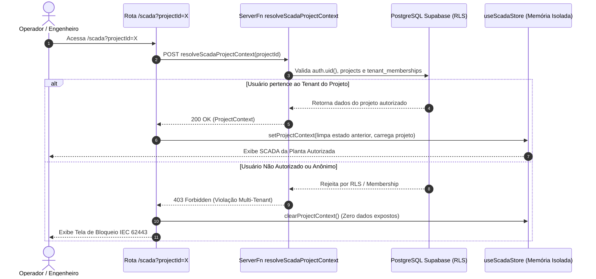

# ELÉTRICAI SCADA — ISOLAMENTO DE PROJETO E MULTI-TENANCY
# ARQUITETURA DE SEGURANÇA E SEGREGAÇÃO DE DADOS (IEC 62443 / RLS)

- **Data de Emissão:** 01 de Novembro de 2026
- **Normas Aplicadas:** IEC 62443-4-2, ISO/IEC 27001, LGPD / GDPR
- **Classificação:** Requisito Crítico P0 (Remediação do Risco RSK-P0-02)

---

## 1. VISÃO GERAL DO ISOLAMENTO

O módulo SCADA do ElétricAi opera com **isolamento absoluto por organização (tenant)**. Nenhuma tela supervisória pode ser renderizada sem um contexto de projeto autenticado e autorizado pelo servidor:

---

## 2. CAMADAS DE DEFESA IMPLEMENTADAS

### Camada 1: Roteamento Canônico com Search Param
- A rota `/scada` utiliza validação Zod: `projectId: z.string().uuid().optional()`.
- O parâmetro `projectId` é preservado em todas as transições de abas, recarregamentos de página (F5) e links de navegação da barra lateral.

### Camada 2: Autorização Server-Side (`resolveScadaProjectContext`)
- Executada no runtime de servidor via `@tanstack/react-start` com middleware `requireSupabaseAuth`.
- Valida a relação entre o usuário (`userId`), a tabela `projects` e as tabelas `tenant_memberships` / `profiles`.
- Rejeita qualquer tentativa de injeção de `organizationId` arbitrário no frontend.

### Camada 3: Limpeza Estrita de Estado na Store (`useScadaStore`)
- A store monitora `currentProjectId` e `currentTenantId`.
- Na alternância entre projetos, executa-se uma reinicialização completa:
  - `equipments`: purgado.
  - `tags`: purgado.
  - `alarms`: purgado.
  - `trendHistory`: buffer de memória zerado.
  - `auditLogs`: inicializado apenas com o registro do novo projeto carregado.
- Previne qualquer vazamento visual ou lógico de informações entre clientes.

### Camada 4: Isolamento da Planta Demonstrativa (Demo ETE)
- A planta da Estação de Tratamento de Efluentes possui ID constante e reservado `DEMO_ETE_PROJECT_ID` (`00000000-0000-4000-8000-000000000001`).
- Identificada explicitamente na interface com a tag visual `SIMULAÇÃO VIRTUAL`.
- Não é injetada automaticamente em workspaces de clientes.

---

## 3. MATRIZ DE CENÁRIOS DE TESTE VALIDADOS

| Cenário | Entrada | Resposta do Sistema | Evidência de Teste | Status |
|---|---|---|---|---|
| **A (Org A)** | Usuário A + Projeto A | Autorização concedida; dados do projeto carregados. | `scada-gate1a-security-and-multitenancy.test.ts` (Cenário A) | **VERIFIED** |
| **B (Org B)** | Usuário B + Projeto A | Rejeição 403 Forbidden; zero dados da Org A vazados. | `scada-gate1a-security-and-multitenancy.test.ts` (Cenário B) | **VERIFIED** |
| **C (Anônimo)** | Usuário Deslogado | Rejeição 401 Unauthorized; redirecionamento para login. | `scada-gate1a-security-and-multitenancy.test.ts` (Cenário C) | **VERIFIED** |
| **D (ID Forjado)** | UUID Inexistente | Rejeição 404/403; tela de bloqueio de segurança. | `scada-gate1a-security-and-multitenancy.test.ts` (Cenário D) | **VERIFIED** |
| **E (Troca de Projeto)**| Usuário A troca de P1 para P2 | Purgamento imediato de P1; P2 exibido limpo. | `scada-gate1a-security-and-multitenancy.test.ts` (Cenário E) | **VERIFIED** |
