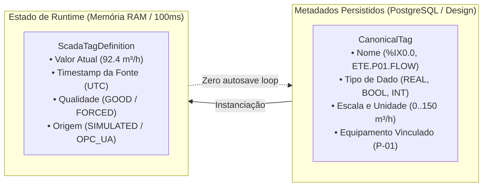

# ELÉTRICAI SCADA — TAG REGISTRY & ESTADO DE RUNTIME
# ESPECIFICAÇÃO DE VARIÁVEIS, QUALIDADE E PROTOCOLOS

- **Data de Emissão:** 01 de Novembro de 2026
- **Normas Aplicadas:** IEC 61131-3, ISA-18.2, OPC Unified Architecture (IEC 62541)

---

## 1. DESACOPLAMENTO METADADOS vs. RUNTIME

Para garantir escalabilidade e suporte a ciclos de varredura determinísticos de alta velocidade sem sobrecarregar o banco de dados do Supabase, o ElétricAi separa formalmente a definição de uma TAG do seu valor de telemetria instantâneo:



---

## 2. ATRIBUTOS DA TAG CANÔNICA

```typescript
export interface CanonicalTag {
  id: string; // ID persistente unívoco
  name: string; // Identificador técnico (ex: P01.FLOW)
  dataType: "BOOL" | "INT" | "REAL" | "STRING" | "TIME";
  area: "I" | "Q" | "M" | "DB"; // Área de memória IEC 61131-3
  address?: string; // Endereço simbólico ou absoluto (%IX0.0, DB10.DBD0)
  unit?: string; // Unidade de engenharia (m³/h, bar, kW, °C, RPM)
  scaleMin?: number; // Limite inferior de calibração
  scaleMax?: number; // Limite superior de calibração
  initialValue: boolean | number | string;
  forced: boolean; // Flag de override por operador
  retentive: boolean; // Preservação em caso de reinicialização de CLP
  description: string;
  linkedEquipmentId?: string; // Vínculo ao CanonicalEquipment
}
```

---

## 3. QUALIDADE E ORIGEM DO VALOR EM TEMPO REAL

Cada amostra recebida no SCADA possui metadados de integridade:

### Qualidades Suportadas (`TagQuality`):
- `GOOD`: Variável lida com sucesso do barramento ou simulador, dentro dos limites nominais.
- `BAD`: Erro de leitura, timeout de comunicação ou falha física de sensor.
- `UNCERTAIN`: Variável com valor presumido ou afetada por estado de emergência (`SIMULATION_HALT`).
- `STALE`: Valor não atualizado no tempo máximo de varredura configurado (*watchdog* expirado).
- `NOT_CONNECTED`: Gateway industrial correspondente desconectado ou em manutenção.
- `FORCED`: Valor sobrescrito manualmente por um operador autorizado (exibe badge âmbar na UI).

### Origens Suportadas (`ProtocolDriver`):
- `SIMULATION`: Gerado por modelo matemático de simulação. Marcado formalmente como dado virtual.
- `INTERNAL_RUNTIME`: Variável interna gerada pelo motor elétrico ou lógico da aplicação.
- `OPC_UA`: Proveniente de servidor OPC UA industrial externo.
- `MODBUS_TCP`: Mapeado a registrador Modbus (Holding Register / Coil).
- `MQTT`: Recebido via tópico MQTT / Sparkplug B.
- `IMPORTED`: Importado de arquivo externo ou gêmeo digital.

---

## 4. CONSUMO CENTRALIZADO DE WIDGETS

Nenhum componente visual armazena valores numéricos privados. Um display numérico, um gráfico de tendência Recharts e um indicador P&ID consomem a mesma entrada no dicionário `useScadaStore.tags[tagName]`. Se o valor for atualizado ou forçado, todos os widgets refletem a mudança simultaneamente no mesmo ciclo de renderização.
