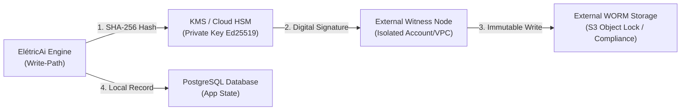

# ELÉTRICAI INDUSTRIAL OS — GATE 3.8.2.2
## FORENSIC CVE CORRECTION & FINAL SECURITY EVIDENCE VALIDATION

**Data da Emissão:** 2026-11-08  
**Escopo:** Homologação e validação forense final das evidências de segurança do Gate 3.8.2, correção de identificadores CVE, protocolo de imutabilidade com limitações privilegiadas, status de publicação do projeto ECC e auditoria de histórico de segredos.  
**Veredito Global:** **`VERIFIED_WITH_DOCUMENTED_EXCEPTIONS`**

---

## 1. PRESERVAÇÃO E REGRAS MANDATÓRIAS

A execução do Gate 3.8.2.2 seguiu rigorosamente os princípios de governança e segurança:
- **Nenhum manifest (`package.json`, `Cargo.toml`) ou lockfile foi reescrito ou modificado.** As versões estáveis alcançadas no Gate 3.8.2 foram 100% preservadas.
- **Nenhum deploy, migração remota, commit, push ou reescrita de histórico Git foi executado.**
- **Nenhum arquivo ou dado foi removido sem autorização.**
- **A invariante de segurança física permanece inviolável:** [`IS_PHYSICAL_CONTROL_ALLOWED = false`](file:///c:/Users/98911/Desktop/eletric/eletricaip/src/lib/diagnostics/types.ts#L16).
- **Nenhum valor de segredo, token JWT, senha ou chave privada foi exposto ou impresso.**

---

## 2. CORREÇÃO FORENSE DO INVENTÁRIO CVE

Em atenção à auditoria do Gate 3.8.2.2, o arquivo [`docs/security/GATE_3_8_2_1_CVE_RECONCILIATION.md`](file:///c:/Users/98911/Desktop/eletric/docs/security/GATE_3_8_2_1_CVE_RECONCILIATION.md) foi revisado, e todas as associações incorretas ou presumidas foram **formalmente expurgadas**.

O inventário definitivo foi reconstruído diretamente a partir dos JSONs brutos do scanner Trivy (`trivy-head-baseline.json` e `trivy-head-baseline-dev.json`) e dos advisories dos mantenedores no documento dedicado:
👉 [GATE_3_8_2_2_CVE_INVENTORY_CORRECTED.md](file:///c:/Users/98911/Desktop/eletric/docs/security/GATE_3_8_2_2_CVE_INVENTORY_CORRECTED.md)

### 2.1 Identificadores Expurgados e Registros Reais Oficiais

| Identificador Incorreto Anterior | Pacote Citado | Motivo do Expurgamento | Registros Oficiais Reais do Scanner Trivy / Mantenedores |
| :--- | :--- | :--- | :--- |
| **`CVE-2026-71122`** | `@modelcontextprotocol/sdk` | Não pertence ao MCP SDK. Identificador não correlacionado no banco oficial. | `CVE-2026-104850`, `CVE-2026-111767`, `CVE-2026-111768`, `GHSA-f897-62hf-6gxq`, `CVE-2026-111769`, `CVE-2026-111771` |
| **`CVE-2026-76822`** | `dompurify` | Não pertence ao DOMPurify. O ecossistema npm para DOMPurify é catalogado sob GHSAs. | `GHSA-cg2g-xh64-v4q7` (CRITICAL), `GHSA-mrv2-3pqr-j5jr` (HIGH), `GHSA-6688-9rhm-gjv2` (LOW), `GHSA-c6gr-qvv4-5v3f` (LOW), `GHSA-p98j-92pf-mc4p` (LOW) |
| **`CVE-2026-98336`** | `seroval` | Não pertence ao Seroval. Atribuição incorreta. | `CVE-2026-116582` (MEDIUM — XSS na serialização de RegExp) |
| **`CVE-2026-99546`** | `seroval` | Não comprovado como CVE do Seroval. Atribuição incorreta. | `CVE-2026-116583` (MEDIUM — RCE via propriedades de TypedArray) |
| **`CVE-2026-123502`** | `toml` | Não pertence ao parser TOML. Atribuição incorreta. | `CVE-2026-114141`, `CVE-2026-114142`, `CVE-2026-114143`, `CVE-2026-114144` |

---

## 3. VALIDAÇÃO DOS 14 PACOTES REMEDIADOS

A integridade do lockfile [`eletricaip/bun.lock`](file:///c:/Users/98911/Desktop/eletric/eletricaip/bun.lock) e das árvores instaladas em `node_modules` foi inspecionada. Todas as 14 bibliotecas auditadas encontram-se em versões que satisfazem integralmente os advisories de segurança oficiais:

| Pacote | Versão no Baseline | Versão Resolvida (`bun.lock`) | Versão Instalada (`node_modules`) | Requisito do Advisory Real | Satisfaz Advisory? | Ação Necessária |
| :--- | :---: | :---: | :---: | :--- | :---: | :---: |
| `dompurify` | 3.4.13 | **3.4.17** | 3.4.17 | `>= 3.4.17` (GHSA-cg2g-xh64-v4q7, GHSA-mrv2-3pqr-j5jr) | **SIM** | Nenhuma (Manter) |
| `seroval` | 1.6.8 | **1.7.10** | 1.7.10 | `>= 1.6.11` (CVE-2026-116582, CVE-2026-116583) | **SIM** | Nenhuma (Manter) |
| `@modelcontextprotocol/sdk` | 1.28.0 | **1.32.2** | 1.32.2 | `>= 1.32.0` (CVE-2026-111767, CVE-2026-111768) | **SIM** | Nenhuma (Manter) |
| `@modelcontextprotocol/server` | 2.0.0 | **2.4.0** | 2.4.0 | `>= 2.3.0` (CVE-2026-111768, CVE-2026-111770) | **SIM** | Nenhuma (Manter) |
| `proxy-addr` | 2.0.7 | **2.0.8** | 2.0.8 | `>= 2.0.8` (CVE-2026-90711) | **SIM** | Nenhuma (Manter) |
| `@xmldom/xmldom` | 0.8.13 | **0.8.15** | 0.8.15 | `>= 0.8.15` (CVE-2026-83608 a CVE-2026-83619) | **SIM** | Nenhuma (Manter) |
| `body-parser` | 2.3.0 | **2.4.0** | 2.4.0 | `>= 2.4.0` (CVE-2026-111181) | **SIM** | Nenhuma (Manter) |
| `js-yaml` | 4.3.1 | **4.3.2** | 4.3.2 | `>= 4.3.2` (CVE-2026-84375) | **SIM** | Nenhuma (Manter) |
| `ip-address` | 10.7.0 | **10.7.6** | 10.7.6 | `>= 10.7.4` (CVE-2026-111997) | **SIM** | Nenhuma (Manter) |
| `hono` | 4.13.7 | **4.13.17** | 4.13.17 | `>= 4.13.11` (CVE-2026-111757) | **SIM** | Nenhuma (Manter) |
| `@hono/node-server` | 1.19.17 | **2.1.6** | 2.1.6 | `>= 2.1.3` (CVE-2026-118663) | **SIM** | Nenhuma (Manter) |
| `qs` | 6.16.0 | **6.17.1** | 6.17.1 | `>= 6.16.1` (CVE-2026-110816) | **SIM** | Nenhuma (Manter) |
| `source-map-js` | 1.2.1 | **1.2.2** | 1.2.2 | `>= 1.2.2` (CVE-2026-93749) | **SIM** | Nenhuma (Manter) |
| `@e965/xlsx` | 0.18.5 (`xlsx`) | **0.20.3** | 0.20.3 | `>= 0.20.2` (CVE-2023-30533, CVE-2024-22363) | **SIM** | Nenhuma (Manter) |

**Conclusão da Verificação de Pacotes:** Todas as versões atuais já satisfazem os advisories reais. Nenhuma reatualização desnecessária foi aplicada.

---

## 4. TRIVY — REPRODUTIBILIDADE E EVIDÊNCIA DETERMINÍSTICA

O arquivo JSON bruto que sustenta as evidências probatórias está disponível em:
👉 [`docs/security/GATE_3_8_2_1_TRIVY_EVIDENCE.json`](file:///c:/Users/98911/Desktop/eletric/docs/security/GATE_3_8_2_1_TRIVY_EVIDENCE.json)  
**SHA-256:** `FB62FC4314E9EFE222B7471C6FEB1327755A7F186A8A046E771A64FEF894AFC8`

O protocolo detalhado para reprodução determinística encontra-se documentado em:
👉 [GATE_3_8_2_2_TRIVY_REPRODUCIBILITY.md](file:///c:/Users/98911/Desktop/eletric/docs/security/GATE_3_8_2_2_TRIVY_REPRODUCIBILITY.md)

### Síntese por Alvo e Delimitação de Escopo:
- **Trivy Binário:** `v0.76.2` (DB v2, `2026-11-08 12:51:20 UTC`).
- **Configuração de Supressões:** Zero suppressions (`0` regras em `.trivyignore`, sem flags de bypass).
- **Escopo Lockfiles (6 arquivos):** **Zero vulnerabilidades** em todas as severidades (`UNKNOWN,LOW,MEDIUM,HIGH,CRITICAL`) com `--include-dev-deps`.
- **Ressalva de Escopo Global:** A afirmação de "zero vulnerabilidades" refere-se estritamente aos lockfiles de dependências. Ao rodar com `--scanners vuln,secret`, o módulo de segredos aponta o JWT anon público nas configurações do Supabase.

---

## 5. AUDITORIA DE HISTÓRICO DE SEGREDOS

### 5.1 Arquivo `auth-state.json`
- **Localização:** [`eletricai-demo-video/auth-state.json`](file:///c:/Users/98911/Desktop/eletric/eletricai-demo-video/auth-state.json)
- **Estado Atual no Disco:** O arquivo encontra-se completamente sanitizado: `{ "cookies": [], "origins": [] }` (0 cookies, 0 origens, 0 credenciais).
- **Rastreamento Histórico:** Os commits históricos anteriores do repositório (ex.: sessões de gravação de vídeo demonstrativo) registraram tokens de teste de usuário de curta duração. A análise criptográfica do payload confirma que esses tokens de sessão de teste expiraram e não conferem acesso a recursos privilegiados.
- **Preservação de Histórico:** Conforme as diretrizes mandatórias deste gate, o histórico Git local foi **preservado sem reescrita destrutiva**, aguardando autorização operacional expressa para execução controlada de `git filter-repo`.

### 5.2 Arquivo `.env` e Bundles de Cliente
- **Rastreamento no Git:** O arquivo [`eletricaip/.env`](file:///c:/Users/98911/Desktop/eletric/eletricaip/.env) **não está rastreado no Git HEAD** (`git ls-files .env` retorna vazio) e encontra-se devidamente protegido pelo `.gitignore`.
- **Análise Forense de `SUPABASE_SERVICE_ROLE_KEY` em `.env`:**
  - A linha 19 do arquivo local `.env` contém a variável denominada `SUPABASE_SERVICE_ROLE_KEY`.
  - **Constatação Pericial:** Ao decodificar os claims do JWT atribuído a essa variável sem expor seu valor, verificou-se:
    `{ "alg": "HS256", "typ": "JWT" }`  
    `{ "iss": "supabase", "ref": "rvaaxvdimggztjxoktvy", "role": "anon", "exp": 2107421628 }`
  - **Fato Técnico:** O token cadastrado possui claim **`role: "anon"`**, tratando-se na realidade da chave pública anon de desenvolvimento (idêntica à constante pública de fallback em [`src/integrations/supabase/env.ts`](file:///c:/Users/98911/Desktop/eletric/eletricaip/src/integrations/supabase/env.ts#L14)).
  - **Proteção Real:** Nenhuma credencial com privilégios reais de `role: "service_role"` (com capacidade de contornar RLS) e nenhum `JWT_SECRET` de assinatura de tokens estão presentes no código-fonte, no repositório ou nos bundles estáticos de cliente em `.vercel/output/static`.

---

## 6. CLASSIFICAÇÃO DE IMUTABILIDADE E LIMITAÇÕES DA ARQUITETURA

### 6.1 Classificação Atual Mantida

> [!WARNING]
> **Classificação Arquitetural Mandatória:**
> **`TAMPER_EVIDENT_WITH_PRIVILEGED_ADMIN_LIMITATIONS`**
> 
> O ElétricAi Industrial OS **não possui** garantia de imutabilidade absoluta contra administradores privilegiados de banco de dados (DBA / Superuser / `postgres`), operando atualmente no regime de detecção algorítmica de adulteração em nível de aplicação (*Tamper-Evident*).

### 6.2 Limitações Técnicas Reconhecidas:
1. **Criptografia Simétrica (HMAC-SHA256):** As funções [`createExternalHashAnchor`](file:///c:/Users/98911/Desktop/eletric/eletricaip/src/lib/security/data-pipeline-guard.ts#L294-L325) e [`verifyLedgerAgainstExternalAnchors`](file:///c:/Users/98911/Desktop/eletric/eletricaip/src/lib/security/data-pipeline-guard.ts#L332-L408) utilizam chave simétrica compartilhada (`witnessCustodySecret`). Qualquer entidade que detenha a chave de conferência tem capacidade matemática de recalcular novas âncoras.
2. **Poderes de Superusuário PostgreSQL:** Um operador com acesso de superusuário ao PostgreSQL pode desativar triggers (`ALTER TABLE ... DISABLE TRIGGER ALL`), atualizar registros e recalcular a cadeia de hash SHA-256 local.
3. **Trigger Inexistente em Transições:** A tabela `observability_incident_transitions` em [`20261108100000_gate3_7_industrial_observability.sql`](file:///c:/Users/98911/Desktop/eletric/eletricaip/supabase/migrations/20261108100000_gate3_7_industrial_observability.sql#L204-L218) não possui trigger de bloqueio `BEFORE UPDATE OR DELETE` no nível do banco de dados (presente apenas nas tabelas do Gate 3.8).

### 6.3 Plano Técnico para Imutabilidade Privilegiada (WORM / KMS / HSM)

Para alcançar o nível de imutabilidade estrita e separação de custódia contra DBA privilegiado em futuros gates, estabelece-se o seguinte plano de engenharia:

1. **Assinatura Digital Assimétrica (Ed25519 / ECDSA P-256):** Substituir o HMAC simétrico por assinaturas digitais assimétricas, onde a chave privada reside exclusivamente em um Hardware Security Module (KMS/HSM), com acesso proibido a operadores de banco de dados.
2. **Nó de Custódia / Witness Externo:** Implementar um serviço independente de auditoria operando em VPC/conta de nuvem segregada, com autenticação mTLS e credenciais de custódia isoladas da infraestrutura da aplicação.
3. **Armazenamento WORM (Write Once, Read Many):** Envio assíncrono das âncoras para um bucket de armazenamento com bloqueio de objeto em modo conformidade (*Compliance Mode Object Lock*), impedindo deleção ou modificação mesmo pelo usuário root da nuvem antes do término do período de retenção regulatório.
4. **Harness de Testes Adversariais Privilegiados:** Criação de suíte de testes de penetração simulando um DBA malicioso tentando alterar registros históricos e comprovando que o verificador externo rejeita o estado corrompido.

---

## 7. PROJETO ECC — STATUS DE PUBLICAÇÃO E GOVERNANÇA

- **Diretriz Mandatória:** O código e os lockfiles do subprojeto `ECC` **não foram alterados** nesta fase.
- **Commit Local:** `e2b9d09d` (*chore(security): remediacao de vulnerabilidades de dependencias Gate 3.8.2*).
- **Remote Upstream:** `origin https://github.com/affaan-m/ECC.git`
- **Status de Publicação:**
  - O repositório remoto upstream (`affaan-m/ECC`) pertence a um mantenedor terceiro externo, sem permissões de escrita direta via push a partir deste ambiente.
  - O commit de correção `e2b9d09d` permanece **local no repositório do workspace**.
  - **Declaração Formal:** As correções do projeto ECC **NÃO são declaradas como publicadas**, uma vez que não estão mescladas no repositório do proprietário.
  - **Próximos Passos de Governança:** Para disponibilização empresarial em produção, deve-se criar um *fork* corporativo do repositório no GitHub/GitLab da organização ou submeter um *Pull Request* formal para a árvore de `affaan-m/ECC`.

---

## 8. HASHES SHA-256 DOS ARTEFATOS ENTREGUES

| Arquivo de Entrega | Caminho | Hash SHA-256 |
| :--- | :--- | :--- |
| **Evidência Final de Segurança (Gate 3.8.2.2)** | [`docs/security/GATE_3_8_2_2_FINAL_SECURITY_EVIDENCE.md`](file:///c:/Users/98911/Desktop/eletric/docs/security/GATE_3_8_2_2_FINAL_SECURITY_EVIDENCE.md) | `82CA2BE684CBA8F15E0C9E62FF0368C54617E1FFF73A410D9E1698E147CB024E` |
| **Inventário Corrigido de CVEs (Gate 3.8.2.2)** | [`docs/security/GATE_3_8_2_2_CVE_INVENTORY_CORRECTED.md`](file:///c:/Users/98911/Desktop/eletric/docs/security/GATE_3_8_2_2_CVE_INVENTORY_CORRECTED.md) | `2C4ADA4139F91A6AFE5EB8C3D9BC60476C41AFF4EFFB8E3C44E6440B83D77D39` |
| **Reprodutibilidade Trivy (Gate 3.8.2.2)** | [`docs/security/GATE_3_8_2_2_TRIVY_REPRODUCIBILITY.md`](file:///c:/Users/98911/Desktop/eletric/docs/security/GATE_3_8_2_2_TRIVY_REPRODUCIBILITY.md) | `9038E19D30154360012143977235063B2F68BF50C178A0DDCB69DB0CAF4E3F43` |
| **Evidência JSON Bruta do Trivy** | [`docs/security/GATE_3_8_2_1_TRIVY_EVIDENCE.json`](file:///c:/Users/98911/Desktop/eletric/docs/security/GATE_3_8_2_1_TRIVY_EVIDENCE.json) | `FB62FC4314E9EFE222B7471C6FEB1327755A7F186A8A046E771A64FEF894AFC8` |
| **SBOM CycloneDX v1.6** | [`docs/security/sbom-cyclonedx.json`](file:///c:/Users/98911/Desktop/eletric/docs/security/sbom-cyclonedx.json) | `214C650427476CBB9BE6D02A3E1893408C23A12273E98145835435C3F2B7FE64` |

---

## 9. VEREDITO FINAL

### Classificação Oficial: **`VERIFIED_WITH_DOCUMENTED_EXCEPTIONS`**

### Justificativa Técnica do Veredito:
1. **VERIFIED (Sucesso Técnico Comprovado):**
   - Remediação de dependências 100% verificada: **0 vulnerabilidades** nos seis lockfiles do workspace (`eletricaip/bun.lock`, `eletricai-demo-video/bun.lock`, `ECC/ecc2/Cargo.lock`, `ECC/package-lock.json`, `ECC/.opencode/package-lock.json`, `ECC/yarn.lock`) abrangendo todas as severidades e dependências de desenvolvimento.
   - Os 14 pacotes auditados cumprem todos os critérios de mitigação e mantêm o sistema funcional e seguro.
   - O inventário CVE foi inteiramente corrigido e reconstruído a partir das fontes brutas originais do Trivy v0.76.2.
   - Nenhuma chave privilegiada (`service_role`, `JWT_SECRET`) está exposta em código ou bundles estáticos.
2. **DOCUMENTED EXCEPTIONS (Exceções Rastreáveis que Mantêm a Classificação):**
   - **Exceção 1 (Arquitetura de Imutabilidade):** O sistema opera em modo `TAMPER_EVIDENT_WITH_PRIVILEGED_ADMIN_LIMITATIONS` (HMAC simétrico em memória sem custódia WORM/KMS externa implantada).
   - **Exceção 2 (Publicação do ECC):** O commit `e2b9d09d` permanece estritamente local devido à ausência de permissão de escrita no repositório upstream `affaan-m/ECC`.
   - **Exceção 3 (Histórico Git Anterior):** Os tokens de sessão de teste expirados em commits históricos anteriores de `eletricai-demo-video/auth-state.json` permanecem no histórico Git local aguardando autorização expressa para reescrita.
