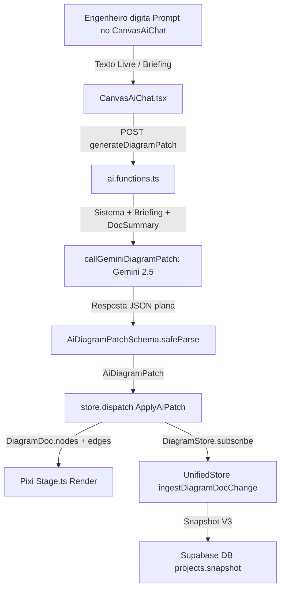

# ELÉTRICAI — AUDITORIA FORENSE DO MOTOR DE CONEXÕES UNIFILAR
## DIAGNÓSTICO DO FLUXO DE GERAÇÃO POR IA, TOPOLOGIA ELÉTRICA E CONECTIVIDADE

- **Data da Auditoria:** 02 de Novembro de 2026
- **Módulos Auditados:** `src/lib/diagram/*`, `src/lib/ai/*`, `src/lib/model/*`, `src/components/canvas-ai-chat.tsx`, `src/lib/diagram/render/*`
- **Responsável:** Engenheiro de Software Principal & Engenheiro Eletricista de Sistemas

---

## 1. MAPA DO FLUXO EXISTENTE (ENTRADA → PERSISTÊNCIA)

O fluxo atual de geração automática de diagramas unifilares por inteligência artificial segue a seguinte trilha no repositório:

### 1.1 Detalhamento de Cada Etapa Mapeada

1. **Entrada do Prompt:**
   - Componente: `src/components/canvas-ai-chat.tsx`.
   - O usuário digita um prompt em linguagem natural ou insere parâmetros via chat.
   - O chat injeta no prompt contexto de erros de normas detectados no canvas (`findings`).

2. **Serviço de IA Utilizado:**
   - Provedor: Google Gemini (`@google/genai`), modelo configurado via `getGeminiModel()` (padrão `gemini-2.5-flash` ou `gemini-2.5-pro` no servidor).
   - Execução estritamente no servidor através de TanStack Start `createServerFn` (`src/lib/diagram/ai.functions.ts`).

3. **Prompt de Sistema Responsável pela Geração:**
   - Função: `buildDiagramSystemPrompt(locale)` em `src/lib/diagram/ai.functions.ts`.
   - **Achado Crítico:** O system prompt orienta a IA sobre nós (`kinds` aceitos e parâmetros numéricos), mas fornece orientações mínimas sobre ligações elétricas. Pior: o exemplo fornecido no prompt possui `"addEdges": []`, ensinando a IA a devolver listas de nós sem conexões!

4. **Schema de Resposta & Zod:**
   - Schema Zod: `AiDiagramPatchSchema` em `src/lib/diagram/schema.ts`.
   - Conversor: `buildPatchJsonSchema()` em `src/lib/diagram/zod-to-json-schema.ts`.
   - **Achado Crítico:** O schema plano gerado para o Gemini omite deliberadamente `sourcePort` e `targetPort` de `addEdges`, tornando tecnicamente impossível para o modelo indicar portas ou terminais de destino.

5. **Parser e Validação da Resposta:**
   - `AiDiagramPatchSchema.safeParse(raw)` com até 3 tentativas de retry no servidor.
   - Caso o parse falhe, tenta reenviar o erro de validação como dica de correção para o modelo.

6. **Normalização dos Equipamentos:**
   - Ao aplicar o patch (`buildAiPatchCommand` em `src/lib/diagram/commands.ts`), os nós adicionados são inseridos diretamente em `DiagramDoc.nodes`. Não há validação de catálogo nem enriquecimento com terminais canônicos.

7. **Conversão em Elementos do Canvas & Portas:**
   - No cliente WebGL (`src/lib/diagram/render/stage.ts`), o método `upsertNode` cria as instâncias gráficas e chama `syncPorts(node, view)` baseado em `src/lib/diagram/render/ports.ts`.
   - As portas no canvas são geométricas (`T`, `B`, `L`, `R`, `B1`, etc.) e não possuem vínculo semântico de terminais elétricos (ex: `1/L1`, `2/T1`, `A1`, `PE`).

8. **Conversão das Conexões:**
   - `upsertEdge` em `stage.ts` busca portas correspondentes ou faz fallback para a primeira ou segunda porta geométrica do símbolo.
   - Se `sourcePort` não coincidir com uma porta geométrica, a linha conecta no centro ou na porta padrão, sem qualquer verificação de compatibilidade elétrica de fase ou corrente.

9. **Armazenamento da Topologia:**
   - A topologia reside exclusivamente como pares de `source` (ID do nó de origem) e `target` (ID do nó de destino) em `DiagramDoc.edges`.
   - Não existe o conceito de `ElectricalNet` (rede de nós equipotenciais) nem lista de terminais conectados no diagrama.

10. **Renderização das Ligações:**
    - Realizada pelo Pixi.js (`stage.ts`), desenhando segmentos ortogonais (`Orthogonal routing`) ou diretos com base em `waypoints`.
    - Cruzamento de linhas é puramente visual; não há nós de junção explícitos cadastrados na topologia.

11. **Salvamento:**
    - O `useDiagramStore` propaga as alterações para `useUnifiedProjectStore.ingestDiagramDocChange`.
    - A store unificada gera `ElectricalConnection` sintética: se `sourcePort` for nulo, inventa `${fromEq}:out` e `${toEq}:in`, criando IDs de terminais fantasmas que não existem na definição do equipamento.
    - O documento final é salvo periodicamente no Supabase na coluna `snapshot` da tabela `projects`.

12. **Reabertura do Projeto:**
    - O snapshot é carregado via `loadUnifiedDoc` ou `loadDoc`. Como a informação de terminais reais não foi gravada, ela não é recuperada.

13. **Conversão Unifilar → Multifilar:**
    - Executada por `buildMultifilarCommands` em `src/lib/diagram/multifilar.ts`.
    - Duplica nós adicionando o prefixo `mf_` e gera arestas com base em `inferCircuitConfig`. Não preserva uma fonte única de conectividade compartilhada.

---

## 2. RESPOSTAS ÀS 12 PERGUNTAS OBRIGATÓRIAS DA AUDITORIA

### 1. A IA retorna explicitamente todas as conexões?
**NÃO.** O prompt de sistema atual instrui a IA primariamente sobre os parâmetros dos equipamentos (`in_A`, `poles`, etc.) e exibe um exemplo oficial com `"addEdges": []`. O modelo tende a devolver os nós e esquecer a árvore de alimentação, os barramentos e as interligações entre proteção, manobra e carga.

### 2. As conexões são descartadas durante o parsing?
**PARCIALMENTE SIM.** `buildPatchJsonSchema()` em `src/lib/diagram/zod-to-json-schema.ts` remove os campos `sourcePort`, `targetPort`, `circuitConfig` e `cable` do schema JSON enviado ao Gemini. Qualquer intenção do modelo de especificar portas ou terminais é descartada antes mesmo de chegar à IA.

### 3. Os equipamentos possuem terminais definidos?
**NÃO NO CANVAS UNIFILAR.** Em `DiagramNodeSchema`, os nós não possuem terminais. No modelo canônico (`unified-schema.ts`), existe `CanonicalTerminalSchema`, mas a função `defaultTerminalsForEquipment` cobre apenas 5 tipos de equipamentos e não possui metadados sobre obrigatoriedade, tipo de circuito ou capacidade de derivação.

### 4. O motor conhece os terminais de entrada e saída?
**NÃO DE FORMA UNIFICADA.** O renderer WebGL conhece apenas portas geométricas (`T`, `B`, `L`, `R`) definidas em `ports.ts`. O motor de cálculo unificado conhece apenas uma lista simplificada de terminais. Não existe um catálogo que correlacione a porta visual ao terminal de potência/comando real do equipamento.

### 5. O sistema utiliza identificação persistente de terminal?
**NÃO.** Quando uma aresta não tem `sourcePort`, o sistema inventa dinamicamente a string `${fromEq}:out`. Como o motor de indução tem terminais `U1`, `V1`, `W1`, a conexão aponta para um terminal que não existe fisicamente no motor.

### 6. A geração de linhas visuais acontece separadamente da criação de conexões?
**NÃO.** A aresta (`DiagramEdge`) é simultaneamente a representação gráfica e a única declaração da conexão. Não há uma camada intermediária de grafo elétrico (Netlist) que decida a topologia antes do roteamento visual.

### 7. Existem conexões que são apenas desenhos sem vínculo elétrico?
**SIM.** Arestas com terminais incompatíveis ou com `sourcePort` inexistente continuam sendo desenhadas na tela como linhas válidas, gerando a ilusão de continuidade elétrica onde há inconsistência física.

### 8. O modelo de conexões é preservado no salvamento?
**PARCIALMENTE.** As arestas visuais são salvas no JSON do diagrama, mas as propriedades de rede elétrica (fases, continuidade, junções e nós de equipotencial) não são persistidas porque não são modeladas.

### 9. A topologia é recuperada corretamente após F5?
**NÃO TOTALMENTE.** Os nós e as linhas visuais retornam, mas a validação semântica falha em reconhecer a integridade do circuito, pois os vínculos foram gravados sem amarração de terminais.

### 10. A conversão para Multifilar utiliza a mesma topologia?
**NÃO.** O multifilar clona e cria nós e arestas duplicados com IDs `mf_...`, inferindo do zero o número de condutores através de heurísticas visuais ao invés de ler redes e condutores canônicos persistidos.

### 11. O validador detecta equipamentos desconectados?
**NÃO.** A função `runDiagramDiagnostics` em `src/lib/diagram/multifilar.ts` valida apenas presença de tags, inconsistência básica de pólos em arestas existentes e queda de tensão. Equipamentos isolados (sem nenhuma aresta conectada) não geram nenhum erro ou aviso.

### 12. O sistema identifica conexões obrigatórias ausentes?
**NÃO.** Não há lógica determinística que analise se um motor possui contator a montante, se um contator possui disjuntor de proteção, ou se o barramento principal possui disjuntor geral de entrada.

---

## 3. PLANO DE REMEDIAÇÃO TÉCNICA (ARQUITETURA DO CONNECTION ENGINE)

Para sanar definitivamente a causa-raiz identificada:

1. **Camada 1 — Biblioteca Canônica de Terminais Industriais (`terminal-library.ts`):**
   - Mapear catálogo completo para todas as famílias industriais (transformadores, disjuntores monopolares a tetrapolares, DRs, contatores, relés térmicos, barramentos com M-derivações, inversores, soft-starters, motores, bornes e fontes).
   - Metadados formais: `id`, `code`, `name`, `phase`, `direction`, `nature` (potência, comando, proteção, sinal), `isRequired`.

2. **Camada 2 — Modelo de Redes Elétricas Canônicas (`CanonicalNet` & `Netlist`):**
   - Estrutura de rede equipotencial com membros `{ equipmentId, terminalId }`.
   - Separação rígida de domínios: Potência Trifásica / Monofásica, Comando (24Vcc / 110Vca / 220Vca), Proteção (PE) e Sinal/Instrumentação.

3. **Camada 3 — Pipeline Estruturado de Geração por IA (Etapas A → E):**
   - Etapa A: Decomposição semântica em árvore hierárquica (Alimentação → Proteção Geral → Barramento → Circuitos Derivados → Cargas).
   - Etapa B: Instanciação dos equipamentos com IDs estáveis e terminais canônicos.
   - Etapa C: Construção determinística de todas as conexões ponto-a-ponto entre terminais obrigatórios.
   - Etapa D: Validador de grafo elétrico (`GraphValidator`) com detecção de ilhas desconectadas.
   - Etapa E: Auto-roteamento ortogonal no canvas sem cruzamentos ambíguos.

4. **Camada 4 — Motor Determinístico de Reparação (`ConnectionRepairEngine`):**
   - Detecta terminais de entrada e saída abertos em equipamentos críticos e sintetiza a conexão de montante/jusante antes de entregar o patch para a UI.

5. **Camada 5 — Relatório de Conectividade Transacional:**
   - Classificação explícita do circuito: `COMPLETE`, `COMPLETE_WITH_WARNINGS`, `INCOMPLETE`, `INVALID`. Proibido marcar como completo se houver conexão obrigatória pendente.
